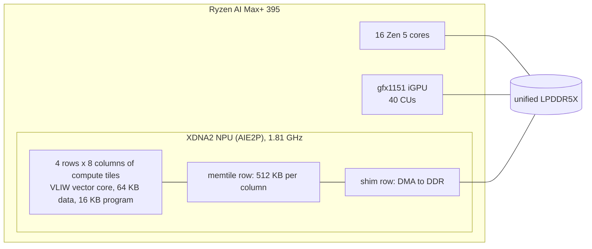

# strix-halo-maxx

Hand-optimised, low-latency model inference on AMD Strix Halo (Ryzen AI Max+ 395): kernels for the XDNA2 NPU and the
gfx1151 GPU, the measurements behind them, and a book of what worked, what didn't and why.

Read it as a book at **https://guppy16.github.io/strix-halo-maxx/**, or browse the Markdown here.

## The hardware in one picture

The measured performance model of the NPU is the [machine chapter](common/book/machine.md); every fact with its
evidence is in the [machine reference](common/MACHINE.md).

## Projects

| project | result | start here |
|---|---|---|
| **TAPNext++** point tracker, whole step on the NPU | **28.42 ms** per frame at 12 blocks, one fused dispatch; DAVIS AJ 70.84 (CPU bf16: 70.98) | [TAPNext](tapnext/README.md) |
| **moondream2** VLM on the GPU | **88.7 ms** per frame (stock HF bf16: ~340 ms) | [moondream](moondream/README.md) |
| moondream2 vision tower on the NPU | 27 blocks in one NPU program, ~75 ms per frame; ~22 fps with the GPU pipelined (extrapolated) | [moondream](moondream/README.md) |
| moondream3-preview evaluation | not better at grounding than moondream2, ~2.6x slower | [moondream3](moondream/book/moondream3.md) |

## Where things live

| what | where |
|---|---|
| The book, machine level: hardware, toolchain, measurement, GEMM, data movement, fusion, elementwise, attention, method | [common/book](common/book/README.md) |
| Every refuted idea, classified (fundamental, measured here, unfinished, ...) | [negative results](common/book/negative-results.md) |
| The hardware model, every fact tagged and sourced | [common/MACHINE.md](common/MACHINE.md) |
| Model chapters | [tapnext/book](tapnext/book/README.md), [moondream/book](moondream/book/README.md) |
| Lab notebooks (raw evidence per round or phase) | [tapnext/npu](tapnext/npu/NOTES.md), [tapnext/research](tapnext/research/ANALYSIS.md), [moondream/npu](moondream/npu/NOTES.md) |
| Tools: asm linter, simulators, the ISA timing table, try.sh | [common/tools](common/tools/) |
| Agent entry point and skills (book-read, book-write, xdna2-npu) | [CLAUDE.md](CLAUDE.md), [.claude/skills](.claude/skills/) |

## Running the code

Start with `source setup.sh`: it finds the repo root, sets the scratch directory (`<repo>/.scratch`, gitignored) and
lists the other environment variables. NPU builds run in Docker; how to rebuild and verify each project is in its README.

> **Reading a timing.** Two effects we measured change NPU numbers under load: heavy floating-point CPU load lowered the
> NPU clock (1.81 → 1.41 GHz), and the NPU's DDR traffic capped at ~55-59 GB/s per direction. They are observations
> under our conditions, not rules; see [measurement](common/book/measurement.md).
