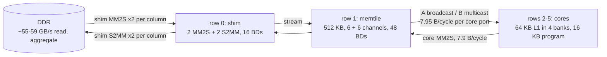

# MACHINE: the XDNA2 / AIE2P NPU as a performance model

History: `git log -p common/MACHINE.md`.

## In brief

- This is the hardware reference for the NPU of AMD Strix Halo (XDNA2, AIE2P cores) as our kernels see it: array and clock,
  the core's slots, registers and timing, L1 banks, locks, streams, memtile, shim and DDR, the command processor, and the
  measured costs of the deployed TAPNext design (design8 / full12 builds).
- Every fact has a stable id **Mx.y** (section x, item y) with an anchor `#mx-y`, a tag (**[DOC]** vendor source,
  **[MEAS]** measured, **[INF]** inferred or modelled; [M0.1](#m0-1)) and its evidence (file, round folder, tool or commit).
- Cite as `MACHINE M4.2` and link as `[M4.2](../MACHINE.md#m4-2)` (from `common/book/`) or
  `[M4.2](../../common/MACHINE.md#m4-2)` (from a model book). Older commits cite `§n` and `Rx.y`; `common/tools/machine-id-map.tsv`
  maps them to M-ids.
- Headline numbers: array clock **1.81 GHz** ([M1.2](#m1-2)); **59 TOPS** peak ([M1.5](#m1-5)); a bundle costs
  $\max(1, \max_b n_b)$ cycles in L1 banks ([M4.2](#m4-2)); memtile → core **7.95 B/cycle** per port ([M8.3](#m8-3));
  DDR aggregate read cap **~55-59 GB/s** ([M10.4](#m10-4)).
- Facts are current. A fact that changes is edited in place; a **Pitfall** line keeps an old wrong value only where the
  mistake teaches something.

## Contents

| id | topic |
|---|---|
| [M0](#m0) | About this reference: tags, sources, which chip |
| [M1](#m1) | Array and clock |
| [M2](#m2) | Compute tile: slots, registers, MAC and pops |
| [M3](#m3) | Compute tile: register timing, ports and loop floors |
| [M4](#m4) | Compute tile: L1 data memory and banks |
| [M5](#m5) | Compute tile: locks, calls and control code |
| [M6](#m6) | Compute tile: program memory, text and stack |
| [M7](#m7) | L1 maps of the deployed cores |
| [M8](#m8) | Streams and ports |
| [M9](#m9) | Memtile |
| [M10](#m10) | Shim and DDR |
| [M11](#m11) | Command processor and runtime sequence |
| [M12](#m12) | Bandwidth and latency per level (summary) |
| [M13](#m13) | Ops in flight |
| [M14](#m14) | Timers, counters and profiling |
| [M15](#m15) | Kernel anatomy and costs in the deployed design |
| [M16](#m16) | Host part |
| [M17](#m17) | Open questions |

## M0 About this reference

### M0.1 Tags

- **[DOC]**: from a vendor source (headers, TableGen, linker scripts, lowered MLIR, disassembly). Each one cites its file.
- **[MEAS]**: measured in our own work. Each one cites the result or file. "main rNN" / "main round N" = an implementer
  measurement, reported in `tapnext/research/RESULTS_FROM_MAIN.md` (RFM), files in `tapnext/npu/rNN/`.
- **[INF]**: inferred: a model fitted to measurements, or arithmetic on documented facts. Treat it as a hypothesis until a
  measurement confirms it. **[MODEL]** marks a calibrated model or a CP (constraint-programming) schedule with cycle replay;
  **[PEANO]** marks a fact read from Peano's generated code; **UNVERIFIED** marks a fact not yet checked on hardware.
- Paths: bare `rNN/` is `tapnext/research/rNN/` and bare `tools/` is `common/tools/` unless a path says otherwise.

### M0.2 Sources

On disk (read without a device):

- In the `npu-iron` image: mlir-aie 1.4.4's `AIETargetModel.h` (**TM**), aie-rt's `xaie2pgbl_params.h` (**PARAMS**) and
  `xaie_events_aie2p.h` (**EVENTS**), Peano's `aie2pintrin.h`, the AIE API headers.
- On the test machine's host: the amdxdna 2.21 driver source in `/usr/src/xrt-amdxdna-2.21.0/driver/amdxdna/` (**DRV**).
- llvm-aie's AIE2P TableGen files, `moondream/npu/p10/td/` (**TD**); the timing table extracted from them,
  `common/tools/aie2p_isa_timing.json`.
- The mlir-aie main checkout of 2026-10-06, `moondream/npu/mlir-aie/` (**UPSTREAM**).

On the web: AMD AM020 (AIE-ML) and AM027 (AIE-ML v2):
[AM020 memory tile](https://docs.amd.com/r/en-US/am020-versal-aie-ml/AIE-ML-Memory-Tile-Memory),
[AM020 stream interconnect](https://docs.amd.com/r/en-US/am020-versal-aie-ml/AXI4-Stream-Interconnect),
[AM027 comparison of generations](https://docs.amd.com/r/en-US/am027-versal-aie-ml-v2/Comparison-of-AIE-Generations),
[AM027 tile architecture](https://docs.amd.com/r/en-US/am027-versal-aie-ml-v2/AIE-ML-v2-Tile-Architecture).

### M0.3 AIE2P is not AIE-ML v2

In mlir-aie, `aie2ps` is the AIE-ML v2 part (VE3858, Versal AI Edge Gen 2), with its own target model. `aie2p` is Strix
XDNA2. The test machine's device is PCI 1022:17f0 revision 0x11, "NPU Strix Halo"
(`/sys/class/accel/accel0/device/{device,revision,vbnv}`), which the driver runs as `npu5` with the `npu4` family's tables
(DRV `amdxdna_pci_drv.c`, `npu5_regs.c`). [DOC]

## M1 Array and clock

### M1.1 Geometry

| item | value | tag |
|---|---|---|
| columns | 8 | [DOC TM `NPU2`] |
| rows | row 0 = shim, row 1 = memtile, rows 2-5 = cores | [DOC TM] |
| tiles | 32 cores, 8 memtiles, 8 shims | [DOC TM] |
| use in design8 | rows 2-4 GEMM, row 5 EW (elementwise) | [MEAS design8] |

### M1.2 Clock: 1.81 GHz

- **The AIE array clock (H-clock) is 1.81 GHz, measured in Turbo** (`tapnext/npu/r7/clk.py` + `r7/clk.cc`: pure-register
  loops of known bundle count at several trip counts; the host slope and the core timer agree). 1.8 GHz is the driver's top
  DPM level. [MEAS round 7] [DOC DRV]
- The DPM table, `npu4_regs.c`, `{npuclk, hclk}` in MHz. `npu5_regs.c` (Strix Halo) uses `NPU4_COMMON_DEV_PRIV`, so the same
  table. The H-clock is the array clock: the driver computes TOPS from it. [DOC DRV]

  | level | 0 | 1 | 2 | 3 | 4 | 5 | 6 | 7 |
  |---|---|---|---|---|---|---|---|---|
  | MP-NPU clock | 396 | 600 | 792 | 975 | 975 | 1056 | 1152 | 1267 |
  | H-clock (AIE array) | 792 | 1056 | 1152 | 1267 | 1267 | 1408 | 1584 | **1800** |

- The power modes, `aie2_pm.c` [DOC DRV]:

  | mode | DPM level | clock gating |
  |---|---|---|
  | TURBO | max (7) | off (only settable with no context open) |
  | HIGH | max (7) | on |
  | DEFAULT | the highest level any open context requested (`dft_dpm_level`); 0 with no context | on |
  | MEDIUM | min(max, 3) | on |
  | LOW | 0 | on |

- `aie2_ctx.c` `aie2_calc_ctx_dpm`: a context whose QoS is incomplete (no gops, or no fps and no latency) and which is not
  low priority requests the max level. pyxrt's `hw_context(dev, uuid)` passes no QoS, so it should get level 7. [INF: the QoS
  XRT sends is not observed; one `xrt-smi examine -r platform` while a context is open settles it, P10]
- **So Default and Turbo both run the array at 1.8 GHz while our context is open.** Turbo only disables clock gating, which
  matches the observation that Turbo "mostly cuts dispatch latency" (validate 50 -> 29 us). Default mode is not measured
  directly (switching needs sudo). [INF]

> **Pitfall.** The first clock figure, "~1.4 GHz Default / 1.43 Turbo", came from the moondream phase-2c spin loop: a
> 364-bundle call in 0.261 us (1.39 GHz if every bundle took one cycle). The call includes stalls and control code; at
> 1.8 GHz it took ~470 cycles. A lower bound was read as the clock (1.408 GHz, DPM level 5's H-clock, may also have fed it).
> ANALYSIS rev 2 section 0 shows how this constant misled the analysis.

### M1.3 Lower bounds that confirm 1.8 GHz

[MEAS]

- The 2x-MAC twin (P1) adds 1.544 us per tile-k-step. The added code is 2,718 bundles (static schedule of the deployed
  `mm_acc`, r6/mm8o2.s), so f >= 1.76 GHz if the added loop never stalls (`tools/sim9.py`).
- Over the whole step, 15,552 k-steps x 2,718 bundles = 23.5 ms at 1.8 GHz and 29.6 ms at 1.43 GHz; measured +24.7 ms. A
  1.43 GHz clock cannot produce that number.
- The GELU kprobe: 110 bundles per vector in 63 ns, so f >= 1.75 GHz.

### M1.4 The clock drops under heavy CPU FP load

[MEAS main r21 / r23 / round CLKLOAD2; `tapnext/npu/r7/clk.py`; probes `r23/clkload.sh`, `r23/clkload12.out`,
`r25/clkload2.sh` (12 threads of each kind, logging package power, Tctl, CPU MHz and the NPU clock)]

| CPU load | package power | NPU clock (GHz) |
|---|---|---|
| idle | 27 W | 1.809-1.810 |
| 12 scalar spin threads | ~99 W | 1.810 |
| 6 numpy matmul threads | 96-100 W | 1.809 |
| 12 numpy 512 x 512 fp32 matmul threads (OpenBLAS AVX-512, ~3 MB per thread, L2/L3-resident) | ~99 W, Tctl 59-71 C | **1.408** |
| the same with `OPENBLAS_CORETYPE=Haswell` (AVX2) | 99 W | 1.408 |
| 12 threads of 64 x 64 matmul in L1 | 99 W | 1.584 |
| 12 threads of `np.copyto` on 64 MB arrays | 42 W | 1.808 |
| ~20 busy CPU threads (main r21) | | 1.405 |

- The trigger is many threads of FP compute with the package at its ~100 W limit. Not thermal, not package power alone,
  not DRAM bandwidth, not vector width, and not scalar spin at 99 W. The mechanism (SMU power or current arbitration, an
  EDC-type limit) is UNVERIFIED.
- Without sudo, amdgpu hwmon `power1_input` labelled PPT (package power; 28.0 W at load ~9) and k10temp `temp1_input` (Tctl;
  78 C) are readable. [DOC hwmon]
- **Rule: <= 6 CPU vector threads while timing.** Quote the clock with every absolute timing.

### M1.5 Peak MAC rate

$$32 \text{ cores} \times 512\ \text{MAC} \times 1.8\ \text{GHz} = 29.5\ \text{TMAC/s} = 59\ \text{TOPS (bfp16 / int8)}$$

The driver's own formula (`NPU4_DPM_TOPS`: 4096 ops x columns x H-clock) gives the same. [DOC DRV `aie2_smu.c`]

### M1.6 Hardware contexts and the slow mode

| item | value | tag |
|---|---|---|
| one program at a time | one hw context per xclbin; switching costs ~2.7 ms; launch floor 97 us median from pyxrt ([M16](#m16)) | [MEAS RESULTS 7] |
| the "slow mode" | sub-ms dispatches sometimes finish on a ~1 ms timer for minutes (driver / firmware) | [MEAS moondream 2b] |

## M2 Compute tile: slots, registers, MAC and pops

### M2.1 VLIW slots: where each op goes

One instruction per slot per bundle; the slots are lda, ldb, st, mv, vec, alu, lng. Ops on the same slot never co-issue.
[DOC TD, `aie2p_isa_timing.json`]

| slot | ops (AIE2P TableGen classes) | result latency |
|---|---|---|
| vec | every fp32-accumulator op: `vmac.f`, `vmul.f`, `vmsc.f`, `vnegmul.f`, `vadd.f` / `vsub.f` (acc + acc), `vneg` | 6 |
| st | **every conversion** (`vconv.bf16.fp32` 2, `vsrs` 4, `vfloor.s32.bf16` 2, `vconv.bfp16ebs8.fp32` 4) **and every store** (`vst`, `vst.conv.bf16.fp32`, `vst.srs`, `vst.push.544.conv` (bfp, 64 lanes)); scalar `movs` ([M3.6](#m3-6)) | as listed |
| mv | integer / bit / shuffle vector ops: `vadd.16/32`, `vsub.*`, `vband`, `vbor`, `vmax_lt.*` / `vmin_ge.*` (incl. bf16), `vsel`, `vshuffle`, `vbcst`, `vbcstshfl`, `vextract`, `vmov x`, `vups` (3), `vconv.fp32.bf16` (bf16 -> fp32, 2), `vlt.bf16` / `vge.bf16` | 2 |
| lda | `vlda`, `vlda.ups`, `vlda.pop.*`, scalar `lda` ([M3.2](#m3-2)) | 7 |
| ldb | `vldb`, `vldb.pop.*`; the 4-way table (LUT) loads `vldb.4x16 / 4x32 / 4x64` lo / hi issue on **ldb only** | 7 |
| alu | scalar `add` / `and` / `xor` (1), `mul` (2), `sel.eqz` / `sel.nez`, `acq` / `rel` and their `.cond` forms | [M3.2](#m3-2) |

So an elementwise kernel's floor per 32 lanes is set by its busiest slot or port, not its op count ([M3.4](#m3-4)). Every
`NK_BF(...)` is an st-slot op: a bf16 Horner step costs one vec and one st. [DOC TD, `aie2p_isa_timing.json`] [MEAS loop counts]

### M2.2 Register files

| file | registers | width | tag |
|---|---|---|---|
| dm (accumulators) | **5**: dm0-dm4 | 2048 bit = one 8x8 fp32 block each; quarters bm (`bmll` / `bmlh` / `bmhl` / `bmhh`) | [DOC TD `AIE2PRegisterInfo.td`: eDM] |
| ex | **12**: ex0-ex11 | 576 bit = one bfp16ebs8 block of 64 values | [DOC TD mEXa] |
| x | x0-x11 | 512 bit, w halves | [DOC asm] |
| ey | 6 pairs | | [DOC TD eEY] |

> **Note.** A reading of Peano output listed dm0-dm4 as "1,024-bit" [DOC asm]; the TD value and the 8x8 fp32 block
> (2048 bit) disagree with it. Check `AIE2PRegisterInfo.td` before relying on either.

The x file (12 minus the pinned constants) and the 5 accumulators set RegMII for most table and epilogue loops
([M3.4](#m3-4)).

### M2.3 Matrix multiply

| item | value | tag |
|---|---|---|
| MMUL rate | 512 MAC per `vmac.f` (bfp16 8x8x8 or 4x8x16; dense int8 the same) | [MEAS moondream] [DOC TD] |
| bfp16 mmul forms | `vmac.f dmD, dmS, exA, exB, r(780)`: 8x8 x 8x8^T, accumulator in dmS, result in dmD (D != S allowed). EX x EY = 4x8x16 (the AIE API's 8x8x16 is two of these plus an A shuffle). EX x QEY / EY x QEX = structured-sparse B | [DOC TD lines 8872-8908; AIE API `aie2p/mmul_bfp16_bfp16.hpp`] |
| bfp mmul class | `VMAC_f_vmac_bfp_vmul_bfp_core_EX_EX`: accumulator read at .td stage 4, result 6 | [DOC aie2p_isa_timing.json] |
| `vadd.f` | `VADD_f_vmac_cm2_add_reg` reads both accumulators at stage 4; its config register selects the mode | [DOC aie2p_isa_timing.json] |
| bf16 into an accumulator | `VLDA_2D_CONV_fp32_bf16_dmx_lda_ups_bf`: bf16 straight into an fp32 accumulator half (lda only) | [DOC aie2p_isa_timing.json] |

### M2.4 Block-vector FIFO pops

| item | value | tag |
|---|---|---|
| pops on both load slots | `vlda.pop.576` and `vldb.pop.576` (also .544 / .640 / .704, 2d / 3d forms). Two FIFOs: (p0, lf0, r24) and (p1, lf1, r25), each usable from either slot | [DOC TD `VLDA_POP_576*`, `VLDB_POP_576*`, `plfr0/plfr1`] |
| fill | a pop delivers 576 bits and refills 512; one `fill` per 8 pops makes up the 72 / 64 B difference | [DOC TD] |
| **dense pops** | **at most 8 pops per lf between fills.** asmlint FIFO-POP9 checks it; it fired on the first ggk, popprobe 6 and popprobes 2 / 3 (a true positive: their "correct" verdict covered only lf0's 8 pops) | [MEAS r16, main round 17] |
| pop classes | `VLDA/VLDB_POP_576_normal_pop`: destination at 8, FIFO state at 7; a `_2D` pop form with a post-modify exists | [DOC aie2p_isa_timing.json] |
| `vldb.pop.576.2d` with dn = 0 | adds m to the 64 B line step | [MEAS main r19] |
| `padda` before a fill | works one bundle before the fill (not in it) | [MEAS main r19] |
| restart | a stream restarts with an explicit pointer (`mov p1, p5` / r25 = 0); mm_ks re-pops B this way for every row block ([M15.1](#m15-1)) | [DOC r17d disassembly] |
| skewed stream | a skewed pop stream's first row block needs a fresh stream at the last 576 B boundary before its first pop | [replay, UNVERIFIED on hardware] |
| `vlda.pop.576` on lf1 | needed by E7'' | [UNVERIFIED] |
| Peano | puts every pop of the deployed C++ GEMM on ldb | [MEAS r6/mm8o2.s] |

### M2.5 Numerics and elementary functions

| item | value | tag |
|---|---|---|
| no fp32 vectors | fp32 vector add / mul / convert are emulated (~21 bundles per 16 lanes). bf16 is native at 32 lanes; fp32 lives only in the MAC accumulator | [MEAS] |
| rounding | defaults to FLOOR; `conv_even` must be set per core | [MEAS] |
| elementary unit | `aie::inv` scalar; `aie::exp2` ~10 ulp p99; `aie::tanh` crude; the 4-way LUT load (`load_lut_2x_float`) is fast | [MEAS round 6] |
| lane tests | `vlt.bf16 rC, x, x` / `vge.bf16` write a 32-lane mask to a scalar register (mv slot, latency 2); `vmin_ge` / `vmax_lt` write theirs to r16. A lane test costs no x register | [DOC aie2p_isa_timing.json] |

## M3 Compute tile: register timing, ports and loop floors

### M3.1 The visibility rule

There are no interlocks. A register written by an op with .td latency $w$ is seen by an operand read at .td stage $r$ of an
op issued

$$d \ge w - r + 1$$

cycles later (LLVM's latency). Before that, readers see the OLD value. [MEAS r11, `tapnext/npu/r11/mk_haz.py`; SKILL section 3]

- Measured for `vlda`, `vldb.4x64` (w 7), `vadd.32`, `vconv`, `vfloor`, `vshuffle`, `vmin_ge` (w 2) with a `vst` reader.
- .td latencies: pop 8, load 7, conversion 2, `vsrs` 4, `vups` 3; pointer moves 2-3 cycles before use. A load result is
  usable 7 cycles later. [MEAS / DOC p10, r11]
- **Accumulator:** a `vmac` reads its accumulator at .td stage 4: dependent macs are >= 3 apart, or back-to-back at
  distance 2 through the one-deep accumulator bypass (round 7). [MEAS p11, r11]

> **Pitfall.** asmcheck's model, c + r >= c' + w, is one cycle optimistic; under it the accumulator read looked like
> "stage 3" (what the .td calls stage 4 under the rule above).

### M3.2 Bypasses and scalar timing

| rule | value | tag |
|---|---|---|
| mv -> mv bypass | a value from an mv-slot op (`vmov`, `vshuffle`, `vadd.32`, `vmin` / `vmax`) reaches mv-slot readers one cycle EARLY. A read of the old value in the cycle before an mv write lands is unsafe for mv readers. Loads as writers: d = 7 for every reader | [MEAS r11] |
| WAW | an older load and a younger short write to one register land in landing order; nothing is dropped | [MEAS r11] |
| Peano's habits | Peano relies on the mv -> mv bypass (46 reads in r15m) and on scalar conveyor reads (reading r / p while a newer `lda` is in flight). Both legal; generated code must not depend on them by accident (asmlint flags them there) | [PEANO] |
| scalar `lda` | no itinerary in the .td (`LDA_dms_*` itin None). Peano consumes its result 4-6 cycles later (pointer users 4-5, alu / mv 5-6). asmlint assumes 7 for generated code | [PEANO] |
| scalar `mul` / `add` | .td: `mul` latency 2 (R_WA_PORT stage 1); `and` / `xor` / `add` 1. Measured: a `mul` result is visible to a `st` 2 bundles later and an `add` result 1 bundle later, inside a zero-overhead-loop body and in straight code | [DOC aie2p_isa_timing.json / .td] [MEAS MULLAT, r24/mullat*] |
| alu -> alu at +1 | inside a loop body it read the old value once (r14 attkb FO -> FA). Peano does alu -> alu at +1 outside loop bodies 1,258 times in r15m; deployed generated loops do alu -> mv at +1 inside loop bodies | [MEAS once, scope UNVERIFIED] |

### M3.3 Itinerary ports: the structural hazards beside the slots

`AIE2PGenSchedule.td` itineraries (`aie2p_isa_timing.json` `itin`; msched.ports) name shared ports. Each holds one op per
cycle at the listed stage, reserved modulo II exactly like a slot. [DOC; the DM_ADA / QEY_RS sharing is MEAS r11]

| port | held by (stage) |
|---|---|
| **DM_ADA** (load address A) | every `vlda` incl. `vlda.ups`, `vlda.pop.*` (1); every LUT load `vldb.4x16 / 4x32 / 4x64` (1). **Not** a plain `vldb` / `vldb.pop` |
| **QEY_RS** (x / y file read) | LUT loads (0: they read the index register), `vfloor.s32.bf16` from a w register (0), `vst` of an x register (0), `vst.push.576` (0), `vconv.bfp16ebs16.ebs8` (0) |
| QEY_WA | vlda x results (6), vconv bf16 (1), vfloor (1), vconv bfp (3), vlda.pop (7) |
| QEY_WB | vldb results incl. LUT loads (6) and pops (7) |
| CRRND_RS | vconv.bf16.fp32 (0), vst.conv (0), vconv.bfp (1), vst.push.*.conv (1) |
| L_RM / L_WM | vshuffle, vbcst, vsel, vbcstshfl (L_RM 0); vmin / vmax (L_WM 1); **vst.push.576(.conv) holds both at 0**; scalar `sel.eqz` / `sel.nez` (select on r27) use L_RM, shared with `acq` / `rel` [DOC .td] |
| DM_WM | vlda into bm (6), vshuffle into bm (1), vconv.fp32.bf16 / ups (1), vmov cm (1) |
| DM_RM | vadd.f acc + acc (3), vmov cm (0) |

Escape hatches found in the json (not probed):

- `VFLOOR_s32_bf16_mv_float_to_int_bm` (source = a bm quarter, `$src[$imm]`) holds only QEY_WA. It takes the floor's
  operand read off QEY_RS.
- A plain `vldb` holds only QEY_WB, so in LUT loops data loads go on ldb.

### M3.4 Loop floors: ResMII, then RegMII

For a modulo-scheduled loop:

$$\text{ResMII} = \max\Big(\max_{\text{slots}} n_\text{slot},\ \max_{\text{ports}} n_\text{port}\Big)$$

1. **ResMII is the max over slots AND ports** ([M2.1](#m2-1), [M3.3](#m3-3)). For every table-lookup line (GELU, the SSM
   sigmoid, the attention exp), QEY_RS (8 LUT index reads + 2 vfloor per 32 lanes) and DM_ADA (8 LUT + the vlda loads) bind
   at 10 per 32 lanes. [DOC + MEAS r11]
2. **RegMII binds next.** The x file is 12 registers (512 bit) minus the pinned constants: msched reaches II 11-13 on LUT
   loops whose ResMII is 10 [GEN `r12/g1sched.out`]. The dm file is 5 accumulators: the SSM recurrence (ResMII 10, vec) stops
   at 13 on dm MaxLive 5.
3. **Latencies** are the .td latencies under the visibility rule plus the mv bypass ([M3.1](#m3-1), [M3.2](#m3-2)): a modulo
   schedule's dependence distance is w - r + 1, and an mv-written register stays reserved from c + w.
4. The bank rule ([M4.2](#m4-2)) applies on top: it is a per-bundle memory cost, independent of the ports.
5. A modulo loop of N iterations with S stages costs $(N + S - 1) \times II$ per call: attvs (6 iterations per call) is
   II 18 / 2 stages 126 cycles vs II 11 / 4 stages 99 (<= -0.02 ms per step; S3 on the new attention loops -0.01..-0.04 ms). [MODEL]

Floors per 32 lanes at these rules (ResMII / generator II):

| loop | ResMII | II |
|---|---|---|
| LUT line + product (GELU) | 10 | 11-13 |
| LUT line only (sigmoid) | 10 | 11-12 |
| attention exp per 64 | 20 | 23-31 |
| fused gated per 64 | 24 (DM_ADA) | no allocation: needs 2 passes |
| gated product + push per 64 | 6 | 6 |
| bf16 -> bfp push per 64 | 2 | 2 |
| attkb (attention K loop) | 29 (DM_ADA 29, b 27, mv 23, vec 15) | 34, register-bound [MEAS] |
| FSX (ssq + gate_a's sigmoid, `r25/gen_fsx.py`, 109 ops) | 30 with eight constants reloaded on lda (bank 2 30, mv 29, lda port 28, ldb 26) | none found at II 30-33 (cpsched, 600-700 s, 2 workers) [MODEL] |

- Peano's 2-chain loops run at 3-7x this floor (sigmoid 77 bundles per vector for ~22 MACs). [MEAS loop counts]
- **Peano's in-situ schedule can be serial where its bench pipelined:** the SSM z loop was 27 bundles per 64 lanes inside
  ew_ssm (zol @0x1610 in r18a) vs 97 cycles for all 8 in the one-core C++ bench; ZK (asm) -0.17 ms. [DOC + MEAS main round 18]

> **Pitfall.** A slot count alone ("ldb 8, mv 8 per 32 lanes with the index adds, 6 with a biased table pointer", from the
> deployed asm `build/r10/gx.s`: 8 ldb per 32 lanes = 4 vldb.4x64 per 16 lanes) underestimates table loops: the ports bind at 10.

### M3.5 Zero-overhead loops

| item | value | tag |
|---|---|---|
| alignment | the LAST bundle must be 16-B aligned, otherwise the body runs about once; writing every body bundle in the 16-byte full form makes this automatic. All deployed loops end with a 16 B, 16 B-aligned bundle; first body bundles may be compact (10 / 12 B in bias_pcs, gate_gemm, norm_rows_k, ew_ssm) | [MEAS r11] [PEANO] |
| **setup distance is in bytes to the loop END** | r14's bad zero2 (six 2-byte nops after `add.nc lc`) and the deployed zero2 (six full-form bundles) have the same 10 bundles from the lc write to `le` and differ only in bytes (52 vs 132). Peano writes lc 2 bundles (4-16 B) before `ls` when the body is long. Every deployed loop has >= 80 B (cpy32; Peano >= 96) from the last lc / ls / le write to `le`. Bad <= 52 B, known safe >= 80 B, gap unmeasured. Hypothesis: fetch runs ahead of issue | [MEAS pair + PEANO] |
| trip count | the value written to lc (Peano: n - 1 plus a peeled iteration; generated loops: n) | [DOC] |

### M3.6 Immediates, scalar forms and disassembly

- **Immediate types** (AIE2PGenInstrInfo.td; cNs_stepK = signed, N bits, multiples of K). Vector ld / st offsets and
  `padda #imm` are c10s_step64: multiples of 64 in [-512, 448] (the assembler's "[-512, 511]" is only the containing range;
  #511 is rejected). 256-bit (w) loads are c9s_step32 = [-256, 224]. sp-relative spills are cNn (negative). Every violation
  is a fatal "error in backend". [DOC TD + assembler]
- `movs` writes p / m (dn, dj, dc) from r / m / p on the st slot; `lda.2d` (`LDA_2D_dms_lda`, dst p / r / m) exists and
  assembles. [DOC aie2p_isa_timing.json / .td; lda.2d UNVERIFIED on hardware]
- Disassemble with `llvm-objdump -z`: runs of 2-byte nops are zero bytes and are elided otherwise. [DOC]

## M4 Compute tile: L1 data memory and banks

### M4.1 Memory map

| item | value | tag |
|---|---|---|
| data memory | 64 KB per core, 4 banks for allocation | [DOC TM] |
| L1 banks | 4 x 16 KB: 0x70000, 0x74000, 0x78000, 0x7C000 (the linker script's bank0-3) | [DOC ld script] |
| neighbour memory | own + S, W, N neighbours (TM bases: S 0x40000, W 0x50000, N 0x60000, own 0x70000) | [DOC TM] |
| width | data memory 256 bit (`MEMORY_MODULE_DATAMEMORY_DATA_WIDTH`); core load / store bus 256 bit; 512-bit vectors need 64 B alignment | [DOC PARAMS, TM] |
| memory cycle | `vlda`, `vst`, `vlda/vldb.pop.576`, `.fill.512` access data memory at cycle 5 of their itinerary (`MemoryCycles<[5]>`) | [DOC TD] |

### M4.2 The bank rule (exact)

**A bundle costs**

$$c = \max\Big(1,\ \max_{b \in \text{banks}} n_b\Big) \text{ cycles,}$$

where $n_b$ is the number of the bundle's memory accesses in bank $b$. [MEAS: `tools/bankmodel.py` reproduces all 207
placements of the round-8 mmb sweep (`tapnext/npu/build/mmb_run.out`) to 0.0 cycles with one constant, 13 = loop + call]

- n accesses to one bank issued in one bundle serialise into n cycles (n - 1 stall cycles).
- Accesses in different bundles never conflict: there is no adjacent-bundle penalty (consistent with the memory cycle: same
  bundle = same cycle, [M4.1](#m4-1)).
- There is no read / write asymmetry: load + load, load + store and pop + store each cost exactly 1.
- Ops on the same slot never co-issue, so A pops and accumulator loads (both lda) are free together.
- The offset inside a bank does not matter (16 KB granularity; offsets 0-10 KB apart tested).

Why each mmb pair cost what it did, from the co-issued bundles of `mm_core_split` (225 bundles) [DOC count
(`bankmodel.py --pairs`) = MEAS]:

| buffers in one bank | co-issued bundles = extra cycles |
|---|---|
| B-Cs | 42 |
| B-Cl | 36 |
| Cl-Cs | 33 |
| A-B | 14 |
| A-Cs | 3 |
| A-Cl | 0 |
| triple B+Cl+Cs | 27 bundles, each costing 2 extra: 33 + 36 + 42 - 27 = 84, measured 84 |
| triple A+B+Cs | 3 |

### M4.3 What the bank rule means for scheduling

- A conflict costs exactly the serialisation a scheduler would add by moving one access to another bundle. Rescheduling wins
  only where the moved access finds a free slot of its unit inside its dependency window.
- At a 4-chain group boundary (16 accumulator loads + 16 stores + ~13 B ops pinned into ~16 cycles, lda and st already full)
  it cannot: P21's rule R1 gave 273 bundles where the stalls cost 271. [MEAS P21]
- **Fix conflicts by layout (different banks), not by scheduling rules.**
- LUT loads: each table copy should sit in its own bank, away from the banks the same bundles load or store. [DOC TD] [INF rule]

### M4.4 DMA writes steal core cycles

The core yields to DMA writes into a bank it touches in the same cycle:

$$\text{stall cycles} \approx \alpha \cdot N_\text{32 B DMA writes into a bank the core touches that cycle}, \qquad \alpha = 0.72$$

| item | value | tag |
|---|---|---|
| who yields | the core, ~1 cycle per 32 B DMA write into its active bank; the k-step model scales x0.79 | [MEAS main r18] |
| α, time-resolved | 0.72 core cycles per 32 B write reproduces KS-P38's 167.5 (`r20/collide.py`); DMAB direct: 0.68-0.75. mm_rot g2a: A 75, B 92 cycles per k-step | [MEAS main r18 + MODEL] |
| the model across kernels | GEMM k-step model 221 vs measured +231; n1k ~20-30 vs +17; part of the SSM chunk's ~+250-350 and of the norm pass-2 excess | [INF] |
| asm GEMM call in situ | ~12 cycles above the bank rule (r8c: ~283 vs 271 + 0), ~17 with the round-7 placement (A slots in B's bank 3) | [MEAS g11 stamps - mmb] |
| E7'' collision floor | A writes into banks 1 / 2 (busy ~0.4) ~93, B writes into bank 3 (0.9) ~70 and bank 0 (0.46) ~12 cycles per k-step; there is no idle bank to move either into | [MODEL] |
| DMA reads of an output ring at 4 B/cycle | <= one bank access per 8-16 cycles: no measurable stall | [MODEL, static] |

### M4.5 Counting free L1

Free space = a linker region's length minus its section contents (`llvm-nm -S`), never the region length. [DOC ld script + nm]

> **Pitfall.** The GEMM core's `.aie.bank3` region (0xA80 = 2,688 B at 0x7F580) was once read as 2,688 B free; its tables
> took 2,304 and 384 B were free ([M7.1](#m7-1)).

## M5 Compute tile: locks, calls and control code

### M5.1 Locks

| item | value | tag |
|---|---|---|
| count | 16 per core tile, 64 per memtile | [DOC TM] |
| value | 6-bit, 0-63 | [DOC TM] |
| addressing | a kernel reaches its own lock n at id 48 + n | [DOC TM] [MEAS] |

### M5.2 Lock instructions

- `acq #id, rN` / `rel #id, rN` (id = 48 + n for the tile's own lock n; rN = -1 acquires >= 1 and decrements); pointer forms
  exist (`aie2p_locks.h`). [DOC Peano, TD]
- Conditional forms `acq.cond` / `rel.cond` (alu slot) take their condition **in r26 only** (the assembler says "invalid
  operand" for r28 / r29 / r30) and test **bit 0** of it: `rel.cond` with r26 = 0 / 2 did not release, 1 / 3 did (a
  DMA-gated buffer observed; no hang possible). **Lock conditions must be 0 / 1.** [MEAS assembler] [MEAS RELC, r24/relcb.py]
- `rel.cond` is unused in the deployed code. [DOC .td]

> **Pitfall.** The KTL kernel hung because its masks were flag x counter: with bit-0 testing, every A acquire at an even
> counter was skipped. With boolean masks the KTL kernel ran ([M15.1](#m15-1)).

### M5.3 Lock timing

| item | value | tag |
|---|---|---|
| lock unit | `acq` / `rel` hold the LCKREQ unit 4 cycles (one lock request per 4 cycles per core) | [DOC AIE2PGenSchedule.td] |
| cost when free | ~1 cycle beyond issue: 15 dynamic cycles per k-step over 20 lock operations | [MEAS r7p stamps] |

### M5.4 Call ABI

`jl` + 5 delay slots, `ret lr` + 5 delay slots, lr spilled when the callee calls. A C++ wrapper around an asm kernel costs
34 bundles per call (mm_acc). [DOC objdump]

### M5.5 IRON control code

- Per GEMM k-step: 89 bundles = 9 x 8 per call (A acquire in a delay slot, slot pointer, release, `jl`) + 17 (B acquire /
  release, counters). [DOC objdump]
- IRON lowers worker loop counters to i64 (12 `phi i64`, `icmp slt i64`; the endless loop compares against 2^63 - 1): every
  loop increment is add / ltu / add-carry and every test ltu / lt / eq / sel, plus hi-word spills. [DOC r17d
  `opted_main_core_0_2.ll`]

## M6 Compute tile: program memory, text and stack

### M6.1 Program memory and text by build

Program memory is 16 KB (16,384 B) per core. [DOC TM] Text used (`llvm-nm` / `llvm-size`, `tools/textmap.py`) [DOC]:

| build | GEMM core text | EW core text |
|---|---|---|
| full12r9s | 15,840 | 16,240 |
| full12r11d | 15,968 (416 B free) | 16,240 (144 B free) |
| full12r12e | 16,288 (849 all-nop bundles, 1,842 B) | 16,224 |
| full12r13f | 16,384 (full; 867 all-nop bundles, 1,874 B) | 16,224 (unchanged since r12e) |
| r14f | | loops identical to r12e (slot counts as ANALYSIS §6) |
| r17d | 16,336 | 15,808 |
| r18a / r18b | | 15,584 / 15,680 |
| full12r22c, EW C++ alone (-O2, deployed EW_DEFS; `r23/ewsize.sh`) | | 11,056 (TXT18: 10,656) [MEAS compile] |

### M6.2 Text by function

Sizes in bytes. [DOC readelf / textmap]

- **GEMM r10r**: acc_epilogue 3,168, core loop 2,080, mm_ks 1,818, chunk_k 1,456, mm_kstep 880, attn_begin 800,
  attn_end 784, bias_pcs 752, chunk_v 608, rescale_rb 560, aexp_push 464, gelu_lut_n 448.
- **GEMM r11d**: acc_epilogue 3,024, core loop 2,080, mm_ks 1,818, chunk_k 1,456, mm_kstep 880, attn_begin 800, attn_end
  784, bias_pcs 752, gelu_ms 718, chunk_v 608, rescale_rb 560, aexp_push 464, acc_zero 336, exp32 304.
- **EW r11d**: ew_ssm 2,752, norm_rows<LN> 2,624, norm_rows<RMS> 1,968, sqrt_lut_n 784, ew_patch 704 (unused by the deployed
  schedule), gemm8 672, ln_stats 672, ew_norm 528, exp_pD 512, exp_pC 496, gate_gemm 480, ssm_tables 480, exp_pB 464,
  rsqrt_i 432, sigmoid_lut_n 384, exp_pA 336.
- **r12e by area**: GEMM 16,288 = attention 6,048, epilogues 5,024, k-step 2,992 (mm_kstep 832 is a once-per-run record
  builder: one C object per core), IRON control 2,238. EW 16,224 = SSM 7,600, norms 6,752, ring I/O 1,296, control 590. No
  dead entry points.
- **GEMM r13f**: attention 6,864 (chunk_k_fused 1,360, attk 896, attn_begin 816, attn_end 784, chunk_v 608, rescale_rb 560,
  aexp_push 464, attn_qcopy 400, attn_chunk_k 304, exp32 304, attn_chunk_v 256, rows8 112), main 2,080, acc_epilogue 2,000,
  mm_ks 1,824, bgelu 848 + bgelu3 304, bias_pcs 752, gup 432, acc_zero 336, mm_kstep 320, pan 304, cpy32 176
  (`r14/textmap_r13f_*.out`).
- **GEMM r17d** (16,336): main 2,080 (204 nop bundles), mm_ks 1,824, acc_epilogue 1,456, attn_chunk_k 1,344, k_rb 944,
  attkb 768, attn_end 752 (-O2), bias_pcs 752, bgelu 688, attn_begin 608, attn_chunk_v 416, rescale_rb 416, mm_kstep 320
  (frame + cache check 90, inlined ks_records 182, tail 48).
- **EW C++ r22c** (11,056): norm_rows_k 3,504, ew_ssm 1,632, ln_stats 672, ew_norm 464, ssm_tables 464, rsqrt_i 432, ew_op
  320, in_copy / out_copy 288 each, copy_run 272; ew_patch, gemm8 and out64 (1,584 B) are in the object but dropped at link.
  [MEAS compile]

### M6.3 Stack by build

| build | GEMM core | EW core | tag |
|---|---|---|---|
| full12r9s | stack 0xB00 | 6,144 reserved; max call path 4,224 (norm_rows<LN> 2,944 + ln_stats 1,024 + 256): 1.9 KB never used | [DOC] |
| full12r11d | 1,664 of 2,816 B used | 4,288 of 6,144 B | [MEAS stackaudit] |
| r15m | deepest path 832 B + 128 margin of 2,560 (1,728 free) | 4,032 + 128 of 6,144 (2,112 free) | [MEAS stackaudit] |
| full12r20z | deepest path 1,856 B + attkb's own 64 B frame against 2,560 reserved | | [MEAS stackaudit + disassembly] |
| r24z | | stack 0x70000 + 0x1300; deepest path 1,792 B (the norm path via stats64's 1,152 B frame); the SSM path 320 B | [DOC `llvm-readobj --stack-sizes`] |

- Asm kernels with frames (r24z EW): ggk, convk, nrm_ln (64 B each); sigk, ssq, reck, zk, n1k_*, nrm_rms, cpy64 have none.
- stackaudit's ASM_FRAMES table lacks the r13-r15 kernels' frames (nrm_ln 64, attkb 64, ...) and counts them as 0: add them
  before trusting its total.

### M6.4 Build hazards and run-time program changes

- mm8.cc includes generated headers as `"build/<k>.h"`; a quoted include searches mm8.cc's directory first, so per-build
  object directories would silently use a stale header. Parallel design builds must be serialised (lock). [DOC]
- Overlays: `aiex.npu.load_pdi` exists for the full-ELF flow only; the pyxrt dispatch bridge rejects it. `npu_blockwrite` can
  address any tile register / memory in principle; writing core program memory at run time is untested (P59). [DOC mlir-aie 1.4.4]

## M7 L1 maps of the deployed cores

Addresses are absolute (0x7xxxx) or, where noted, offsets from 0x70000. Banks: [M4.1](#m4-1).

### M7.1 GEMM core (rows 2-4)

| build | layout | tag |
|---|---|---|
| full12r8c core 0,2 (offsets) | B fifo 0xD100 / 0xE300 (bank 3); A ring 0x7B80 / 0x8000 / 0x8480 (banks 1, 2, 2; contiguous, stride 1152); C object 0x8900 (its 12 KB of fp32 rows = stripes 0-2 in bank 2); `acc_hi` 0x1900-0x78FF (stripes 3-5 bank 0, stripe 5 straddles, 6-8 bank 1). The bank rule gives 33 cycles per call (C loaded and stored in place), +3 on stripes whose A slot shares C's bank: **34 per call** | [DOC input_with_addresses.mlir, llvm-nm] [INF rule] |
| full12r9s | stack 0xB00; data 0x70B00 + 28,416 B (acc_hi 24 KB, tables, records); A ring 3 x 1,152 (banks 1, 2, 2); C object 18 KB (bank 2); B fifo 2 x 4,608 (bank 3); .aie.bank3 2 KB (GELU cd tables). **Free ~0.9 KB** (data 100 B, bank 1 192 B, bank 3 640 B) | [DOC] |
| full12r10r core 0,2 (epilogues) | sgelu_ab 0x70B00 / serf_ab 0x70F00 (bank 0), sgelu_cd 0x7F580 / serf_cd 0x7F980 (bank 3), acc_hi 0x71880-0x7787F (banks 0-1: pieces 0-9 in bank 0), C object 0x78900-0x7D0FF (bank 2, last 4,352 B in bank 3), aexp_ab 0x71300 | [DOC readelf] |
| attention (mm8.cc `q_map` / `attn_begin`) | C object 18,368 of 18,432 B used (O tile 0, osum, srb, maxb, mbuf, ones, the exp table's second copy); acc_hi 24,576 of 24,576 | [DOC] |
| bank 3 / bank 1 | `.aie.bank3` region 0xA80 (2,688 B) at 0x7F580, shared with the K objects; sgelu_cd + serf_cd take 2,304: **384 B free**. Bank 1 has 192 B. The K object's tail has 384 B beyond the -m rows | [DOC ld script + nm] |
| r16z bank 0 | stack, sgelu_ab 0x70A00, serf_ab 0x70E80, aexp_ab 0x71300, ks_tab 0x71800, acc_hi from 0x718C0; q_buf(t) = 0x748C0 + 3,456 t (bank 1) | [DOC] |
| r17d (all 24 GEMM cores) | one placement: C object (`C<c>_<r>_buff_0`) 0x78900 (35,072), A slots `a<cr>_0/1/2` 0x77B80 / 0x78000 / 0x78480 (31,616 / 32,768 / 33,920) | [DOC r17d input_with_addresses.mlir] |
| r18m core 0_2 | stack 2,560 + data 28,672 + tbk / tbt / tbc 192 + A 3,456 + C 18,432 + B 9,216 + tbn / tba 128 + .aie.bank3 2,304 = **64,960 of 65,536 B** | [DOC] |
| full12r20z | L1 free ~576 B overall | [MEAS stackaudit + disassembly] |

Each GEMM core holds a single C object in L1 (`C0_x_buff_0`): the cause of the ~1.3 us tile handoff ([M15.1](#m15-1)). [DOC
textmap r12e]

### M7.2 EW core (row 5)

| build | layout | tag |
|---|---|---|
| full12r9s | stack 6,144; ewo0 9 KB (bank 0); data: ssig_ab 2.5 KB, g_arena 22,016, g_panels 1 KB, g_ptmp 1 KB; .aie.bank0 ssqrt_ab 1 KB, .aie.bank2 ssig_cd 2.5 KB, .aie.bank3 ssqrt_cd 1 KB; ewi0 15 KB (bank 3). **Free: bank-2 region tail 2,560 B + data tail 960 B**, plus 1.9 KB of stack never used | [DOC] |
| r16z | ewi0 0x7C000-0x7FBFF (bank 3); ewo0 0x71800-0x73BFF (bank 0, beside the stack 0x70000-0x717FF); g_arena 0x74A00 (+0x5600), g_ptmp 0x7A040, g_nacc 0x7A480, g_panels 0x7A680, ssig_cd 0x7AC00, ssq_tab 0x7B880, ssqrt_ab 0x73C00, ssqrt_cd 0x7FC00 | [DOC] |
| r24z | stack 0x70000 + 0x1300; ewp 0x71300 (1,152); ewo 0x71780 (9,216); .aie.bank0 0x73B80 (1,024 used of 1,152); data 0x74000-0x7AC00 (.data 2,560 + .bss 23,616: arena 22,016, g_panels 1,024, g_nacc 512); .aie.bank2 0x7AC00 (4,160 used of 5,120); input ring 0x7C000 (15,360); .aie.bank3 0x7FC00 (full) | [DOC r24z EW elf, `llvm-readobj --stack-sizes`, disassembly] |

## M8 Streams and ports

### M8.1 Stream width

- AM020 (AIE-ML): 32-bit. AM027 (aie2ps): 64-bit. aie2p: not documented on disk. [DOC]
- aie2p's core-side streams are 64-bit, or the A path is not a single 32-bit stream: the no-MAC twin moves one tile-k-step
  (10,368 B of A per core) in 0.753 us (sim9 segment fit of `tl_full12p1n`) = **>= 13.8 GB/s = 7.6 B/cycle per core**. That
  is 96% of a 64-bit stream at 1.8 GHz, and above any 32-bit stream (7.2 GB/s). [MEAS P1 + INF]

### M8.2 Core ports and core DMA

| item | value | tag |
|---|---|---|
| input ports per core | 2 (A and B in the GEMM) | [DOC TM] [MEAS] |
| GEMM core streams | exactly two input streams: A (the memtile broadcast to the column's 3 cores) and B (the weight multicast to the row's 8 cores). Neither can carry per-core data such as a residual tile | [DOC] |
| core DMA | 2 S2MM + 2 MM2S, 16 BDs (fields in PARAMS `MEMORY_MODULE_DMA_BD*`) | [DOC PARAMS] |
| EW core channels (full12r19b) | S2MM 0 = input ring, MM2S 0 = output ring; S2MM 1 unused | [DOC lowered MLIR] |
| free EW endpoints (full12r19z) | EW core (c, 5) MM2S 1 and S2MM 1 | [DOC lowered MLIR] |

### M8.3 Memtile -> core rate

| measurement | rate | tag |
|---|---|---|
| memtile -> 8 L1 send (K / V multicast) | 580 cycles per 4,608 B object = **7.95 B/cycle** | [INF `tools/attsim.py` fit] |
| A broadcast, idle core | **>= 5.5 B/cycle hard, ~7.6 fitted** (>= 13.8 GB/s per core, [M8.1](#m8-1)) | [MEAS P1 + INF] |
| A broadcast, in situ under mm_ks | **>= 5.03 B/cycle**: its steady 2,055-cycle k-step needs it and gets it | [MEAS] |
| **A-port floor** of a k-step | $10{,}368\ \text{B} / 7.95\ \text{B/cycle} = 1{,}304$ cycles. Once the in-situ k-step nears ~1,300-1,450, body cuts stop paying | [MODEL] |

> **Pitfall.** "~4 B/cycle" for this path (an early constant, and a later reading of the k-step) was the mean k-step
> including the op-start wait and the DDR-bound slot load ([M10.4](#m10-4)), not the port (ANALYSIS rev 5 §1, rev 2 section 0).
> Also: round 6's "1.04 us per k-step" for down_a divided a span that covers 3 of its 4 tiles by all 96 k-steps. The no-MAC
> twin's whole-step delta (-16.1 ms over 15,552 k-steps) implies >= ~7 B/cycle on the A path.

The exact port rate is open ([M17](#m17)): a 2x2 GEMM bringing the k-step to ~0.77 us would need 7.5 B/cycle.

### M8.4 Core -> memtile drain

A core MM2S drains a C object at 7.9 B/cycle: 18,432 B in ~2,330 cycles. [MEAS main TPROF] ([M15.1](#m15-1))

### M8.5 Packet switching and out-of-order S2MM

| item | value | tag |
|---|---|---|
| packet switching | packet id 5 bit, 4 packet-rule slots per slave port; PacketFlows can share one shim MM2S channel | [DOC TM] [MEAS pkt_test] |
| S2MM out-of-order mode | `DMA_S2MM_n_CTRL.Enable_Out_of_Order` (bit 3), `XAie_DmaSetOutofOrderBdId`: the packet header picks the BD, so one S2MM channel can land several packet streams in separate rings. FoT (finish-on-TLAST) mode and decompression also exist | [DOC aie-rt params / xaie_dma.h] |

### M8.6 Multicast runs in lockstep (the K / V multicast)

design8 attention, lowered MLIR of full12r13f [DOC]:

| item | value |
|---|---|
| producer | per core row r: shim r -> memtile r fifo `B<r>`: 8 buffers x 4,608 B (`--l2-depth 8`; the GEMM's B object type, the K / V payload is 3,456 B), S2MM BD ring with prod / cons locks |
| multicast | **one memtile MM2S channel**, one BD per buffer, routed to the 8 columns' `B<r>L1_<c>` (2 buffers each, prod lock init 2) |
| consequence | a send starts only when all 8 destinations have a free L1 slot: a column runs at most one object ahead of the slowest. The memtile depth decouples only the shim side [INF] |
| head groups | the A ring (Q objects to the column's 3 cores, 3 slots) and the single C object per core make the 24 cores start every head group together [INF from design8 `one_attn`] |
| work per core | pass 0: tiles 0-1 (12 row blocks), pass 1: tile 2 (6); 4 head groups (head r + 3g) x 24 chunks x (K, V); chunk 23 empty, chunk 22 2 of 6 key blocks |

Costs of this lockstep: [M15.2](#m15-2).

### M8.7 EW rings

| item | value | tag |
|---|---|---|
| input ring (shim -> core packet flow, 768 B slots; 15 x 1 KB in L1) | **~3.8 B/cycle per column**: 3-input norms 801 / 821 cycles per 3 KB unit, 2-input 567 / 693; the SSM 3.86. This is 1/8 of the DDR read cap (8 x 3,072 B per 801 cycles = 55.5 GB/s), not a channel limit: one stream alone does ~7 B/cycle ([M10.4](#m10-4)) | [MEAS main r19d, SSMCUT] |
| output ring (core MM2S -> shim S2MM -> DDR, 768 B slots) | not binding: >= 3.5 B/cycle; out_begin waits ≈ 5 cycles per unit net at r16z and with NPIPE G2 | [MEAS] |
| norm input rates over their streaming spans | norm1 (2 inputs) ~2.2 B/cycle, norm0 (3 inputs) ~3.4 B/cycle | [INF timeline spans / bytes] |
| round-6 fit | 2-3 x 221 KB per column in 0.12-0.15 ms = 3.7-5.6 GB/s into the EW core | [MEAS round-6 fit] |
| ring straddles | 1 KB unit streams straddle the input ring's end only when the op params leave g_in_b off a 1 KB boundary (SSM 10,752 B per head -> ~47 % of chunks copy one part, ~250 cycles) | [INF] |

> **Pitfall.** Fitted ring rates (input 6.0 then 5.75 B/cycle, output 2.35 B/cycle = 4.3 GB/s per column, `tools/ewio.py`)
> made the norms look output-bound and then "one shim channel"-bound. Both were wrong: the fit's free per-op constant
> absorbed the input time, and the input rate is the DDR read cap shared by 8 columns
> ([E5](book/negative-results.md#e5), [C12](book/negative-results.md#c12)).

## M9 Memtile

### M9.1 Resources

| item | value | tag |
|---|---|---|
| size | 512 KB; TM uses 8 banks for allocation | [DOC] |
| channels | 6 MM2S + 6 S2MM; channels 0-3 reach the east / west neighbour memtile | [DOC TM] |
| BDs | 48: even channels BDs 0-23, odd 24-47; a static chain gets ~22 | [DOC TM] [MEAS] |
| BD fields | length 17 bit (words), 4D addressing, zero padding on MM2S, iteration wrap 6 bit, next-BD 6 bit, lock ids 8 bit | [DOC PARAMS] |
| MM2S task queue | bounds how finely drains can be split, as on the shim S2MM ([M10.2](#m10-2)) | [INF main] |

### M9.2 Use in the deployed design

| item | value | tag |
|---|---|---|
| per column (design8) | A slot 248,832 B (144 rows x K 1536 bfp16) + B forward + C join | [MEAS design8] |
| channels, round-14 builds, memtiles 0-2 | S2MM channels all used (A on 0 and 5, B on 1, C join on 2-4); MM2S 0 is B, 1 is C | [DOC lowered MLIR] |
| channels, full12r19z | runtime S2MM 0 = A loads; memtiles 0-2: S2MM 1 B, 2-4 C join; 3-7: S2MM 1-3 C join; **S2MM 5 free** | [DOC lowered MLIR] |
| memory, round-14 builds | A slot 243 KB, C 110 KB, B 37 KB; memtiles 0-2 ~127 KB free (two 56 KB holes); 3-7 ~164 KB free | [DOC lowered MLIR] |
| memory, r20z | memtiles 0-2: 128,000 B free in five holes (largest 56,320; B fifo objects scattered); 3-7: 141,312 contiguous. IRON re-packs them when the A slot grows to 36 chunks (main round 22 3A: 3,584 B left, C joins still 64 KB aligned) | [DOC mtmap] [MEAS main] |

### M9.3 The A slot (A_RT) and its locks

[DOC design8 A_RT]

- The A_RT slot loads per-head chunks of 10,368 B with one lock per chunk: gathers must arrive head-major as one TAP per
  column (P60g's constraint).
- K = 768 ops and attention use only half 0 of the A slot (`ld[h]` for h < K / 768); half 1 is free during them.
- The chunk loads release ONE lock F for both halves and the t0 sends acquire F per chunk: loads must arrive in k order
  unless F is split per half.

## M10 Shim and DDR

### M10.1 Shim channels, BDs and BD fields

| item | value | tag |
|---|---|---|
| channels | 2 MM2S + 2 S2MM per shim, 16 BDs | [DOC TM] |
| BD fields | length 32 bit; D0 / D1 wrap 10 bit; steps 20 bit (words); iteration wrap 6 bit; packet id 5 bit | [DOC PARAMS] [MEAS] |
| step > 2^20 words | moves the right bytes but serialises the columns (8x slower) | [MEAS round 4] |
| BD lock fields (hardware) | lock acquire (id, value, enable) and release (id, value) are independent BD fields; release value 0 = no release, so an acquire-only BD is legal in hardware | [DOC aie-rt BD layout via txn_trace] |
| BD locks (toolchain) | an A DMA BD block takes an acquire AND a release or neither: acquire-only is refused by the verifier; release-by-0 works; acquire-by-0 passes the verifier but fails CDO generation (use a hand-off lock) | [MEAS main r21] |

### M10.2 Task queues

- 4 tasks per channel (+1 running); repeat <= 255; the runtime sequence `maskpoll`s before pushing. [DOC TM] [MEAS full12k.bin]
- A shim S2MM channel queues ~5 tasks: 7 drain TAPs per column for yx cost +0.44 ms, 4 TAPs do not. Splitting into finer
  drain groups is bounded by the channel's task queue. [MEAS main r24b/c/d, INF main]

### M10.3 Shim use in the deployed design

| item | value | tag |
|---|---|---|
| channels (full12r19b) | MM2S 0 = Ain{c} + Ein{c} (packet-shared); MM2S 1 = B{r} on shims 0-2 only (free on 3-7); S2MM 0 = C drains; S2MM 1 = EW output on 0-2 (flow8..) | [DOC lowered MLIR] |
| free BDs (full12r19z) | shim BDs 14-15 never used on any shim (13 also free on 3-7) | [DOC lowered MLIR] |
| runtime BDs live at once | 16 per shim | [MEAS round 2] |
| BD pressure at out_proj | shim 0 holds 16-20 live BDs: 9 are the attention's Q fill + 8 K / V fills (4 per pass), kept until the attention group finishes; the rest are 5 drain groups (#p0, #h0-3) and out_proj's own. Moving the Q + pass-0 fills into "#p0" (P0FREE) frees 5 | [MODEL design8 static BD accounting, `r26/design8_bd.py`] |
| `aiecc --reclaim-bds` | inserts completion maskpolls, which can hang when completion depends on a later push | [MODEL] |

### M10.4 DDR rates

Conditions: GPU idle. These caps are observations under our conditions, not rules.

| path | rate | tag |
|---|---|---|
| **aggregate read, 8+ streams** | **~55-59 GB/s** (8 x 1 and 4 x 2 streams 59, 8 x 2 54 GB/s) | [MEAS DDRCAP, `tapnext/npu/r19/ddrcap.py`, RFM round 19] |
| one shim -> core stream alone | ~7 B/cycle: 12.6 GB/s per stream with 4 x 1 (not capped); 4 x 1 = 2 x 2 streams (channel count per column is irrelevant) | [MEAS DDRCAP] |
| reads + writes together | ~63 GB/s; 63-74 GB/s with drains | [MEAS] [MEAS DDRCAP] |
| one shim S2MM write stream | 12.1 GB/s (~6.7 B/cycle); 2 columns 24.4, 4 columns 45, 8 columns ~50-60 GB/s (aggregate write cap ≈ read cap) | [MEAS DDRW, `r20/ddrw.py`, RFM round 20] |
| A-slot load, 8 columns at once | 8 x 248,832 B in ~33 us from mm_ks entry (~36 us from the previous op's last send): **55-60 GB/s in total = the read cap, ~7 GB/s = 4.1 B/cycle per column**; ~7.3 GB/s per column with 8 loading. The op-start wait is DDR-bound | [MEAS g11-r9sp first-tile records, `tools/profdec.py`] |
| moondream single shim stream | ~6.4 GB/s = 3.6 B/cycle | [MEAS moondream p2/bw.py] |

- **The cap is aggregate.** A second input or drain channel per column cannot raise it; only fewer DDR bytes help.
- The 12 us producer tail at dependent boundaries is the last 442 KB of C objects (8 columns x 3 x 18,432 B through
  store-and-forward memtile joins) written at the aggregate write cap, not a per-channel write limit and not token latency
  ([C14](book/negative-results.md#c14), [C15](book/negative-results.md#c15)). [MEAS DDRW]

> **Pitfall.** "The NPU sustains >= 84 GB/s DDR read + write" (8 columns x 4,672 B per 801 cycles) was derived from norm
> walls x bytes, calling 55-63 GB/s "8 x the single-channel rate"; DDRCAP measured the cap and restored 55-59
> ([C12](book/negative-results.md#c12)).

> **Note.** moondream's ~6.4 GB/s per stream is half DDRCAP's single-stream 12.6 GB/s; the conditions differ and the two
> are not reconciled ([M17](#m17)).

### M10.5 DDR traffic of the deployed step

| item | value | tag |
|---|---|---|
| per step, r19z | 914 MB read, 676 MB written; weights ~230 MB per step; APAN objects drain 18,432 B per 10,368 B of data (74 MB of junk writes per step) | [DOC plan8 TAPs + MEAS shares, `r21/ddrbudget.py`] |
| per step, round 5 | 1.67 GB moved: ~22 GB/s at 76 ms | [MEAS] |
| per block, EW ops | norms 17.9 MB + SSM 13.6 MB read (EW read floor 6.6 ms per step at 57 GB/s). In-span read rates: 3-input norms ~55 GB/s, SSM 48.5 | [DOC + MEAS, `r21/ddrbudget.py`] |
| GEMM steady tiles | first tile whose A loads after the producer wait is paced at the read cap ([M11.3](#m11-3)) | [MEAS] |
| attention | pass 1 reads ~17 GB/s of K / V; +1 MB of out_proj A gives ~23 GB/s, far under the ~55 GB/s cap: OPPRE's +0.18 is not aggregate DDR (H_CP or H_SHIM; OPPRE-W separates) | [INF from ddrbudget bytes] |
| SSM params | `kb_pad(SSM_PARAM_BYTES)` = 12,288 B for 10,752 B of data ([2 slots][Wx 4,608][Wa 4,608]), read at the same DDR address by all 8 columns: 1.18 MB per block of identical reads, 147 KB of it padding | [DOC plan8 ssm()] |
| SSM activations | 7 streams x 18 units x 1 KB = 129,024 B per head and column from the column's own area | [DOC plan8 ssm()] |
| SSM span | after YXSSM, in its 288 us span the SSM reads 13.57 MB plus ~2.0 MB of the overlapping yx = 54 GB/s vs the 55-59 cap; writes ~28 GB/s. The r24d build (the SSM 15 us earlier, its span +19 us) agrees | [INF plan8 bytes + r23z timelines] |
| SSM per unit | DDR read floor 2,010 cycles per unit (13.6 MB per block at 57 GB/s); channel 0 needs 2,066 cycles per unit, static compute 2,115, both just under the cap; in situ 2,416 per unit (2,336 before the yx overlap) | [INF r21 ddrbudget, r23z] |
| norms | norm1 (2-input RMS, 567 cycles per unit) reads at ~52 GB/s (at the cap); norm3 (2-input LN, 693 per unit) at ~43 GB/s (compute-bound) | [INF r21 ddrbudget] |

## M11 Command processor and runtime sequence

The command processor (CP) runs the runtime sequence: BD writes, queue pushes, `maskpoll`s and token waits (`tct`).

### M11.1 What the runtime sequence contains

| build | contents | tag |
|---|---|---|
| full12k.bin | 7,716 BD writes + pushes, 6,960 maskpolls, 5,228 token waits in 289 sync points per step | [DOC `tools/txnstats.py`, `tools/txnq.py`] |
| full12r19b | 404,816 words, ~51k CP instructions (write32 13.0k = queue pushes, maskpoll32 12.2k, blockwrite 7.7k, patch 7.6k, maskwrite32 5.3k, tct 5.2k), 289 sync runs; 92-144 instructions between each dependent op's sync and its last A-path push (`r20/cpseq.py`) | [DOC .bin, `aie.utils.txn_trace`] |

Order per GEMM op (design8): finish_deps -> A fills -> memtile A loads -> B fills -> A sends -> drains; EW ops finish_all
first. So B of a dependent op leaves DDR only after its producer finished. [DOC design8.py]

### M11.2 CP cost per operation

| operation | CP time | tag |
|---|---|---|
| **post-wait shim fill** (blockwrite + patch + maskpoll + maskwrite + push) | **~0.55 us**; push-only when the BD is configured before the wait (CPPRE) | [MEAS main r24] |
| queue push (maskpoll + write32) | 0.17 us | [INF from CPST + CPRATE] |
| post-sync CP path to column 0's sends | ~2.5 us (not 92-144 x 0.17) | [INF] |
| per instruction | 0.13-0.22 us (the boundary fit of ANALYSIS §2); CPRATE decides | [INF, UNVERIFIED] |

> **Pitfall.** A BD write + address patch was inferred at ~0.10 us of CP time; the measured post-wait fill is ~0.55 us
> ([C8](book/negative-results.md#c8)).

### M11.3 Dependent op boundaries

- **A dependent GEMM's boundary is its A slot load** [MEAS timelines + INF]: out_proj (after attention) waits 17.6 us = 124 KB
  per column; mlp3_a (after mlp0) 37.5 us (boundary + g11 first-tile wait) = 248 KB per column, both at the measured slot rate
  (~7.3 GB/s per column with 8 loading). Same-shape ops that do not depend on their predecessor (down_a, down_b, mlp3_b) show
  none. B fills are not on this path (ANALYSIS rev 8, 0.1). The fitted dependent-load latency is 34 us per dependent GEMM
  (round 6), ~ one 248 KB A-slot load.
- **mlp0 -> mlp3_a in detail** [MEAS main r20 CPST + TPROF]: the CP passes the first token wait 12.2 us after the producer's
  last epilogue; the 8-tct run takes ~1 us; column 0's first k-step ends 4.15 us after the CP passes; each further column
  +0.85 us (K = 1536: 5 send pushes); the 24 GEMM cores' timers agree within ~1k cycles.
- **The first tile after the wait is paced at the DDR read cap** [MEAS main r20 tpgap + MODEL]: 2,626-2,977 cycles per k-step
  (model: 8 x 10,368 B per chunk / 57 GB/s = 2,634 for A alone; + B when B is not prefetched, up to ~3,070). Pace 6.5-8.5 us
  (K = 768), 13.3 (K = 1536); 0.87 ms per step.
- **First-tile B starvation** (g11-r10rp mlp3_a): 2,324 cycles per k-step outside mm_ks + 33 K cycles before the first k-step
  on every core's first tile (~49 us); A on time. [MEAS records, `tools/profdist.py`]
- **Boundaries in the full step** (r10r): after an EW op +21 to +38 us, after a dependent GEMM / attention +20 / +34,
  independent next op -6 to -11 (it starts under the previous op's last drain), up_b (reuse) +6. [MEAS timeline - g11
  composition, `tools/sim13.py`]
- **GEMM after GEMM**: spans grow ~15 us when the next op's 2 MB A preload overlaps the final drain (down_a vs down_b 90.4 /
  75.3, mlp3_a vs mlp3_b 89.5 / 73.9, up_b vs up_a +12). [MEAS timelines, `r21/tlhist21.py`]
- **EW -> GEMM first-word gaps** (main r24 TL_ONLY, 3-4 us polls): norm0 -> yx 16.1, norm1 -> up_a 27.9, norm2 -> qkv 14.2,
  norm3 -> mlp0 17.6 us; attn -> out_proj 29.2 (23.7 with OPPRE2 v2). [MEAS]
- **GEMM <-> EW sandwich overheads** (TPROF first-k-step time after the previous GEMM end, minus the EW span and first-unit
  time): up_a 19, qkv 16, mlp0 22, out (yx -> SSM -> out) 32, norm0 ~19 us per block: ~1.0 ms per step. [MEAS TPROF r21t2 +
  timeline r21k1]
- The drain tail before a boundary: [M10.4](#m10-4).

### M11.4 Register access from the host

| item | value | tag |
|---|---|---|
| writes | the runtime sequence can write any tile register: `npu_write32` / `npu_maskwrite32(address, value, mask, column=, row=)` (IRON 1.4.4 `aie.dialects.aiex`) | [DOC IRON] |
| reads | control packets: a read packet to a tile's TileControl port returns the value as a packet to a shim S2MM (`aie.utils.trace.utils.create_ctrl_pkt`, `setup.configure_packet_ctrl_flow`, `config_ctrl_pkts_aie`, one target, one word per transfer) | [DOC IRON 1.4.4] |

## M12 Bandwidth and latency per level (summary)

| path | rate | latency / fixed cost | details |
|---|---|---|---|
| core register <- L1 | 2 load slots x 64 B (+ pops) per cycle; one access per bank per cycle | load +7, pop +8 cycles | [M3.1](#m3-1), [M4.2](#m4-2) |
| L1 <- memtile (stream) | 7.95 B/cycle (multicast send); >= 7.6 (13.8 GB/s) per core fitted; >= 5.03 in situ | | [M8.3](#m8-3) |
| L1 -> memtile (core MM2S) | 7.9 B/cycle | | [M8.4](#m8-4) |
| memtile <- DDR (one shim stream) | ~7 B/cycle (12.6 GB/s) alone; ~7 GB/s per column with 8 loading | ~34 us for the 248 KB A slot with 8 loading | [M10.4](#m10-4), [M11.3](#m11-3) |
| DDR aggregate | ~55-59 GB/s read; ~50-60 write; 63-74 read + write | | [M10.4](#m10-4) |
| CP | ~0.55 us per post-wait shim fill | | [M11.2](#m11-2) |
| host -> NPU dispatch | | 97 us launch, 12-27 us per bo sync | [M16](#m16) |

## M13 Ops in flight

| resource | limit | tag |
|---|---|---|
| DMA tasks queued per channel | 4 (+1 running); repeat <= 255; a shim S2MM ~5 tasks in all | [DOC TM] [MEAS main r24] |
| BDs | 16 per shim / core tile; 48 per memtile | [DOC TM] |
| shim runtime BDs live at once | 16 per shim | [MEAS round 2] |
| lock value | 0-63 | [DOC TM] |
| lock requests | one per 4 cycles per core | [DOC] |
| block-vector streams per core | 2 FIFOs (lf0, lf1), each poppable from lda or ldb; <= 8 dense pops per lf between fills | [DOC TD] [MEAS] |
| forwarded (broadcast) L1 fifo depth | at most 3 free slots | [MEAS] |
| multicast | a column runs at most one object ahead of the slowest ([M8.6](#m8-6)) | [INF] |

## M14 Timers, counters and profiling

### M14.1 Timers and the processor bus

| item | value | tag |
|---|---|---|
| timers | 64-bit, one per module: core module `Timer_Low` 0x340F8 / `High` 0x340FC; memory module 0x140F8 / 0x140FC; memtile 0x940F8 | [DOC PARAMS] |
| core access to tile registers | `read_tm(addr)` / `write_tm` (Peano `aie2pintrin.h`) compile to `lda.tm` / `st.tm` at 0x80000 + addr: the core's **processor bus** | [DOC Peano headers, TD `LDA_TM*`] |
| **enable the bus first** | **Core_Processor_Bus (0x32038) bit 0 `Enable` resets to 0, and "without this the core will hang on access to the processor bus"** (why `read_tm(0x340F8)` hung in round 6). Bit 2 is `SLVERR_ON_ACCESS` | [DOC UPSTREAM `test/npu-xrt/tile_mapped_read/aie.mlir`, `programming_examples/basic/dma_compression/` (runs on npu2); PARAMS `CORE_MODULE_CORE_PROCESSOR_BUS*`] |
| second hazard | back-to-back `st.tm` / `lda.tm` packed into one bundle (or into adjacent bundles) can stall the core: separate them with `__builtin_aie2p_sched_barrier()` and check with `llvm-objdump` | [DOC UPSTREAM dma_compression README, mlir-aie issue #2346] |
| `aie::tile::cycles()` | calls `get_cycles()`, which aie2p's compat header only declares (link error); no timer register exists in the core register file (TD control / status registers list none) | [DOC] |

### M14.2 Performance counters

| module | counters and registers | tag |
|---|---|---|
| core module | 4: `Performance_Control0/1` 0x31500 / 0x31504 (start / stop event per counter, 7 bits each), `Control2` 0x31508 (reset events), `Counter0-3` 0x31520-0x3152C, `Counter*_Event_Value` 0x31580-0x3158C | [DOC PARAMS] |
| memory module | 2: `Performance_Control0` 0x11000, `Control1` 0x11008, `Counter0/1` 0x11020 / 0x11024 | [DOC PARAMS] |

> **Note.** One reading of PARAMS gave the core module's event fields as 8 bits each; check the field masks before writing
> them.

To count an event's cycles, set start event = stop event = the event (the AIE convention) [INF]: P38 self-checks it with a
TRUE counter against the timer.

### M14.3 Events

| module | events (ids) | tag |
|---|---|---|
| core | TRUE 1, PERF_CNT_0 5, GROUP_STALL 22, MEMORY_STALL 23, STREAM_STALL 24, CASCADE_STALL 25, LOCK_STALL 26, ACTIVE 28, DISABLED 29, INSTR_EVENT_0 33, INSTR_EVENT_1 34, INSTR_CALL 35, INSTR_VECTOR 37, INSTR_LOAD 38, INSTR_STORE 39, INSTR_LOCK_ACQUIRE_REQ 44, PROCESSOR_BUS_ERROR 72, PORT_RUNNING_0 75, PORT_STALLED_0 76 | [DOC EVENTS `XAIE2P_EVENTS_CORE_*`] |
| memory-module DMA | S2MM_0/1 STALLED_LOCK 31 / 32, STREAM_STARVATION 35 / 36, MEMORY_BACKPRESSURE 39 / 40; MM2S_0/1 STALLED_LOCK 33 / 34, STREAM_BACKPRESSURE 37 / 38, MEMORY_STARVATION 41 / 42; S2MM / MM2S FINISHED_BD 23-26 | [DOC EVENTS `XAIE2P_EVENTS_MEM_*`] |

### M14.4 Trace unit

Event packets with timestamps; IRON `enable_trace`. Works on one-column builds. UPSTREAM main adds lateral routing to a
spare column and `kernel_design.cycles_per_call` (whole-call intervals from event0 / event1 markers). [MEAS round 4] [DOC UPSTREAM]

### M14.5 PROF stamps and timelines

- **Stamp intervals contain the call.** NPROF in_need: in_need's 35-cycle path + `jl` / `ret` delay slots + stamp ≈ 44
  cycles; out_begin ≈ 40. r16z gross 101.5 / 45.0 -> net ~57.5 / ~5; NPIPE_G=2 61.0 / 46.6 -> ~17 / ~6.6. Subtract the call
  before comparing a stamp with a modelled wait. [MEAS + DOC]
- -DPROF stamps add ~16-40 cycles per call (the g11 stamps read 3,352 for a ~2,900-cycle k-step, [M15.1](#m15-1)). [INF sim11]
- step8 timeline polls come every 16.5-17.5 us, so per-op medians are quantised to multiples of ~16.5 us; use means over
  blocks 1-11 (norm gaps 8.6-11.0 us). TL_ONLY timelines poll every 3-4 us; 17-27 us-poll timelines blur gaps by up to a
  poll. [MEAS timelines, `r21/tlhist21.py`, main r24]

### M14.6 Static counts and twins

- **Static whole-call counts reproduce the EW ops** (tcall): r15h norm row blocks within 3 % of the timeline; r15h -> r15i
  -0.54 static vs -0.53 measured; every SSM phase within one PROF stamp (~30 cycles). Per-op fixed cost ≈ 8 us. [DOC tcall + MEAS]
- Twins with wrong outputs change downstream data-dependent work (twin-4 saved 0.5 ms more than its static compute): compare
  per-op walls, not the step. [INF, UNVERIFIED]

## M15 Kernel anatomy and costs in the deployed design

Conditions: TAPNext design8 (full12 builds), 1.81 GHz unless noted. Mechanisms and lessons: `common/book/`; the attempts:
`tapnext/book/`.

### M15.1 GEMM k-step

- **What bounds the k-step:** compute and per-call overhead, not the A port (P1; ANALYSIS §0). The C++ k-step ran at its
  static schedule; the "missing" 12.6% of GEMM k-step cycles was op / tile time a fit spread over k-steps (ANALYSIS rev 3
  section 0). The round-7 asm call stalled 44 cycles per call on L1 bank conflicts ([M4.2](#m4-2)), as the DMA-free mmb sweep
  predicted.
- **C++ `mm_acc` in situ (r8c, non-PROF): ~2,900 cycles = 1.60 us** per k-step: static 2,420 (9 x 259 + 89) + bank 306 +
  DMA ~108 + ~65 fitted (sim11). [INF sim11 from MEAS stamps + step time]
- **mm_ks** (the whole k-step as one modulo-scheduled zero-overhead loop): steady state 2,055 + 67 cycles (ANALYSIS rev 5).
  Anatomy (r17d disassembly, `tools/ksplan.py`) [DOC]:
    - 9 trips (one A object = 2 row blocks x 8 k-panels) x 4 groups of 32 MACs (1 row block x 4 column blocks, 8 k-panels).
    - Per group: 32 MAC bundles + 12.75 swap bundles (16 vlda + 16 vst of bm quarters; the stores read the old quarters
      inside the loads' latency window) + 3 ldb-only bundles (32 pops + 4 fills on ldb).
    - B (4,608 B) is re-popped for every row block (stream restart via `mov p1, p5` / r25 = 0); A is popped once. dm4 unused.
    - Accumulator pieces: pair 0 of rb < 12 in the C object (bank 2), pair 0 of rb >= 12 at acc_hi + (rb - 12) KB (bank 0),
      pair 1 at acc_hi + (6 + rb) KB (bank 0 for rb < 4, bank 1 after): consecutive groups alternate banks.
- **ROT** (staggered chains): R = 72 + g cycles per row block is optimal (g = 0, 1, 2) [CP + replay]. The binding resource is
  the single B FIFO: the ldb slot and bank 3 at once (64 pops + 8 fills per row block), plus the restart gap. Identical job
  timings at 9-cycle offsets are infeasible for g ≢ 0 (mod 9). B in two banks is infeasible under ROT (capacity); A-slot
  placement costs <= 15 cycles. [MODEL + DOC]
- **mm_rot g2f**: 1,384 static, 0 stalls (r17d + four r18h-like placements), text 1,486 B, 94 records. Per-bank core busy:
  b0 0.24, b1 0.45, b2 0.37, b3 0.97. [DOC + MODEL] k-step static cuts land at ~0.75 (g0a, g1a). [MEAS main r19]
- **A modulo k-step pays its whole call per k-step** (tcall, full12r20z / r21 kernels): ROT g0a 1,357 = 18 x 72 + 61, E7'' R 68
  1,338 = 18 x 68 + 114, plus mm_ktile's per-k-step loop 13 (incl. the B lock pair). [DOC tcall]
- **E7''** (B on lf0 + lf1, X in bank 0, Y in bank 3) [MODEL CP + replay; MEAS main r21]:
    - Bank 3 takes panels + one fill per 8 per segment = 63 line reads per row block for a 576 B X segment.
    - R 68 conflict-free (1,338, 0 stalls); R 64 best 1,244 + 129 replayed stalls, measured neutral vs R 68 (+0.04 / -0.04 /
      -0.08). Segment bases must be 64 B aligned (ny multiple of 8).
    - In situ, R 68 gave -0.28 ms at 1.405 GHz (~-0.22..-0.30 at 1.81) for -19 static cycles per k-step: the in-situ gain
      exceeds the static one [INF: B DMA writes split over banks 3 / 0, bank-3 busy 0.97 -> 0.93; [M4.4](#m4-4)].
    - In gen_e7's soft bank-3 objective one excess unit = 18 stalls per call, one conflict unit = 1 (weights 1,800 : 100). [MODEL CP]
- **A-port floor**: 1,304 cycles per k-step ([M8.3](#m8-3)). [MODEL]
- **KTL** (A loop across k-steps) [MODEL; MEAS KTLP-NL / KTLP-D]:
    - It needs every B stream instance to serve one row block (consecutive k-steps read different buffers). One row block's 64
      pops span ~85 cycles, so a single B FIFO cannot; E7'' with lf1 split in two can (CP-feasible at R 70; replay-verified
      whole-tile kernel mm_e7k_r70: 76 + 1,260 x nks).
    - With boolean lock masks ([M5.2](#m5-2)) the KTL kernel (`r24/mm_e7k_r70b`) issues 9 / 9 A and nks - 1 / nks B lock ops
      per tile and its pieces equal E7 R 68's, lock-free (1 and 3 k-steps) and with real locks and DMA-fed A / B (3 k-steps in
      one call).
    - KTL (E7'' aligned, n1b 16): bank 3 carries 63 accesses per row block (Y 27, lf1 L 18 + N 18): 91-93 % of the bundles at
      R 68-69. The A pops' bank (1 / 2) and the accumulator pieces' banks (2/0, 2/1, 0/1 by row block) all change with the row
      block. [MODEL CP]
    - R 69 with hard banks: no schedule with 12 workers (deterministic budget 2,500), nor with 4. R 68 soft, from the
      12-worker solution repaired at 4 workers: a 35-conflict plateau (35 modelled conflicts per k-step). [MODEL CP]
- **Per tile** (main TPROF): first k-step 1,487, k-step 1,576, epilogue plain 1,310 / gelu_pan 4,918 / gated 3,263 / qkv 1,941,
  hand 3,010 = C-drain wait ~2,330 (18,432 B at 7.9 B/cycle core MM2S) + zero / loop ~680. [MEAS main TPROF]
- **Tile handoff** (release C -> the next acquire): 1.31 us handoff + 0.49 acc_zero (P24), caused by the single C object per
  core ([M7.1](#m7-1)). [MEAS P24]

### M15.2 Attention

Fitted in-situ costs (`tools/attsim.py` on the round-13 twins, `r14/attcal.out`) [INF, fit rms 0.02 ms]:

| item | cycles | note |
|---|---|---|
| fused K loop per row block | **400** (bench 390; static II 35 x 8 = 280) | |
| aexp_push per row block | **400** (twin F8: 399) | |
| exact test + rescale | T + ~0.1 R determined only: T 66 (bench) -> R 300-450 | R carries +-100 % |
| rows8(-m) prep + call | 68 (bench) | |
| V phase per row block | 222 (r8 stamps; chunk_v 42 bundles per dim pair x 4) | |
| shim -> memtile fill | ~1,600 per 4,608 B object = 2.9 B/cycle | fitted from the no-K-compute twin only; not binding in production |
| memtile -> 8 L1 send | 580 per object (7.95 B/cycle) | [M8.3](#m8-3) |
| lockstep cost, r13f | 0.80 ms per step | the model's columns-independent counterfactual |
| per-block check | model vs timeline attention walls: corr 0.97, slope 0.80 (thinned map) | `r14/attblk_thin.out` |

- **Where the slow path's time goes** [MODEL sim17, κ = 0.6, checked three ways (ANALYSIS §1)]: of the ~2.3 ms the slow
  path costs, own cycles 0.22, multicast lockstep ~1.3, head-group barrier ~0.8 ([M8.6](#m8-6)).
- **Per flagged row block** [MEAS]: first-pass rerun 393, exact test 164, rescale_rb 578 (421 at -O2), -m rows 59, exact
  rerun 393. In situ after RESCK, rescale_rb ≈ 270 cycles per flagged row block (sim18 fit to the measured -0.29 ms) [MODEL].
- **The lazy max on real data** (`r14/lazystat.out`, CPU map) [INF]: flagged = moved to within 0.055 %. After chunk 0: 2.26 %
  of row blocks, peaking at chunks 12-13 (4.4 %), clustered in columns 5-6 (4.2-4.9 % vs 0.25 % in column 0); blocks 10-11 ~0.
  Slow row blocks per K object: max over columns 5.5x the mean (iid 4.0x). The row's self-score q_i . k_i is nearly always its
  max: seeded with it, 0.27 % flag after chunk 0 and 9.7 % in chunk 0.
- `--l2-depth 4 -> 8` gained 0.30-0.36 ms (r13c -> r13e); the model has no depth effect (PROPOSALS Q1). [MEAS]

### M15.3 Elementwise ops: norms and SSM

Norms:

- **Per-kind norm walls** (r16z timeline, 12 ops each): RMS n2 83.8, RMS n3 103.1, LN n2 100.6, LN n3 115.4 us (r17d: 87.0 /
  101.8 / 98.3 / 106.5; medians 83.4 / 99.6 / 99.2 / 101.5). [MEAS main round 17]
- The norms are not output-bound; after NPIPE G6 they are compute-bound (input waits ~12 per unit, model). Fitted in-situ
  excess above static: pass 2 +76 (RMS) / +132 (LN) per unit (s2 3-5), pass 1 +17 (NPROF n1k stamp 161.5 vs static 134 +
  call). [MODEL refit + MEAS, `tools/ewio.py fit13`]
- Passes serialise against the 15 KB / 9 KB rings (pass 1 input only, pass 2 output only). [MODEL]
- The 3-input norms sit at the DDR read cap ([M8.7](#m8-7), [M10.5](#m10-5)).

Per-call overheads in the deployed EW code (tcall, r16z), in cycles [DOC]:

| call | cycles |
|---|---|
| out_copy | 75 (16 vectors, no wrap) .. 247 (48, wrapped) |
| in_copy | 76-248 |
| cpy64 | 17 + 4 per 4 vectors |
| in_need / in_done | 22-35 / 33-34 |
| out_begin / out_end | 23-31 / 31-32 |
| each call's `jl` + delay slots | + 6 |
| ln_stats / rms_rstd / rowsum8 per row-block call | 381 / 263 / 63 |

- **No output-ring store stall** [MODEL, static]: one out_copy of 16 vectors = 77 cycles in r15b: 16 stores + ~61 of call,
  setup, prologue and delay slots; three of them + glue = the measured 289 per chunk. The ~3.5 cycles per vector seen in round
  15 is fixed per-call cost divided by vectors.

SSM:

- **One SSM unit** (the inner loop of ew_ssm, tcall, full12r21k1 EW core) is 1,828 static cycles with sigk counted at one trip
  (~2,115 with its real trips), of which 740-757 is call glue: ssq 194, reck 92, ggk 90, convk 68, sigk 45, zk 34, in_need /
  in_done ~60, C++ ~180. In situ ~2,340 per unit (23.3 us per head / 18 units). [DOC tcall]
- **SSMCUT** (`r24/ssmin.py` on full12r25s / full12r25g) [MEAS]: the SSM chunk is 2,289 cycles with input waits of 71; with
  sigk + ssq removed it is 2,034 with waits of 529. Input floor ~2,030 cycles per chunk = 7,851 B per column per chunk at
  3.86 B/cycle (~56 GB/s over 8 columns, the read cap). **The SSM is compute-bound by ~255 cycles per chunk.**
- After X1 / HRING / PTRG / ZK: chunk static ~1,854 (r18b), in situ ~+250-350; output 3 KB per chunk does not bind (<= 880
  cycles at R_out >= 3.5). Before X1 an SSM chunk moved 13 KB per column. [MODEL]
- The SSM's DDR bytes and span rates: [M10.5](#m10-5).

## M16 Host part

Per frame, measured `r11/hostprof.py` [MEAS]:

| piece | ms |
|---|---|
| conv | 0.48-1.1 |
| heads | 0.6-1.0 (one thread 0.83) |
| queries | 0.12 |
| X0 packing | 0.14 (HOST_FAST=2) |
| read | 0.08 |
| total | **2.0-2.2** |

- The variance comes from the OpenMP pool waking after the 52 ms NPU wait, and from background CPU load.
- Launch floor 97 us (pyxrt median); frame upload 27 us; 12-27 us per bo sync. [MEAS RESULTS 7]

## M17 Open questions

1. **Default-mode clock.** Measured only in Turbo; the driver says Default also runs level 7 with our context ([M1.2](#m1-2)).
   Settle with `xrt-smi examine -r platform` while a context is open (P10; needs sudo to switch modes).
2. **The A path's exact port rate and stream width** ([M8.1](#m8-1), [M8.3](#m8-3)). A one-column port microbenchmark (P10)
   gives the number; P34 measures it with today's ring, P38 shows whether the core ever waits for it.
3. What does a `maskpoll` stall cost the schedule? -> P3, P4.
4. CP time per instruction ([M11.2](#m11-2)): CPRATE.
5. The zero-overhead-loop setup gap between 52 B (bad) and 80 B (safe) ([M3.5](#m3-5)): zero2 with k full-form nops.
6. Why `--l2-depth 4 -> 8` helped ([M15.2](#m15-2)); PROPOSALS Q1.
7. The CPU-load clock drop's mechanism ([M1.4](#m1-4)).
8. moondream's ~6.4 GB/s vs DDRCAP's 12.6 GB/s per stream ([M10.4](#m10-4)).
9. Unverified on hardware: `vlda.pop.576` on lf1 and the skewed-stream restart ([M2.4](#m2-4)); `lda.2d` ([M3.6](#m3-6));
   the scope of the alu -> alu +1 hazard ([M3.2](#m3-2)); the twin side effect ([M14.6](#m14-6)).
