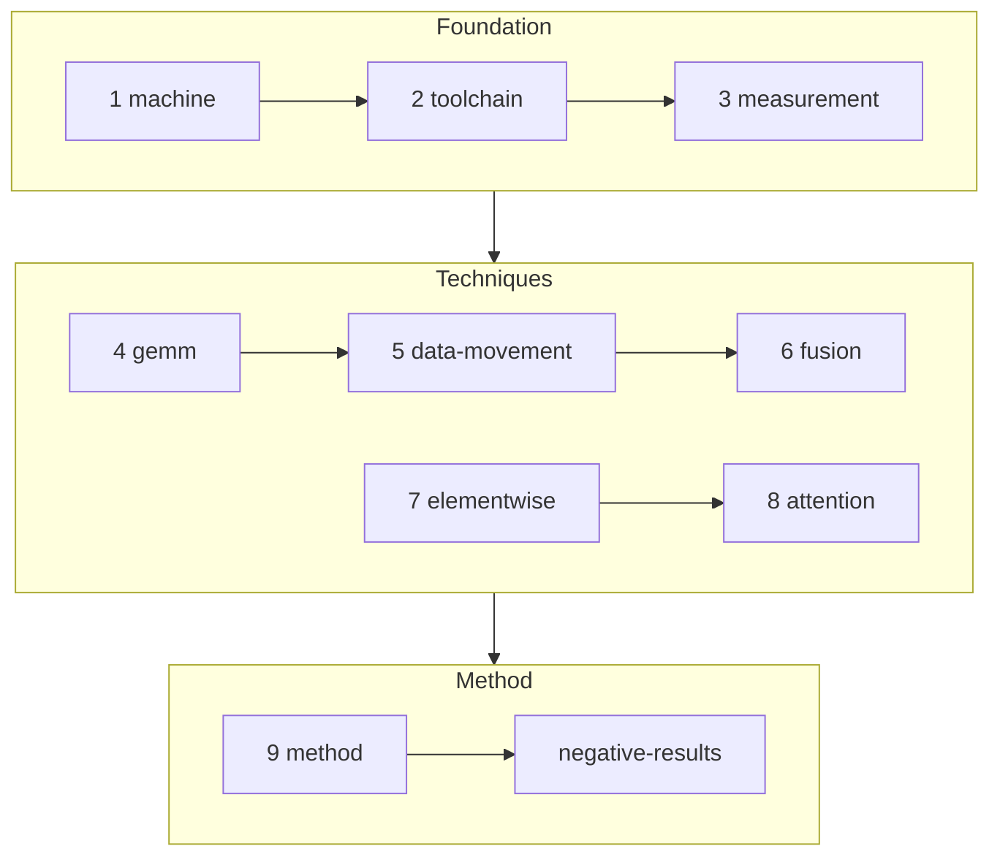

# The book: Strix Halo NPU and GPU, machine level

> **In brief**
>
> - A manual for this machine: what the hardware does, how to program and measure it, and which general techniques worked or failed, with numbers and evidence.
> - Read it before the model chapters. Each chapter links down to [tapnext/book](../../tapnext/book/README.md) and [moondream/book](../../moondream/book/README.md) for shapes, layouts and the specific attempts.
> - The lab notebook (rNN/ folders, NOTES, RESULTS, the commit log) is the raw evidence. Find things with the [book-read skill](../../.claude/skills/book-read/SKILL.md); add to the book with the [book-write skill](../../.claude/skills/book-write/SKILL.md).

## Where to start

Chapters 1-3 are the foundation (what the chip is, how code is built, how timings are trusted). Chapters 4-8 are techniques built on it. Chapter 9 is how the work was organised.

| # | chapter | one line |
|---|---|---|
| 1 | [machine.md](machine.md) | the AIE2P array: tiles, slots, registers, L1 banks, locks, DMA, the command processor, clocks |
| 2 | [toolchain.md](toolchain.md) | IRON, Peano, the asm route, generators, CP-SAT modulo scheduling, asmlint, tcall, program memory |
| 3 | [measurement.md](measurement.md) | A/B in one process, twins, timelines, stamps, benches, the clock under CPU load, timeouts, pre-registration |
| 4 | [gemm.md](gemm.md) | bfp16 GEMMs: compute vs DDR bound, the k-step from C++ to KTL, bank conflicts, pricing, epilogues and C drains |
| 5 | [data-movement.md](data-movement.md) | rates, the aggregate DDR caps, on-chip residency, BDs, queues, fills before or after waits |
| 6 | [fusion.md](fusion.md) | one dispatch, what an op boundary is, overlap at unit granularity, the CP sequence and deadlock rules |
| 7 | [elementwise.md](elementwise.md) | bf16 math, exp, LUT tables, GELU, norms' structure, judging accuracy |
| 8 | [attention.md](attention.md) | the online softmax, the fused K loop, lockstep under a multicast |
| 9 | [method.md](method.md) | the implementer + research loop, pricing, how mispredictions happened and what fixed them |
| — | [negative-results.md](negative-results.md) | the index of refuted ideas, one row per entry, with class, reason and chapter link |

## Citation keys

Chapters cite sources this way (paths from the repo root):

| key | where |
|---|---|
| MACHINE Mx.y | `common/MACHINE.md` topic id (older commits cite §n / Rx.y: `common/tools/machine-id-map.tsv`) |
| SKILL §n | `.claude/skills/xdna2-npu/SKILL.md` |
| NOTES n, RESULTS n, HANDOFF round n | `tapnext/npu/{NOTES,RESULTS,HANDOFF}.md` |
| RFM round n | `tapnext/research/RESULTS_FROM_MAIN.md` |
| ANALYSIS / PROPOSALS rev n | `tapnext/research/`; older revisions in `git log --follow -p` or `git show eed3870:npu-research/revN/<file>` |
| MD NOTES / MD RESULTS phase n | `moondream/npu/{NOTES,RESULTS}.md` |
| A1 … N36 | entries in [negative-results.md](negative-results.md) |
| 7 hex digits | a commit in this repo |
| round n, rNN/ | a TAPNext round; its tools and logs are in `tapnext/npu/rNN/` (implementer) or `tapnext/research/rNN/` (research) |

## Number status

Number status follows the sources:

| tag | meaning |
|---|---|
| MEASURED | taken on the device |
| MODEL | a calibrated model or CP-SAT result |
| EXTRAPOLATED | projected beyond what was measured |

> **Note.** The DDR caps and the CPU-load clock drop are observations under our conditions, not rules.
