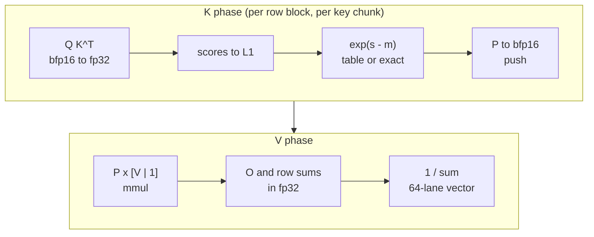
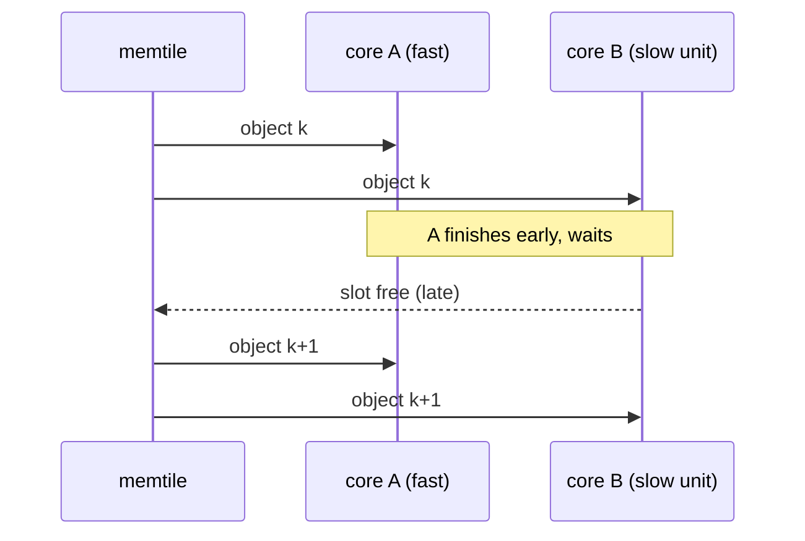

# Attention on AIE2P: softmax, exp and the K loop

> **In brief**
>
> - Attention runs as **one fused pass per query tile**: $QK^\top$ with bfp16 operands into fp32, an online softmax (fp32 output and
>   row sums, bfp16 $P$), then $PV$, with K/V multicast to the cores of a row or column.
> - Three choices made it fast: update the running max **lazily**; compute exp by **table** or exact split arithmetic, never with the
>   hardware exp2; write the K phase as one hand-scheduled loop that falls back to an exact path only for the rare rows whose max moved.
> - moondream's attention went from 3.78 to 0.675 ms per block this way (phase 9). TAPNext's K loop reached II 33 against a resource bound of 31.
> - Attention is **compute-bound** in both projects. What costs extra time at scale is **lockstep under a multicast**: a rare slow unit
>   costs ~3x its own time on the wall.
> - This chapter is the general part. Shapes and layout attempts: [TAPNext attention](../../tapnext/book/attention.md) (48 query slots,
>   12 heads, P60g, S2, K2) and [moondream NPU attention](../../moondream/book/npu-attention.md) (16 heads × 729 × 72, v2-v15).

**Terms.** II = initiation interval (cycles per loop iteration). TAU = the lazy-max threshold. bfp16 = block-floating-point 16 (shared exponent per block of 8).
L1 = a core's local memory. CP = constraint-programming solver. Memtile = the shared on-chip scratch memory of a column.
Twin = a build with one component removed, to measure what that component costs.

Caption: the K phase repeats per key chunk; a flag from the K phase sends the rare rows whose max moved through an exact C++ path.

## The online softmax on this chip

- **O and the row sums in fp32, P in bfp16.** The scale of $P$ is free: it is a block-floating-point operand of the PV mmul.
- **Lazy max.** Move the stored row max only when a row's max passes it by $\text{TAU} = 8$ (so $P \le e^{8}$). Eager rescaling on every increase
  cost 0.42 ms per block, as much as the exp itself. Lazy cut TAPNext's attention 1.77 → 1.35 ms per block (round 5;
  [D3](negative-results.md#d3) <!-- nr: D3 -->).
- **The exp argument in fp32**, taken straight from $s$ and $m$ ([D4](negative-results.md#d4)). With a table exp the $s$ and $m$ operands can be bf16,
  because the line is evaluated in the score domain ([elementwise.md](elementwise.md#exp)).
- **Unscaled scores.** $1/\sqrt{d} = 1/8$ is a power of two, so it moves into the table's slopes and index shift: 53 → 46 bundles, bit-identical.
- **Row sums from a ones panel** in the PV mmul ($P \times [V \mid 1]$). Then every lane of the row sum holds the sum, and $1/\text{sum}$ is one 64-lane
  vector reciprocal. Replacing the scalar `aie::inv` saved 1,264 B of code (round 6).

$$m_\text{new} = \begin{cases} m_\text{old} & \max_j s_j < m_\text{old} + \text{TAU} \\ \max_j s_j & \text{otherwise (rare, exact path)} \end{cases}
\qquad P_j = e^{\,s_j - m}$$

moondream's numerics were at the bfp16-operand floor (rms 9.8e-3 vs a host-model floor of 8.1e-3). An exp2-based variant was 25 % faster
and failed accuracy (2.7e-2; [D22](negative-results.md#d22)).

## Is it compute- or data-bound?

Compute-bound, in both projects:

| project | experiment | result |
|---|---|---|
| TAPNext | twin with no K-phase compute | 43.4 ms against ~50 (round 13; [D2](negative-results.md#d2)) |
| TAPNext | twins on the phases | K phase 0.60 ms per block, V 0.19 ([D1](negative-results.md#d1)) |
| moondream | empty-kernel floor (DMA only) | 0.29 ms per block against 0.675 with compute |
| moondream | broadcast K/V from the memtile | K/V bytes 3.5x lower (33.8 → 9.7 MB per block), but 0.955 vs 0.885 ms: no gain (MD NOTES phase 9) |

So the K loop's schedule is the lever, and attkb's II cuts landed 1:1 (round 22).

## The K loop

The K phase per row block does $QK^\top$ for a key chunk, writes scores to L1, computes $\exp(s - \text{stored max})$, converts $P$ to bfp16 and pushes it.
How it is built (TAPNext rounds 13-22; `tapnext/npu/r13/gen_attk.py`, `r14/gen_attkb.py`):

- **Lazy-fast plus fallback.** The asm loop assumes the stored max is still valid and returns a flag if any lane has $s - m \ge \text{TAU} - 0.25$.
  C++ reruns only the flagged row blocks exactly. This is bit-identical by construction. About 10 % of units take the slow path:
  chunk 0, the chunk with invalid key blocks, and the ~1-2 % whose max really moves.
- **Operand placement.** Pop Q per key block on the other load slot instead of holding it in registers (lda: Q, ldb: K): 70 → 53 bundles
  per pair. Popping the held operand in PV instead was worse (42 → 67), so measure both directions
  ([D7](negative-results.md#d7) <!-- nr: D7 -->). Remember `ex_n` aliases `x_n` ([D9](negative-results.md#d9)).
- **Batch it.** One modulo loop per (tile, chunk) over row blocks and key blocks needs only 2D modifiers and pointer-only steps, not 3D
  pops ([D12](negative-results.md#d12)). Bench warm unit 444 → 261 cycles.
- **What bounds the II.** The resource bound of attkb is 29-31 (DM_ADA, the ldb slot), but the loop is register-bound at the deployed II:
  II 36 → 34 → 33 by re-solving with more CP time (-0.13, -0.035 ms). A split QK loop and exp loop could not fit the exp in 6 free x
  registers ([D8](negative-results.md#d8) <!-- nr: D8 -->). Carrying looked-up exp lines across trips spilled
  ([D6](negative-results.md#d6) <!-- nr: D6 -->).
- Text matters: the attention is ~6-7 KB of the GEMM core's 16 KB, and several variants died on it ([D21](negative-results.md#d21)).

| step | bundles | note |
|---|---|---|
| Q held in registers | 70 per pair | |
| Q popped per key block (lda: Q, ldb: K) | 53 per pair | |
| held operand popped in PV instead | 42 → 67 | worse |
| unit, before batching | 444 cycles | bench, warm |
| unit, one modulo loop per (tile, chunk) | 261 cycles | bench, warm |

## Lockstep under a multicast

A memtile `forward` to N cores is one MM2S (memory-to-stream DMA) channel. A send waits until every destination has a free L1 slot, so a
column runs at most one object ahead of the slowest ([M8.6](../MACHINE.md#m8-6)).

- **Price a non-uniform per-unit cost by the max over destinations per object, never by its mean.** ~10 % slow units cost ~3x their own
  cycles on the wall: P56's fallback cost +1.35 ms for ~0.45 ms of its own cycles ([H19](negative-results.md#h19) <!-- nr: H19 -->,
  [D11](negative-results.md#d11)). A cost every column pays at once passes 1:1.

$$t_\text{object} = \max_{d \in \text{destinations}} t_d \quad\neq\quad \overline{t_d}$$

- The tool: `common/tools/attsim17.py` / `sim17.py`, an event model calibrated on twins (per-block correlation 0.97). Where the ~2.3 ms
  of the slow path went in TAPNext:

    | part | ms |
    |---|---|
    | the slow path's own cycles | ~0.22 |
    | multicast lockstep | ~1.3 |
    | head-group barrier ([M15.2](../MACHINE.md#m15-2)) | ~0.8 |

- **Balance the rows across the destinations, rather than decoupling the destinations.** Deeper buffers and more slots helped a little
  (`--l2-depth` 4 → 8: -0.36 ms, unexplained) or did not fit L1. Dealing query rows round-robin over the columns (P60g) gained -1.06 ms.

## What didn't work

| idea | outcome | why | index |
|---|---|---|---|
| eager rescale of the max | as costly as the exp | rescale on every increase | [D3](negative-results.md#d3) <!-- nr: D3 --> |
| bf16 $s - m$ | 2-3 % error | rounding before the exp | [D4](negative-results.md#d4) <!-- nr: D4 --> |
| exp lines carried across trips | spills | register pressure | [D6](negative-results.md#d6) <!-- nr: D6 --> |
| P popped in the PV loop | 67 vs 42 bundles | operand placement | [D7](negative-results.md#d7) <!-- nr: D7 --> |
| separate QK and exp loops | no exp schedule | only 6 free x registers | [D8](negative-results.md#d8) <!-- nr: D8 --> |
| Q held in ex0-7 | wrong results | aliases x0-7 | [D9](negative-results.md#d9) <!-- nr: D9 --> |
| biased-base LUT load | not possible | no such instruction form | [D10](negative-results.md#d10) <!-- nr: D10 --> |
| rare costs priced by their mean | misprice under lockstep | max over destinations | [H19](negative-results.md#h19) <!-- nr: H19 --> |

The TAPNext-specific attempts (re-streaming K/V, deals, slots, chunk-0 tricks, numerics changes) are in
[TAPNext attention](../../tapnext/book/attention.md#what-didnt-work). The moondream stream and exp variants are in
[moondream NPU attention](../../moondream/book/npu-attention.md#what-didnt-work).

## Lessons

- Lazy max, a table or exact exp, a fused K loop with an exact fallback: all bit-identical to an exact reference.
- Attention is compute-bound here. Spend effort on the K loop's II and on the fallback's frequency, not on K/V traffic.
- Under a multicast, balance the work. Price the max, not the mean.

## Going deeper

- [SKILL](../../.claude/skills/xdna2-npu/SKILL.md) §3 (rounds 5, 7, 13-15 attention rules), [MACHINE](../MACHINE.md) [M8.6](../MACHINE.md#m8-6), [M15.2](../MACHINE.md#m15-2).
- `moondream/npu/p9/attn15.cc` (one-pass v15), `tapnext/npu/mm8.cc` (`chunk_k_fused`, `attn_begin`, `attn_end`), the generators above.
