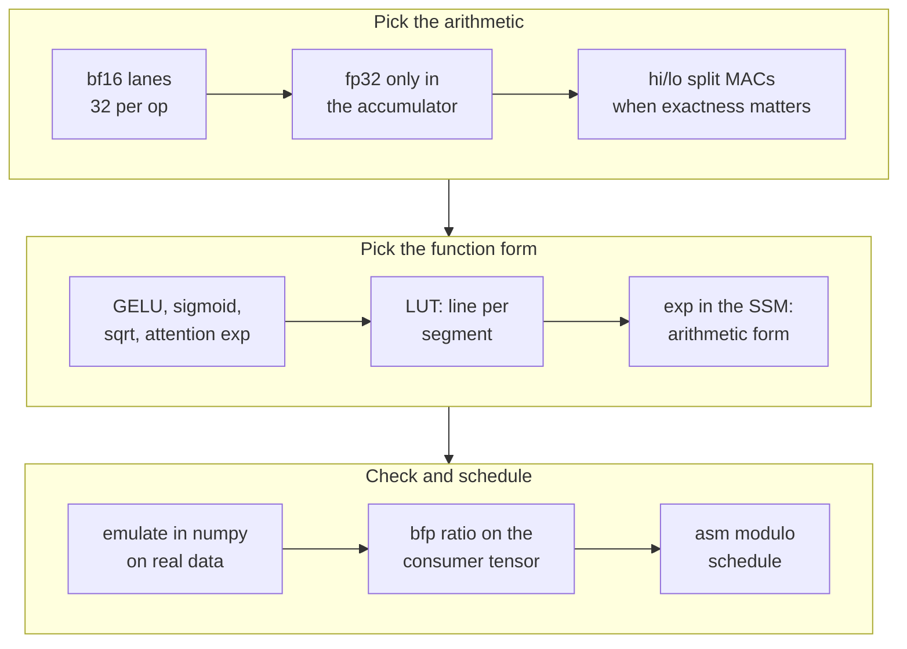
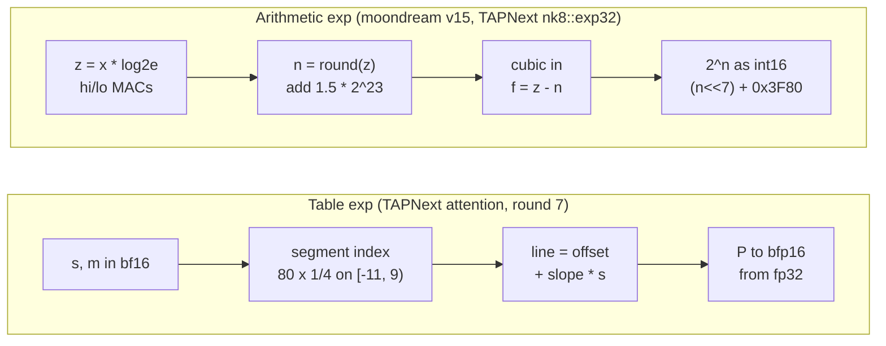
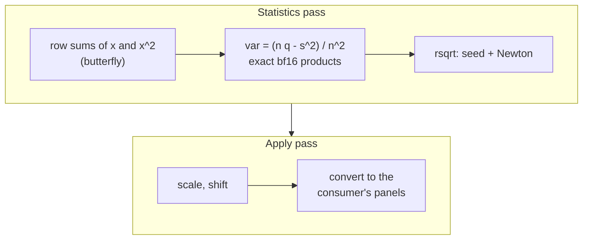

# Elementwise and transcendental functions on AIE2P

> **In brief**
>
> - Do elementwise math in **bf16** (32 lanes, native) and keep fp32 only inside the MAC accumulator. fp32 vector arithmetic is
>   emulated at ~21 bundles per 16 lanes: an fp32 GELU would have cost moondream ~120 ms per frame (MD RESULTS phase 6).
> - Compute transcendentals (GELU, sigmoid, the attention exp, sqrt) by **table lookup** with AIE2P's 4-way LUT load where you can.
>   Where a table's absolute error is not enough, use split hi/lo bf16 arithmetic in the MAC unit.
> - Judge every approximation on **real activations** against what the consumer needs, and schedule the long chains in asm,
>   because Peano will not pipeline them.
> - A norm on this chip is usually bound by its I/O, not its math.
> - The model chapters hold the specific kernels: [TAPNext SSM](../../tapnext/book/ssm.md), [TAPNext norms](../../tapnext/book/norms.md),
>   [moondream NPU elementwise](../../moondream/book/npu-elementwise.md).

**Terms.** LUT = lookup table. II = initiation interval (cycles per loop iteration once pipelined). Bundle = one VLIW instruction word.
EW = elementwise. SSM = state-space model block. LN = LayerNorm. RMS = RMSNorm. CP = constraint-programming solver (CP-SAT).
MAC = multiply-accumulate. Slots: vec (MAC), st (store), mv (move / shuffle), ld (load).



## The bf16 / fp32 rules

- **Slots decide the floor.** Per 32 lanes a kernel costs at least the busiest slot (formula below), and then the itinerary ports and
  register pressure on top ([machine.md](machine.md#the-compute-tile)). Every bf16 Horner step is one vec (the MAC) plus one st (the rounding).
- **Exact constants and fp32-accurate products without fp32 vectors**: split a value into three bf16 parts (exact, below) and multiply
  in the MAC unit. Six MACs give $\sim 2^{-20}$ (SKILL §3, `tapnext/npu/ew8.cc`).
- **Reductions**: sum the 8 lanes of each row of a [4][8] fp32 accumulator with an `interleave_unzip` / `zip` butterfly plus
  accumulator adds (native, ~40 bundles; every lane ends with the row sum). `reduce_add` on fp32 vectors is emulated.
- **Set the rounding mode** (`conv_even`) per core. The default is FLOOR.
- **A vector reciprocal**: an int16 bit-trick seed (below) plus Newton corrections in hi/lo MACs. One Newton step was visible in the
  next tensor ([F9](negative-results.md#f9) <!-- nr: F9 -->).

$$\text{bundles} \ge \max(\text{vec MACs},\ \text{st},\ \text{mv},\ \text{loads}/2)$$

$$h = \mathrm{bf}(a),\qquad m = \mathrm{bf}(a-h),\qquad l = \mathrm{bf}(a-h-m)\quad(\text{exact})$$

$$x_0 = \texttt{0x7EF3} - \mathrm{bits}(x)\quad(|\text{err}| < 5.3\,\%)$$

Here st counts conversions and stores, and mv counts int and shuffle ops.

### Primitives to distrust

Characterise any primitive on every bf16 input first (`tapnext/npu/r6/kprobe.py`).

| primitive | behaviour | entry |
|---|---|---|
| `aie::inv` | correctly rounded but scalar (32 lane extracts) | [F7](negative-results.md#f7) <!-- nr: F7 --> |
| `aie::exp2` | ~4-bit interpolant: p99 10 ulp, 8 % rms on a ramp | [F7](negative-results.md#f7) |
| `vtanh` | identity for $\lvert x\rvert \le 0.5$, 2-7 % off up to 2 | [F7](negative-results.md#f7) |
| 8-lane bf16 `aie::max` | returns wrong values | [F8](negative-results.md#f8) <!-- nr: F8 --> |

## Exp

Two forms are in production.



| form | accuracy | cost |
|---|---|---|
| arithmetic | exact to bf16 | ~1.3 bundles per element once pipelined |
| table (80 segments of 1/4 on $[-11, 9)$) | as accurate as the arithmetic exp on real scores | 49 bundles per 64 scores including the push |

- The table's line is evaluated in the score domain, so $s$ and $m$ can be bf16 there. A table spanning $h = 1/2$, or ending at $-7$ or
  higher, was worse ([D5](negative-results.md#d5) <!-- nr: D5 -->).
- Take the softmax argument in fp32 straight from $s$ and $m$. Rounding $s - m$ to bf16 first costs up to 2-3 % at $\lvert s - m\rvert \sim 10$
  ([D4](negative-results.md#d4) <!-- nr: D4 -->). The softmax specifics are in [attention.md](attention.md).
- A cheaper SSM exp by a range-reduced $2^f$ table was not faster, and a direct piecewise-linear exp on $\log a$ was too inaccurate
  ([E14](negative-results.md#e14)).

## Tables (LUT loads)

AIE2P has a 4-way parallel table load (`load_lut_2x_float`, 16 lanes from two table copies). Write the lookup by hand, as mlir-aie's
`lut_segments_acc` does (SKILL §3 round 6).

```text
bank A:  [slope0 off0][slope1 off1][slope2 off2][slope3 off3]
         [slope0 off0][slope1 off1][slope2 off2][slope3 off3]
         (a group of 4 entries, stored twice in a row)
bank B:  the same table again, in ANOTHER bank

index (byte offset, 16 B per segment of width 2^-k):
         bfloat16_to_int(x, k + 4)      (vfloor)
```

- Both copies in one bank still work, at +1 cycle per 4x load (+8 per 32 lanes; round 9).
- `aie::linear_approx` is 2.7x slower: it reloads its object from the stack every compute ([G3](negative-results.md#g3) <!-- nr: G3 -->).
- 16-bit tables (`load_lut_2x_int8`, 4 B per entry, runs of 16 doubled) give an exact bf16 sqrt: 256 mantissa entries plus an int16 exponent halving.

> **Pitfall.** Linear tables have absolute error. A symmetric sigmoid table on $[0, 8)$ had far fewer bf16 mismatches (5 % vs 18.6 %),
> but $1 - s$ lost the relative accuracy of small sigmoids, and TAPNext's gate feeds $a = \exp(-8\,sp\,\sigma)$ near 1
> ($|da|/(1-a)$ 1.6e3; [E13](negative-results.md#e13) <!-- nr: E13 -->). One asymmetric $[-12, 8)$ table fixed it
> (-2.8 ms with the sqrt table, round 9).

Results in TAPNext:

| table | result | round |
|---|---|---|
| GELU = $x\cdot s(x)$, $s$ piecewise linear in 64 segments | 3.9x faster than the arithmetic GELU at the same real-data error (-6.0 ms) | 6 |
| SSM sigmoid and sqrt | -2.8 ms | 9 |

The LUT loops then sit at their port bound: DM_ADA and QEY_RS bind at 10 per 32 lanes, and register pressure gives II 11-13
([M3.4](../MACHINE.md#m3-4)).

## GELU

Use the GELU your reference uses: torch's ViT MLP is the erf form, and every TAPNext build before round 6 used tanh there.

- Reciprocal-free and polynomial GELUs failed in bf16: every 8-bit operand rounding costs $2^{-9}$, and a polynomial in $\lvert x\rvert$ is ill-conditioned in
  bf16 Horner (26-37 % mismatches vs 15 %; [B6](negative-results.md#b6) <!-- nr: B6 -->). Emulate the exact op sequence in numpy before
  you build (`tapnext/npu/r5/gelufit3.py` rejected it in minutes).
- moondream's GELU epilogue ran 492 bundles per 64 elements against a slot bound of ~114. Peano issues ~1 op per bundle on long chains,
  and staging the chains did not help ([B12](negative-results.md#b12) <!-- nr: B12 -->). This was the clearest case for the asm route.

How the TAPNext GELU loop was scheduled:

| step | cycles per 32 lanes (II) |
|---|---|
| forced-II Peano loop | 17.8 |
| hand modulo schedule | 13 |
| fused bias + GELU | 12 |
| bound counted with ports | 10-11 |
| bound counting slots only | 8 |

The slot-only bound of 8 was wrong; the ports give 10-11 ([B4](negative-results.md#b4) <!-- nr: B4 -->). II 10 was never reached:
the CP search found nothing within 400 s per try, which is not a proof ([B5](negative-results.md#b5) <!-- nr: B5 -->).

## Norms: the general structure

A LayerNorm or RMSNorm over rows is two passes.



$$\mathrm{var} = \frac{n\,q - s^2}{n^2},\qquad s = \sum x,\quad q = \sum x^2$$

On this chip a norm is usually bound by its I/O, not its math:

- **Per-call overhead dominates small-grain I/O.** A noinline "append 64 B to the ring" helper made TAPNext's norms 3x slower than their DMA
  bound. Reserve output slots per larger unit and store straight into the ring ([E1](negative-results.md#e1) <!-- nr: E1 -->). One loop
  body per mode (a template), with no mode or count branches in inner loops.
- moondream: a bf16 LayerNorm was bit-exact at 116 µs, and LN + residual 146 µs (MD RESULTS phase 8).
- TAPNext's 3-input norms (residual + two partial sums) are byte-bound at the DDR read cap. Its 2-input norms are compute-bound at ~480 (RMS) /
  ~560 (LN) cycles per unit (RRTWIN, round 25). Price norm levers per input count.
- One 64-lane statistics chain beats two 32-lane chains, because 64-lane bf16 MACs into a 64-lane fp32 accumulator are native. Select
  between chains arithmetically ($x\cdot 1.0 + y\cdot 0.0$ is exact), never with a vector PHI, and never call a function inside the chain (STATS64 -0.10).

## Peano and elementwise loops

- Two independent chains per basic block (exp 73 → 38 bundles per vector); four spill ([G4](negative-results.md#g4)).
- Split a long chain into short passes through L1 so each pipelines (SSM exp 63.5 → ~44 bundles). Separate in/out pointers, constant trip counts,
  constants as locals, loads before stores in source order.
- When that is not enough, go to asm ([toolchain.md](toolchain.md#generators-and-modulo-scheduling)).

## Judging accuracy

- Use the **bfp ratio** on real activations, for the tensor the result lands in:

    $$\rho = \frac{\mathrm{rms}(\text{approx} - \text{exact})}{\mathrm{rms}(\mathrm{bfp16}(\text{exact}) - \text{exact})}$$

    bf16 ulps alone overstate harmless changes (`tapnext/npu/r6/capture.py`, `numh.py`, `emu.py`).
- For recurrent state, judge by the end metric (DAVIS). Any ulp-level SSM change gives the same chaotic 30-frame track noise
  ([H26](negative-results.md#h26)).
- bf16-only elementwise ops kept moondream's yes/no accuracy (`moondream/gpu/BF16_ELEMENTWISE.md`).

## What didn't work

| idea | outcome | why | index |
|---|---|---|---|
| GELU floor of 8 cycles | wrong bound | counted slots only; the shared ports give 10-11 | [B4](negative-results.md#b4) <!-- nr: B4 --> |
| GELU at II 10 | no schedule found | register budget; not proven infeasible | [B5](negative-results.md#b5) <!-- nr: B5 --> |
| reciprocal-free or polynomial GELU | too inaccurate | bf16 rounding and ill-conditioned Horner | [B6](negative-results.md#b6) <!-- nr: B6 --> |
| staged GELU chains for Peano | no gain | allocation-bound | [B12](negative-results.md#b12) <!-- nr: B12 --> |
| exp argument rounded to bf16 | 2-3 % error | $s - m$ loses bits before the exp | [D4](negative-results.md#d4) <!-- nr: D4 --> |
| other exp table ranges | worse on real scores | tail and step size | [D5](negative-results.md#d5) <!-- nr: D5 --> |
| per-64 B output helper | norms 3x slower | per-call overhead | [E1](negative-results.md#e1) <!-- nr: E1 --> |
| symmetric sigmoid table | lost small-value relative accuracy | $1 - s$ near 1 | [E13](negative-results.md#e13) <!-- nr: E13 --> |
| hardware tanh, exp2, inv | inaccurate or scalar | see the primitives table | [F7](negative-results.md#f7) <!-- nr: F7 --> |
| 8-lane bf16 max | wrong values | hardware behaviour | [F8](negative-results.md#f8) <!-- nr: F8 --> |
| one Newton step in the reciprocal | visible error downstream | too few correction steps | [F9](negative-results.md#f9) <!-- nr: F9 --> |
| `aie::linear_approx` | 2.7x slower | reloads its object every compute | [G3](negative-results.md#g3) <!-- nr: G3 --> |

## Lessons

- bf16 math, fp32 accumulators, tables for transcendentals. Check a table's tail against what its consumer needs.
- Emulate the exact op sequence on real data before building a numerics change.
- Measure the slot + port + register bound first. The gap between that and Peano's loop tells you whether asm will pay.

## Going deeper

- [SKILL](../../.claude/skills/xdna2-npu/SKILL.md) §3 (all rules with round numbers), `tapnext/npu/nk8.h` (exp32, recip, sigmoid, sqrt),
  `tapnext/npu/r6/lutgen.py`, `r7/explut.py`, `r9/ssmlut.py`, `moondream/npu/p8/expsplit.h`.
- [MACHINE](../MACHINE.md) [M2.1](../MACHINE.md#m2-1), [M3.3](../MACHINE.md#m3-3), [M3.4](../MACHINE.md#m3-4).
