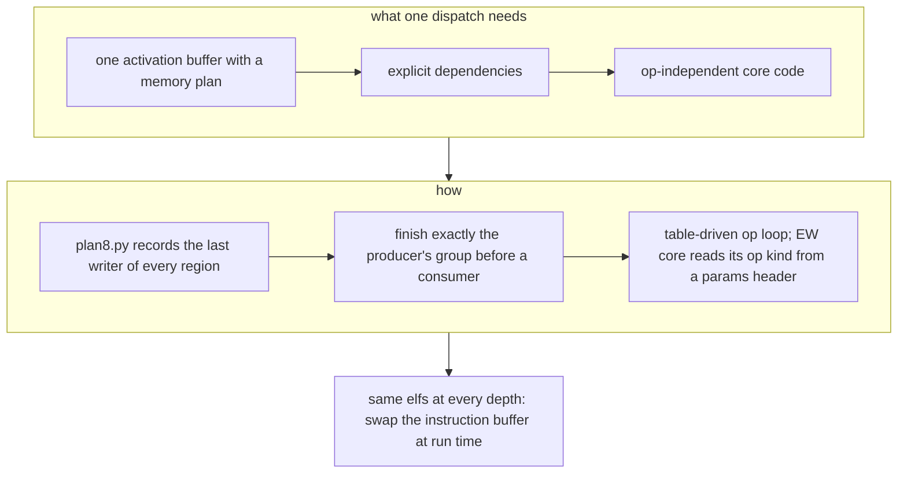
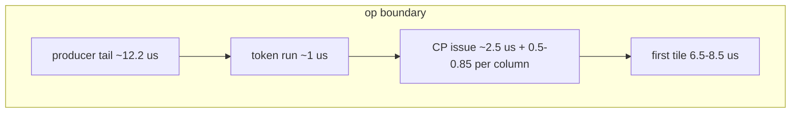
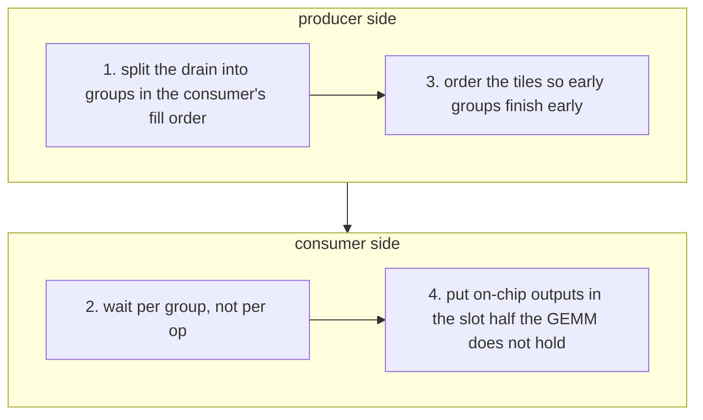

# Fusion, overlap and the command-processor sequence

> **In brief**
>
> - Put the whole model step in **one dispatch**. In TAPNext, fusion took the step from ~2 ms of context switching per op to one dispatch per frame.
> - Then make every boundary between ops cheap: keep the next op's input on chip or load it early, issue everything independent
>   before each wait, and let a consumer start on its producer's partial output when the consumer works in finer units.
>   Boundary work in rounds 20-24 removed ~3.5 ms more (EXTRAPOLATED sum of the kept A/B deltas; −2.07 ms in round 20 alone).
> - An op boundary is **bytes** (a drain tail at the DDR write cap, then the consumer's first tile at the read cap), not CP instructions.
> - The command processor (CP) that runs the sequence is a serial, in-order machine with small queues. Most hangs in
>   the late rounds were CP-order deadlocks of our own making; the [deadlock rules](#deadlock-rules) list what prevents them.

**Conditions.** TAPNext, depth 12, NPU clock 1.808 GHz, quiet box (gpu_busy 0). Gains are A/B deltas in ms per step (negative = faster), bit-identical unless noted.

**Terms.** CP = command processor. BD = DMA buffer descriptor. EW = elementwise core. GEMM = matrix-multiply core. DDR = shared system memory.
SSM = the state-space (recurrent) mixer. Memtile = the shared on-chip scratch memory of a column. Shim = the DMA tile that talks to DDR. A = the left GEMM input (activations).

## One dispatch

| fact | number |
|---|---|
| hardware-context switch | ~2.7 ms (MACHINE [M1.6](../MACHINE.md#m1-6), SKILL §5) |
| pyxrt dispatch | ~80-97 µs |
| moondream tower, four xclbins → one program for 27 blocks | 40.4 → 33.8 ms (MD RESULTS phase 6) |
| TAPNext first prototype | six xclbins at ~2 ms each (NOTES 5); design8 (round 3) runs the whole 12-block step in one runtime sequence |

- Dependencies must be explicit: a lookahead pipeline alone passes only by timing.
- With op-independent core code the elfs are the same at every depth, and the depth changes at run time by swapping the instruction buffer
  (no rebuild, no new context; round 5).
- Rotating state (the SSM's frame-indexed regions) uses a few runtime sequences per depth, swapped per dispatch the same way (round 17 X1).

## What an op boundary is

Measured on mlp0 → mlp3_a in TAPNext (CPST + TPROF, round 20; [M11.3](../MACHINE.md#m11-3)):

| phase | time | what it is |
|---|---|---|
| producer tail | ~12.2 µs | the last 442 KB of C objects through the memtile joins, at the DDR write cap |
| token run | ~1 µs | 8 completion-token waits |
| CP issue | ~2.5 µs to column 0, +0.5-0.85 µs per further column | BD writes, patches, pushes, issued column by column |
| first tile | 6.5-8.5 µs (K 768), 13.3 (K 1536) | the consumer's A arriving at the DDR read cap |

- Boundaries totalled ~3 ms per step, not the 5 ms the timeline "gaps" suggested, because a GEMM's gap contains its whole first tile
  ([H15](negative-results.md#h15) <!-- nr: H15 -->).
- **It is bytes, not CP instructions.** A boundary model with a fitted 0.17 µs per CP instruction reproduced six boundaries within 5 µs and
  was wrong ([C2](negative-results.md#c2) <!-- nr: C2 -->, [H14](negative-results.md#h14) <!-- nr: H14 -->). The measured CP rates are
  0.06 µs per write32 and 0.11 per maskpoll ([C3](negative-results.md#c3) <!-- nr: C3 -->). Moving post-sync work before the wait gave at
  best −0.04 against a predicted −1.4 ([C4](negative-results.md#c4) <!-- nr: C4 -->).
- The CP's serial per-column issue still matters: it staggers the columns, and a B multicast then holds every column to the last one.
  NRES alone gained −0.06..−0.11; with the sequence reordered (NSEQ), −0.18..−0.21 ([C18](negative-results.md#c18)).

## Cures that worked

All are bit-identical and measured in TAPNext. The specifics are in [TAPNext boundaries](../../tapnext/book/boundaries.md).

| technique | example | gain (ms) |
|---|---|---|
| keep the consumer's A on chip: the producer streams panels into the memtile A slot | NRES (4 norms), SRES (SSM → out) | −0.65, −0.16 |
| load the next op's A into the slot half the current op leaves free, before the producer ends | IL, DAPRE, AQPRE, AKVPRE, 3A | −0.40, −0.13, −0.11..−0.23, −0.13..−0.24, −0.07 |
| issue everything independent of the producer before the wait | NSEQ, SSMPRE | −0.17 (with NRES), −0.07 |
| configure post-wait fills before the wait, push after | CPPRE | −0.09 |
| split the consumer's load per producer part, sends before the part waits | OPPRE2 | −0.15 |
| run the producer's last tile as row passes so the consumer starts on the first rows | MSPLIT-P | −0.17, −0.10 |
| overlap an EW consumer with its producer at unit granularity | YXSSM + YXR | −0.79 |

## Overlap when the consumer's unit is finer (YXSSM pattern)

The SSM's head *q* needs only two of yx's output tiles (y tile *q*, x tile 12 + *q*), but it waited for all of yx. The recipe (round 23,
baeaf64, c9f9779):

1. Split the producer's drain into groups in the consumer's fill order.
2. In the consumer's fill loop, wait per group instead of for the whole op.
3. Order the producer's tiles so the first groups complete early (YXR interleaves y and x so the SSM starts after step 2 of 8).
4. Put on-chip outputs in a slot half the running GEMM does not hold. NRES / SRES tasks acquire all 12 chunk locks of a half.

The overlap is not free: yx's wall grew 94 → 164 µs from shared DDR, and an earlier start lengthened the SSM by 19 µs in one variant
([L6](negative-results.md#l6)). The norm-side bound came from NTWIN (norms not waiting for their producers: −0.92 ms with walls
unchanged). MSPLIT-P reached −0.27 of that, because each pass pays its own call and drain.

> **Pitfall.** Splitting a frame into row chunks repeats every tile's fixed cost and every dependent load. A list-schedule
> model gave 76.3 → 76.9-77.2 ms ([C1](negative-results.md#c1) <!-- nr: C1 -->). Split only where the consumer's unit is already finer
> than the op.

## The command-processor sequence

- **The CP is in order.** A wait blocks every push behind it. A push into a full channel queue (5 tasks) blocks the CP until that
  channel's oldest task completes ([data-movement.md](data-movement.md#dma-bookkeeping)).
- **A post-wait shim fill costs ~0.55 µs of CP time** (blockwrite + patch + maskpoll + maskwrite + push; [M11.2](../MACHINE.md#m11-2)). With 8 columns that is
  ~4.4 µs of skew per wait:

$$8 \times 0.55\ \mu\text{s} \approx 4.4\ \mu\text{s}.$$

- Configure the fill before the wait and push it after (design8 `prefill()`). The live BD count rises, so keep
  the static shim BD peak ≤ 16. This revived an idea that had been dropped on an inferred 0.10 µs ([C8](negative-results.md#c8) <!-- nr: C8 -->).
- Decode and re-serialise a `.bin` with `aie.utils.txn_trace` to see or move CP instructions (`tapnext/npu/r20/binpatch.py`,
  `r24/cpsegs.py`).

## Deadlock rules

Each of these hung a dispatch at least once (rounds 10, 21, 23):

| rule | why |
|---|---|
| Push an op's memtile tasks only after its fills | a blocked push may only wait on work already issued ([C5](negative-results.md#c5)) |
| With a B multicast, push every column's first five memtile tasks before any column's sixth | r23d hung column by column |
| When you reorder the sequence, no group wait may need work issued after it | `push()` can finish the oldest pending groups early, and a consumer that finishes a group whose completion needs its own later fills hangs (r23o2) |
| Never make a core wait for its own C drain while it holds multicast inputs | LATEC, round 21; [B9](negative-results.md#b9) |
| Use per-half locks for a reordered slot load | per-chunk locks identify nothing: one F lock for both A halves would let half-0 sends go before their data ([M9.3](../MACHINE.md#m9-3)) |
| Patch the xclbin before a kernel takes a new lock | a kernel taking a new lock on an unpatched xclbin hangs ([toolchain.md](toolchain.md#iron-and-mlir-aie)) |

> **Pitfall.** design8 `SEQLOG=1` prints every group wait with the op being issued: read it before dispatching a reordered sequence.

## What didn't work

| id | idea | why it failed |
|---|---|---|
| [C1](negative-results.md#c1) <!-- nr: C1 --> | overlapping EW and GEMM by row chunks | every chunk repeats fixed costs (model: +0.6-0.9 ms) |
| [C2](negative-results.md#c2) <!-- nr: C2 --> | the CP-bound boundary model | the free constant absorbed the producer tail |
| [C3](negative-results.md#c3) <!-- nr: C3 --> | the CP rate as the cause | the rate is real but small |
| [C4](negative-results.md#c4) <!-- nr: C4 --> | pre-issuing post-sync work | −0.04 against −1.4 predicted; the boundary is bytes |
| [C5](negative-results.md#c5) <!-- nr: C5 --> | memtile sends before the wait | blocked the CP (+1.1) |
| [C6](negative-results.md#c6) <!-- nr: C6 --> | sends after fills, loads and drains before | +0.13 |
| [C8](negative-results.md#c8) <!-- nr: C8 --> | hoisting BD writes | dropped at 0.10 µs, **revived** at the measured 0.55 µs (CPPRE −0.09) |
| [C18](negative-results.md#c18) <!-- nr: C18 --> | an on-chip bypass without reordering the sequence | the per-column issue stayed |
| [H15](negative-results.md#h15) <!-- nr: H15 --> | "5 ms of boundaries" | the gaps counted first-tile compute |

The TAPNext levers (SENDPRE, OPPRE, MSPLIT on out, YXH, NRES variants) are in [TAPNext boundaries](../../tapnext/book/boundaries.md#what-didnt-work).

## Lessons

- One dispatch per frame. Then treat every boundary as bytes: what must cross DDR, and can it cross earlier or not at all?
- Issue independent work before a wait, configure dependent work before it, and push after.
- Read `SEQLOG` and count queue depths before dispatching any reordered sequence.

## Going deeper

- [MACHINE](../MACHINE.md) [M11](../MACHINE.md#m11), [M11.1](../MACHINE.md#m11-1), [M11.2](../MACHINE.md#m11-2), [M11.3](../MACHINE.md#m11-3), [M9.3](../MACHINE.md#m9-3), [M10.2](../MACHINE.md#m10-2), [M10.3](../MACHINE.md#m10-3), [M10.5](../MACHINE.md#m10-5), [M14.5](../MACHINE.md#m14-5). [SKILL](../../.claude/skills/xdna2-npu/SKILL.md) §3 (round 19-24 rules).
- NOTES 25 (round 20), 28 (round 23), 29 (round 24). `tapnext/npu/design8.py` (`prefill`, `SEQLOG`), `plan8.py`.
