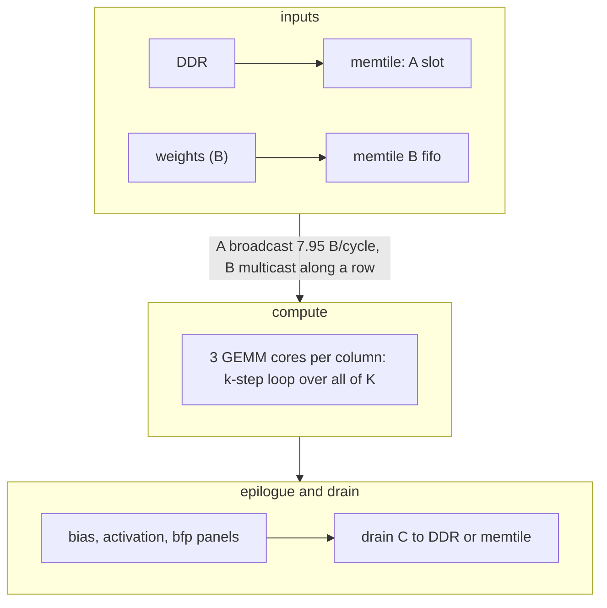
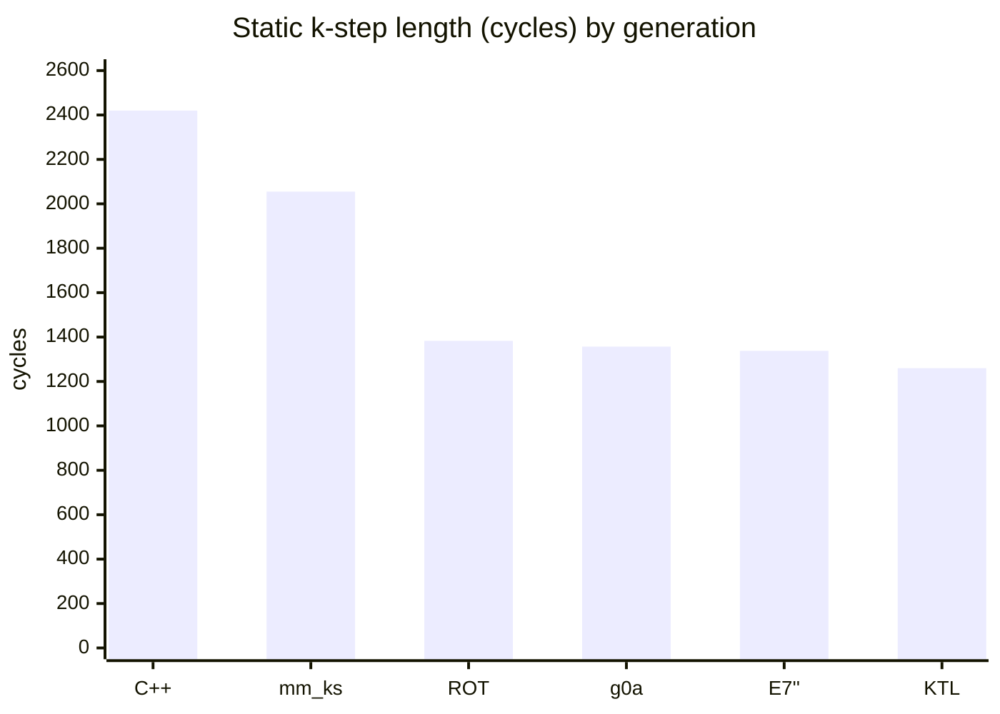
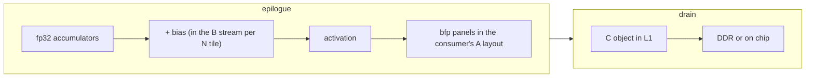

# Matrix multiplies on AIE2P

> **In brief**
>
> - A GEMM on this NPU runs `vmac.f` bfp16 8x8x8 MACs (512 per instruction) into fp32 accumulators kept over the whole K.
>   A comes from the memtile (broadcast to a column's cores), and B is a weight multicast along a row.
> - Whether a GEMM is compute-bound or data-bound depends on the shapes. moondream's frame GEMMs were **DDR-bound**
>   (1,317 MB per frame at 37-39 GB/s). TAPNext's are **compute-bound** (twins: no-MAC −16.1 ms, 2x-MAC +24.7 ms of 84.0).
> - Once compute-bound, the k-step loop took the most work and gave the most time back: in-situ k-step
>   2,900 → ~1,340 cycles over 16 rounds, through four generations of hand-scheduled asm.
> - Every generation moved the bound (chains → accumulator swap → B bank → call prologue → DMA collisions and the A port).
> - This chapter covers the general mechanics. The shapes are in [TAPNext GEMM](../../tapnext/book/gemm.md) and
>   [moondream NPU GEMM](../../moondream/book/npu-gemm.md).

**Conditions.** Cycle counts are MEASURED in situ in TAPNext unless a row says "static" (the schedule's length, no stalls).
Step deltas are A/B at depth 12, NPU clock 1.808 GHz unless a row gives another clock, bit-identical to the reference.

**Terms.** GEMM = matrix multiply. DDR = shared system memory. bfp16 = block floating point (shared exponent per 8 values).
EW = elementwise core. CP = the NPU's command processor. ZOL = zero-overhead loop. L1 = a core's 64 KB local memory.
DMA = direct memory access engine. TAP = tensor access pattern. FIFO = the core's stream-fed register queue. dm = accumulator register.

## How does a GEMM flow through a column?

Each core accumulates over all of K in fp32, then runs the epilogue on its tile.

## Vocabulary

| term | meaning |
|---|---|
| **Panel** | an 8x8 bfp16ebs8 block, 72 B (8 rows of [shared exponent + 8 int8 mantissas]). One pop of a block-vector FIFO delivers one panel into an `ex` register |
| **k-step** | one A object's worth of MACs. In TAPNext: 144 rows × 64 k = 10,368 B of A per core, 9 calls of 2 row blocks × 8 k-panels in the C++ form |
| **Accumulators** | 5 `dm` registers of one 8x8 fp32 block each. A tile's partial sums live in L1 ("pieces") and are swapped in and out of the dm registers |
| **A-port floor** | the time to move one k-step of A from the memtile to the core (below) |

The A-port floor is

$$t_\text{A} = \frac{10{,}368\ \text{B}}{7.95\ \text{B/cycle}} = 1{,}304\ \text{cycles}$$

([M8.3](../MACHINE.md#m8-3)). Once a k-step nears ~1,300-1,450 cycles, body cuts stop paying.

## Is it compute- or data-bound?

Decide with a twin (a build with one resource removed or doubled), not a fit.

| claim | what happened | verdict |
|---|---|---|
| Rev 1: "4 B/cycle A-port floor" | matched a k-step time within 2.4 % and booked 32 % of the step on the A port. Both constants were wrong (the clock and the port rate); the no-MAC twin refuted it ([A1](negative-results.md#a1) <!-- nr: A1 -->) | method error |
| Round 9: "A-port-bound at ~4 B/cycle" | used a mean that included each op's start wait ([A3](negative-results.md#a3) <!-- nr: A3 -->) | method error |
| moondream: faster inner loop | a 17 % faster inner loop moved the 27-block frame only 7.6 %. A is re-read ~2x per N tile (403 MB of an inherent ~200), so halving A traffic is the lever, not the loop (MD RESULTS phase 11-12) | data-bound |
| TAPNext twins | no-MAC −16.1 ms, 2x-MAC +24.7 ms of 84.0 | compute-bound |

**Precision.** Keep the accumulator fp32 across the whole K. bf16 C every 64 K cost moondream 1.4 points of frame accuracy
([F4](negative-results.md#f4)). bfp16 operands with fp32 accumulation are within noise (moondream 99.6 vs 99.4 %, TAPNext DAVIS
70.68 vs 70.54; SKILL §6).

## The k-step, from C++ to KTL

Each step was measured in situ in TAPNext (bit-identical to the reference throughout).

Static lengths from the table below (the `mm_ks` bar excludes its 67 cycles of call overhead). KTL's 1,260 is per k-step inside its loop, plus 76 per tile.

| generation | what changed | per k-step | step delta | ref |
|---|---|---|---|---|
| C++ `mm_acc` (Peano) | 2 accumulator chains at distance 3; 28 bundles per 16 MACs, bound by the chains | ~2,900 in situ (static 2,420) | — | [M15.1](../MACHINE.md#m15-1) |
| `gen_mm` asm call | 4 chains over 2 column blocks, B repacked on the host; 225 vs 321 bundles per call | ~290 per call in situ | −1.9 ms | round 7, [A7](negative-results.md#a7) |
| A ring pinned away from B | layout fix for the bank conflicts the asm call exposed | | −1.5 ms | round 8 |
| `mm_ks` | the whole k-step as one modulo-scheduled ZOL; affine accumulator pieces | 2,055 + 67 | −3.5 ms | round 9 |
| ROT (`gen_rot`) | rotating accumulators: a job = one accumulator over 8 k-panels, jobs every 9 cycles, B popped in MAC order | 1,383 static, 1,603 in situ | **−3.3 ms** | round 18, 992dfb6 |
| ROT g0a | the B stream wraps inside the last pop (2D post-modify) | 1,357 static | −0.18 | 3a6ee94 |
| ZLOAD | the first k-step's MACs use the zero_acc config bit; no zeroing stores | | −0.13 | d09a01a |
| E7'' (`gen_e7`) | B split over both FIFOs and two banks (X in bank 0, Y in bank 3) | 1,338 static (R 68) | −0.28 at 1.405 GHz | round 21, 728b59e |
| KTL (`gen_e7k`) | one modulo loop per tile across its k-steps | 76 + 1,260 × nks | **−0.82 ms** | round 23, 516d3a9 |

A tile of $n_\text{ks}$ k-steps under KTL then costs

$$t_\text{tile} = 76 + 1{,}260\, n_\text{ks}\ \text{cycles}.$$

What each step found:

- **The accumulator swap was the largest static item.** `mm_ks` spent 12.75 of every 47.75 bundles storing and reloading the 4
  accumulators, which all ended together ([M15.1](../MACHINE.md#m15-1), `common/tools/ksplan.py`). ROT staggers the chains so one dm finishes every
  9 cycles, and the swap disappears into the steady state.
- **Then the B bank binds.** ROT's period per row block is $R = 72 + g$: 72 B line reads from one FIFO and one bank, plus the restart
  gap ($g$; CP OPTIMAL for $g = 0$-$2$; [M15.1](../MACHINE.md#m15-1)). A FIFO pops once per bundle, so B over two banks with *one* FIFO was void
  ([A14](negative-results.md#a14)). E7'' put B on *both* FIFOs (lf0 and lf1 pop and fill on either load slot, probes POPLF0/1) to get R 68.
- **Then the per-call prologue.** A modulo k-step pays its whole call (18 R + setup + prologue + tail) every k-step ([M15.1](../MACHINE.md#m15-1)). KTL runs
  one loop across a tile's k-steps. That needs every B stream instance to serve exactly one row block, because consecutive k-steps
  read different buffers. One FIFO cannot do it, since one row block's 64 pops span ~85 cycles > R ([A28](negative-results.md#a28) <!-- nr: A28 -->).
  E7''s two segment-aligned FIFOs can (CP-feasible at R 70).

> **Pitfall.** Lock conditions in KTL must be 0 / 1: flag × counter skipped every even acquire and hung the step twice ([K1](negative-results.md#k1)).

## Bank conflicts and DMA collisions

L1 has four banks; see [machine.md](machine.md#l1-64-kb-in-four-banks) for the rule. Two accesses to one bank in one cycle stall.

| conflict in the first asm call | extra cycles |
|---|---|
| accumulator load + store in one bank | +33 |
| B with C | +42 |
| A with B | +14 |

Together they made the first asm call ~65 cycles slower than its schedule (round 8 `r8/mmb.py`).

- **Fix conflicts by layout, not by scheduling rules.** Rules that forbid co-issue gave 255-273 bundles against 271 with stalls,
  because at a group boundary there is no free slot to move an access to ([A5](negative-results.md#a5) <!-- nr: A5 -->).
  Pinning the A ring away from B (`Buffer(mem_bank=)`) gave −1.5 ms.
- **DMA writes collide with the core.** A 32 B DMA write into a bank the core touches that cycle costs ~0.72 cycles (DMAB,
  KS-P38, `tapnext/research/r20/collide.py`). With E7'' the floor is ~140 cycles per k-step (A ~93 into banks 1/2, B ~70 into bank 3),
  ~1.2 ms per TAPNext step. No idle bank is left: the popped B bank is busy 0.9-0.97 of cycles ([M4.4](../MACHINE.md#m4-4)). This is the
  largest unpriced GEMM item at the pause, blocked by L1 capacity (PROPOSALS rev 21 rank 8).
- **Check per-bank busy before proposing a layout lever.** Moving B's prefetch, B into two banks, or A slots into the least busy
  bank all needed an idle bank or L1 that did not exist ([A12](negative-results.md#a12) <!-- nr: A12 -->,
  [A15](negative-results.md#a15) <!-- nr: A15 -->, [J6](negative-results.md#j6)).

## Pricing a k-step change

| rule | numbers |
|---|---|
| Price the **whole call** (`tcall`), including prologue and glue, not R × rows | gen_e7's first R 68 schedules carried ~100 cycles of non-body, and the per-call saving shrank from 72 × 18 to ~20 cycles ([H29](negative-results.md#h29) <!-- nr: H29 -->) |
| Static k-step cuts land at **~0.75** of their static price | g0a −0.18 ms for 26 cycles, g1a −0.11 for 15; 8.59 µs per step per cycle at depth 12 ([A18](negative-results.md#a18) <!-- nr: A18 -->). The in-situ collision model scales × 0.79-0.9 |
| Add the replayed bank stalls | E7'' at R 64 had 1,244 static + 129 replayed stalls and measured neutral against R 68's 1,338 + 0 ([A27](negative-results.md#a27) <!-- nr: A27 -->) |
| The gap between k-step calls was waits, not code | removing call overhead gave −0.10, not the −0.44 a 1:1 price said ([A21](negative-results.md#a21) <!-- nr: A21 -->) |

As a formula, the saving to book is

$$\Delta t \approx 0.75 \times \Delta c \times 8.59\ \mu\text{s per cycle}\qquad(\Delta c \text{ in static cycles per k-step})$$

(checks: $0.75 \times 26 \times 8.59\ \mu\text{s} \approx 0.17$ ms, against the measured g0a −0.18).

## Epilogues and the C path

The epilogue turns a tile's fp32 accumulators into the next op's operands.

- **Write epilogues as array passes**, not per-block helper calls. A minsize epilogue with a call per 64 elements ran ~77 bundles per
  block; noinline -O2 passes ran 5.5 (−5.3 ms, round 6).
- **GELU belongs in the epilogue as a table lookup** ([elementwise.md](elementwise.md#tables-lut-loads)). On the idle EW cores it would push
  mlp0's DDR traffic over the cap ([J5](negative-results.md#j5)).
- The residual add or a K-split partial sum cannot join the GEMM epilogue: the core has two input streams, and the residual
  is per core ([J1](negative-results.md#j1) <!-- nr: J1 -->).

### A single C object serialises tiles

In TAPNext the 18,432 B C object also held 12,288 B of the accumulators, so each tile waited for its own drain at 7.9 B/cycle:
~2,330 cycles per tile, ~1.2 ms per step (round 19 TPROF). The cures, in order:

| cure | what it does | gain |
|---|---|---|
| ZHI | zero the accumulators after the release | together −0.5 ms |
| CSPLIT | drain in two parts | (with ZHI, EPLR) |
| EPLR | release part 1 as the epilogue finishes it | (with ZHI, CSPLIT) |
| CSUB | part 1 in three sub-parts released one by one ([B8](negative-results.md#b8) <!-- nr: B8 -->) | −0.13 |

Draining while the epilogue runs slows the epilogue: plain 1,356 → 1,575 cycles, from extra calls and DMA reads of its bank. The hands
fell much more (1,355 → 345), so the trade paid.

> **Pitfall.** Never make a core wait for its own C drain while it holds multicast inputs. Acquiring C sub-parts inside the first k-step hung the
> step (LATEC, round 21; cause inferred; [B9](negative-results.md#b9) <!-- nr: B9 -->).

## What didn't work

Model-specific GEMM entries (L1 capacity, TAPNext layouts, moondream loops) are in
[TAPNext GEMM](../../tapnext/book/gemm.md#what-didnt-work) and [moondream NPU GEMM](../../moondream/book/npu-gemm.md#what-didnt-work).

| id | idea | why it failed |
|---|---|---|
| [A1](negative-results.md#a1) | "k-step on the A-port floor" | wrong constants; twins say compute-bound |
| [A2](negative-results.md#a2) <!-- nr: A2 --> | two A streams per core | the memtile→core port is not binding (7.95 B/cycle); revives only above ~7.5 B/cycle of A |
| [A3](negative-results.md#a3) | "A-port-bound at ~4 B/cycle" (round 9) | a mean including the op-start wait |
| [A4](negative-results.md#a4) <!-- nr: A4 --> | bank placement for the C++ loop | it ran at its static schedule; no stalls to remove |
| [A5](negative-results.md#a5) | scheduling rules against bank conflicts | serialising costs what stalling costs |
| [A6](negative-results.md#a6) | 4 chains in C++ | Peano spills; the asm route instead |
| [A7](negative-results.md#a7) <!-- nr: A7 --> | first asm call priced −7 ms | −1.9 measured: bank conflicts not in the extrapolation |
| [A8](negative-results.md#a8) <!-- nr: A8 --> | bank-aware runtime piece map | faster k-step, but every epilogue paid +0.8 µs per tile |
| [A11](negative-results.md#a11) <!-- nr: A11 --> | identical ROT job templates | CP proof: infeasible for g ≢ 0 mod 9 |
| [A12](negative-results.md#a12) | B prefetch out of the popped bank | no idle bank under ROT |
| [A13](negative-results.md#a13) <!-- nr: A13 --> | B objects in two banks | infeasible with one FIFO; **revived** as E7'' with two FIFOs |
| [A14](negative-results.md#a14) | B over two banks, one FIFO | a FIFO pops once per bundle |
| [A15](negative-results.md#a15) | A slots in the least busy bank | ≤ 15 cycles and no bank-0 room |
| [A17](negative-results.md#a17) <!-- nr: A17 --> | ROT with the acquire 1 bundle before the fill | raced in situ; the bench pre-released locks |
| [A18](negative-results.md#a18) | k-step static cuts priced 1:1 | ~0.75 lands |
| [A19](negative-results.md#a19) <!-- nr: A19 --> | ROT with the padda restart (g1a) | −0.11, beaten by g0a −0.18 |
| [A20](negative-results.md#a20) <!-- nr: A20 --> | pre-registered pop.2d wrap −4544 | the 2D modifier adds to the 64 B line step: −4608 |
| [A21](negative-results.md#a21) | call gap is code | it is mostly waits |
| [A26](negative-results.md#a26) <!-- nr: A26 --> | row block 0's pops from its own stream instance | CP-infeasible at R 64 |
| [A27](negative-results.md#a27) | E7'' at R 64 | 129 replayed stalls; neutral in situ |
| [A28](negative-results.md#a28) | KTL with one B FIFO | instances would straddle row blocks |
| [L1](negative-results.md#l1) <!-- nr: L1 --> | KTL at R 68-69 bank-clean | no schedule found within the CP budgets; not a proof, worth a retry with a new placement |
| [B1](negative-results.md#b1) <!-- nr: B1 --> | "C handoff 3-6 µs" | a fitted constant held the op-start waits; measured 1.31 µs |
| [B8](negative-results.md#b8) | progressive C part-1 release in 4 sub-parts | parked unbuilt (the acquire-only BD looked unverified); the same idea later landed in 3 sub-parts as CSUB (−0.13, 5c9fa57) |
| [B9](negative-results.md#b9) | C acquire inside the k-step | re-priced small; its round-21 form hung |
| [J1](negative-results.md#j1) | residual add in the epilogue | no third core input port |

## Lessons

- Find the bound with a twin. Then attack the largest static item in the whole call, re-solve, and replay.
- Every k-step generation moved the bound: chains → accumulator swap → B bank → call prologue → DMA collisions and the A port.
  Expect the next bound before you price the current one.
- Fix bank conflicts by placement. Fix the C path by releasing early and in parts. Never wait on your own drain while holding a multicast.

## Going deeper

- Generators: `tapnext/npu/r7/gen_mm.py`, `r9/gen_ks.py`, `tapnext/research/r19/gen_rot.py`, `r22/gen_e7.py` (`--ktl`), `r24/mm_e7k_r70b`.
- Models: `common/tools/ksplan.py` (k-step budget), `tapnext/research/r20/collide.py` (collisions), `common/tools/bankmodel.py`.
- [MACHINE](../MACHINE.md) [M2.4](../MACHINE.md#m2-4), [M4.4](../MACHINE.md#m4-4), [M7.1](../MACHINE.md#m7-1), [M8.3](../MACHINE.md#m8-3), [M8.4](../MACHINE.md#m8-4), [M15.1](../MACHINE.md#m15-1).
- NOTES 12 (round 7), 14 (round 9), 23-24 (rounds 18-19), 26 (round 21), 28 (round 23).
