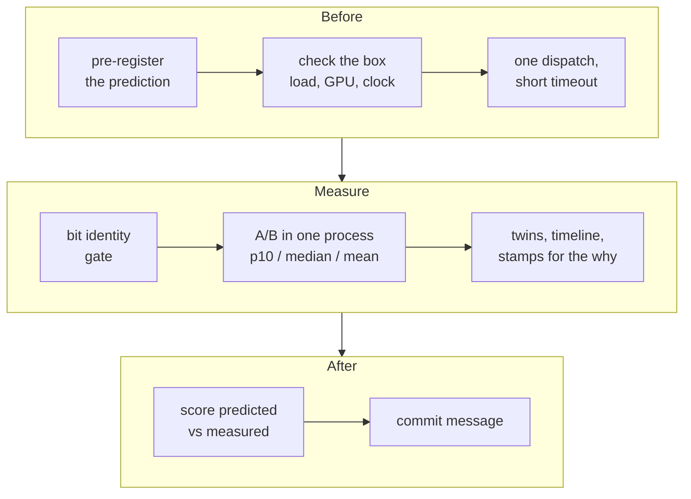

# Measurement

> **In brief**
>
> - Most of the wrong turns in this project were wrong measurements, not wrong ideas.
> - Compare two builds A/B in one process and quote **p10, median and mean**. Find a bound by perturbing it (a twin), not by fitting it. Stamp the wait you think binds.
> - Write the predicted effect down before the build. Check the NPU clock in the same session: 12 threads of floating-point compute dropped it from 1.81 to 1.41 GHz.
> - The numbers in this chapter are **observations from our measurement conditions** (TAPNext and moondream rounds, GPU idle, a shared box). Use them to read a measurement, not as rules: a production load can differ.

**Terms.** A/B = alternating two builds. p10 = the 10th percentile. Twin = a build with one thing removed or doubled, for timing only. TPROF / PROF = in-kernel timer records. CPST = CP-progress stamps. CP = command processor. DDR = shared system memory. AJ = average Jaccard (the DAVIS tracking score). SSM = the state-space (RG-LRU) layer. KTL = the k-step loop kernel. DPM = power level.

## What is the measurement loop?



## A/B in one process

`tapnext/npu/r18/ab.py --a BUILD_A --b BUILD_B [--rounds 10] [--block 22] [--skip 2]`, run through `r16/nrun.sh`.

```text
process:  [ A A A A ... ] [ B B B B ... ] [ A A A A ... ] [ B B B B ... ] ...
            ^ first dispatches after a hardware-context switch are skipped
```

- It alternates blocks of dispatches of the two builds in one process, so background CPU load and drift hit both alike.
- Quote **p10 / median / mean** and the deltas $b - a$. A change is real when all three agree in sign and size. Example: KTL −0.82 ms (60 × 20 blocks; 516d3a9).
- Why this matters: under a background worker, dispatch times split into two clusters ~0.17 ms apart, so a single median of 60 dispatches can land in either ([H20](negative-results.md#h20) <!-- nr: H20 -->).
- Absolute numbers come from `step8.py time` / `sweep` (median and min of many dispatches after 20 warm-up dispatches). The sweep times every depth from one xclbin. TAPNext's best: 28.42 ms at depth 12 (sweep median, 1.808 GHz, gpu_busy 0; HANDOFF round 25).

## Correctness gates

- **Bit identity** first: `step8.py regress --ref full12r9a` must print BIT-IDENTICAL. Every kept TAPNext change since round 9 is bit-identical, so speed changes never need an accuracy round. A numerics change shows its size against NPU-vs-CPU noise.
- **Real weights, region by region**: `step8.py blocks` compares a depth-1 build against the torch block. Random-weight tests missed a GELU that clamped its multiplicand (round 4).
- **Model accuracy**: DAVIS AJ for TAPNext (10 videos, ~7 min on the NPU), a private yes/no frame set for moondream. Judge SSM numerics by DAVIS, not by 30-frame max deviations ([H26](negative-results.md#h26) <!-- nr: H26 -->).
- One dispatch with a short timeout before timing anything new (see [Timeouts](#timeouts-and-recovery)).

## Twins: perturb to find the bound

A **twin** is a build with one thing removed or doubled, used for timing only (its outputs are wrong).

| twin | result | reading |
|---|---|---|
| no-MAC and 2x-MAC GEMM | −16.1 ms and +24.7 ms on 84.0 | the GEMMs are compute-bound, not A-port-bound (RFM round 6 P1; [A1](negative-results.md#a1)) |
| SSMCUT (removes ~1,000 cycles of SSM compute) | chunk 2,289 → 2,034 cycles; input waits 71 → 529 | the SSM was compute-bound by ~255 cycles above an input floor of ~2,030 ([M15.3](../MACHINE.md#m15-3); [M1](negative-results.md#m1), [M2](negative-results.md#m2)) |

**Removal twins with input-wait stamps** measure the distance to a floor directly: the compute shrinks, and the wait that grows is the floor you hit.

> **Pitfall.** Read a twin's per-op walls, never the step delta. A twin with wrong outputs changes downstream data-dependent work. The norm twin "saved" 1.98 ms, while the real asm change gave −0.16..−0.28 ([H17](negative-results.md#h17) <!-- nr: H17 -->), and the chunk-0 twins gave −0.79 and +0.5 for the same lever because the attention's lazy-max flags changed (round 22 K0TWIN). Use twins only where downstream work is data-independent (NTWIN was).

## Timelines

`step8.py timeline` polls, while one dispatch runs, the first and last word every op writes (64 B `sync(FROM_DEVICE)` per probe). The result is a per-op wall-clock timeline of the real program with no trace hardware. It found the BD-step serialisation, the −Oz cost and the slow SSM in one afternoon (round 4).

- **Quantisation**: the polls come every ~16.5 µs, so per-op medians snap to 0 / 16.5 / 33 µs. Use means over blocks 1-11 or effects ≥ 3x the quantum ([H16](negative-results.md#h16) <!-- nr: H16 -->). With ~97 probed words a poll takes ~27 µs, and shifts below ~10 µs are artefacts.
- **`TL_ONLY=<op kinds>`** polls only those ops (3-4 µs polls; `r24/tlo.sh`). Use it for boundaries. The 27 µs timeline once showed a 6 µs shift that was not real (round 24).
- Price a bound over the span of the op that binds, with the cap of the same kind (read vs read+write). A window average hid that the SSM's own span read at 54 GB/s ([L3](negative-results.md#l3) <!-- nr: L3 -->).

## In-kernel stamps and counters

- **TPROF / PROF**: core-timer records written into bytes nobody reads (an output pad) or over first output words (timing builds only). They need the processor-bus enable ([machine.md](machine.md#timers-and-counters)).
- **Performance counters** (KS-P38): MEMORY_STALL and LOCK_STALL per k-step showed the in-situ excess was DMA bank collisions (173.7 + 13.3 cycles; [M4.4](../MACHINE.md#m4-4)).
- **CPST**: the CP writes a word into a core's L1 and a spinning core stamps it, which tells you when the CP passed a point. It showed that the op boundary was 12.2 µs of producer tail, not CP instructions ([M11.3](../MACHINE.md#m11-3)).
- **Judge in-situ rates by the per-tile median.** A mean k-step of 2,588 cycles hid steady k-steps of 2,050 and one op-start wait per op ([H4](negative-results.md#h4) <!-- nr: H4 -->, [A3](negative-results.md#a3)).

A stamp interval contains the call it brackets, so subtract the static call before you compare with a model ([M14.5](../MACHINE.md#m14-5), [H28](negative-results.md#h28) <!-- nr: H28 -->):

| stamp | gross (cycles) | net (cycles) |
|---|---|---|
| `in_need` | 101.5 | ~57.5 |
| `out_begin` | 45 | ~5 |

## One-core benches

A bench of one core is quick and finds hang causes before they cost a multi-core timeout (r9/ksb.py found two). It also lies in predictable ways, so check these:

- Bench the binary you deploy; disassemble it first ([H9](negative-results.md#h9) <!-- nr: H9 -->).
- C++ that pipelines in the bench can be serial in situ ([H10](negative-results.md#h10) <!-- nr: H10 -->).
- A bench that pre-releases locks says nothing about acquire timing. Feed the ring by DMA (`r20/rotdb.py`) ([H11](negative-results.md#h11) <!-- nr: H11 -->).
- Check guard zones on both sides, every stream, and the header you mean ([H12](negative-results.md#h12) <!-- nr: H12 -->).
- A new build name after every source edit; confirm that the elf md5 changed before timing ([H22](negative-results.md#h22) <!-- nr: H22 -->).
- A **lock-free twin** of a modulo kernel cannot hang. Replace each lock op by `add rK, rK, r26` in place and log the sums. It found the KTL hang in one dispatch (`tapnext/research/r24/mkvar.py`).

## Clock and CPU load

Check the NPU clock with `python3 r7/clk.py run --out build/clk` (from `tapnext/npu`, in `npu-iron`; build it once with `clk.py build`). Quiet box: 1.81 GHz. Observed ([M1.4](../MACHINE.md#m1-4); probes `tapnext/research/r23/clkload.sh`, `r25/clkload2.sh`; 12 threads per kind):

| CPU load | package power | NPU clock (GHz) |
|---|---|---|
| idle | 27 W | 1.809 |
| 12 scalar spin threads | ~99 W | 1.810 |
| 6 numpy matmul threads | 96-100 W | 1.809 |
| 12 numpy 512 × 512 fp32 matmul threads (AVX-512) | ~99 W | 1.408 |
| the same with AVX2 (`OPENBLAS_CORETYPE=Haswell`) | 99 W | 1.408 |
| 12 threads of 64 × 64 matmul in L1 | 99 W | 1.584 |
| 12 threads of `np.copyto` on 64 MB arrays | 42 W | 1.808 |

- The drop appeared with many threads of floating-point compute while the package sat at its ~100 W limit. DRAM copies and scalar spin at the same power did not cause it, and vector width did not matter ([M3](negative-results.md#m3) <!-- nr: M3 -->).
- It was not thermal (Tctl 59-71 C). The mechanism (SMU power or current arbitration) is unverified, and GPU load as a trigger is untested.
- While timing, keep `OPENBLAS_NUM_THREADS` and torch threads ≤ 6, or check the clock in the same session.

> **Pitfall.** A/B pairs in one process stay valid under the drop; absolute numbers do not (round 21: 32.3 → 41.0 ms at 1.405 GHz).

## Check the box before timing

- Load: `uptime`. Note the background CPU load (other processes, CP-SAT jobs) in the result.
- GPU: `cat /sys/class/drm/card1/device/gpu_busy_percent`. Record it. GPU load shares DDR with the NPU (moondream: +9 % on the NPU frame with the GPU running, MD RESULTS phase 6).
- Power mode: Turbo for every TAPNext number. moondream phase 2 ran in Default.

## DDR as seen from the NPU

These are observations used to read spans, with the GPU idle. Details in [data-movement.md](data-movement.md#the-ddr-caps).

| direction | cap | source |
|---|---|---|
| aggregate read | ~55-59 GB/s with 8 or more shim → core streams; one stream alone ~7 B/cycle (~12.6 GB/s) | DDRCAP, [M10.4](../MACHINE.md#m10-4) |
| aggregate write | ~50-60 GB/s with 8 columns draining; 12.1 GB/s for one column | DDRW |
| reads plus writes | 63-74 GB/s | |

A span reading at ~95 % of the cap is not necessarily capped. Measure before you price it ([M1](negative-results.md#m1)).

## Timeouts and recovery

- Dispatch every new or changed design once with a short timeout (`run.wait(3_000_000)` µs) before timing it.
- After a timeout, run `journalctl -k | grep -i xdna`, then run a known-good design (bit-exact) to confirm the device recovered. All timeouts so far recovered this way.
- At most 3 timeouts per phase; stop if the device does not recover. Never loop retries on a failing design. Report the timeout count with the round.
- Common hang causes: lock values and conditions (keep conditions 0 / 1), immediates that wrap silently, stale record headers, CP-order deadlocks (read `SEQLOG=1`), and dispatching an `*.unpatched.xclbin` ([G12](negative-results.md#g12), [G16](negative-results.md#g16), [fusion.md](fusion.md#deadlock-rules)).

## Pre-register predictions

- Before a build or probe, write the predicted effect as a range, with the hypothesis it tests, in the notes or PROPOSALS. Score predicted vs measured in the commit message.
- Hits found after the measurement do not count ([H21](negative-results.md#h21)). One number that matches a bound cannot separate two hypotheses ([H2](negative-results.md#h2)).
- Pre-register the in-between outcome too: SSMCUT's two hypotheses both missed, and the registered middle band held (PROPOSALS rev 21).
- More on pricing in [method.md](method.md).

## What didn't work

The method failures are listed above, each next to the rule it produced:

| entry | rule it produced |
|---|---|
| [H4](negative-results.md#h4) | judge in-situ rates by the per-tile median |
| [H9](negative-results.md#h9)-[H12](negative-results.md#h12) | one-core bench checks |
| [H16](negative-results.md#h16) | timeline quantisation |
| [H17](negative-results.md#h17) | read a twin's per-op walls |
| [H20](negative-results.md#h20) | A/B in one process |
| [H22](negative-results.md#h22) | new build name after every edit |
| [H26](negative-results.md#h26) | judge SSM numerics by DAVIS |
| [H28](negative-results.md#h28) | a stamp interval contains the call |
| [L3](negative-results.md#l3) | price a bound over the binding op's span |
| [M3](negative-results.md#m3) | the clock under CPU load |

## Going deeper

- `tapnext/npu/step8.py` (time, sweep, timeline, regress, blocks), `r18/ab.py`, `r24/tlo.sh`, `r19/tprof.py`, `r20/cpst.py`, `r7/clk.py`.
- [SKILL](../../.claude/skills/xdna2-npu/SKILL.md) §8 (verifying and measuring).
- [MACHINE](../MACHINE.md) [M1.4](../MACHINE.md#m1-4), [M11.3](../MACHINE.md#m11-3), [M14.5](../MACHINE.md#m14-5), [M15.3](../MACHINE.md#m15-3).
