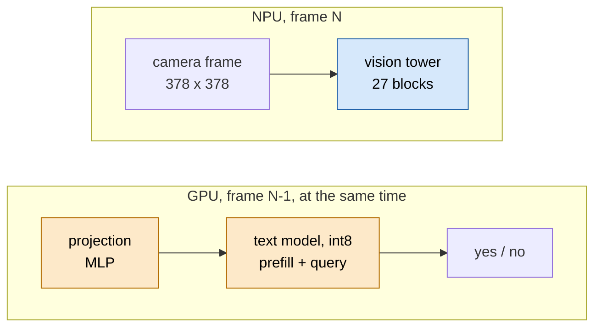

# moondream on Strix Halo

Low-latency VLM inference for local use. moondream2 answers an object-presence (yes/no) question about a camera frame
("Is there a mug in this image? Answer yes or no."). The hardware can be a strong GPU (gfx1151 here) or the XDNA2 NPU, and
this folder covers both. The work predates the TAPNext port and is not active now.

> **In brief**
>
> - On the GPU the yes/no query takes **88.7 ms per frame** (encode 79.6 + query 9.0), against ~340 ms for stock HF bf16 (3.8x),
>   at 98.0 % accuracy on the 493-frame set. Pooling the image tokens to 16 x 16 gives ~65 ms.
> - On the NPU the 27 vision-tower GEMM blocks run as **one program in 33.8 ms per frame**. The whole tower budget is ~75 ms per
>   frame on the NPU alone (phase 12), pipelined with the GPU text side: **27 fps**.
> - moondream3-preview is not better on grounding (44 correct by eye for both) and is ~2.6x slower.
> - The book chapters are in [book/](book/README.md); start with the [overview](book/overview.md).

## Headline numbers

| folder | what | headline |
|---|---|---|
| [gpu/](gpu/README.md) | moondream2 latency on the GPU: fast path, Triton and hand-written HIP WMMA GEMMs, int8 text model | **88.7 ms per frame** (encode 79.6 + query 9.0) vs ~340 ms stock HF bf16 (3.8x), 98.0 % accuracy on the 493-frame set; ~65 ms with image tokens pooled to 16 x 16 |
| [npu/](npu/RESULTS.md) | the moondream2 vision tower on the NPU, phases 1-12 (GEMMs, bfp16, LN, GELU, attention, the asm route) | the 27-block GEMMs in one NPU program: 33.8 ms per frame; tower budget ~75 ms per frame on the NPU alone (phase 12); pipelined with the GPU text side: **27 fps** |
| [moondream3-eval/](moondream3-eval/NOTES.md) | moondream3-preview vs moondream2 on the grounding set | not better (44 correct by eye for both), ~2.6x slower (1.2-1.3 s vs 0.46 s per detect), ~4.5x the GPU memory |

## The split in one picture

The NPU encodes one frame while the GPU answers the previous one, so the rate is set by the slower side, not their sum
([overview](book/overview.md#the-pipelined-27-fps-design)). Blue runs on the NPU, orange on the GPU.

## Where to read next

| you want | go to |
|---|---|
| the map: workload, which side runs what, the tower budget | [book/overview.md](book/overview.md) |
| how the GPU got from ~345 to 88.7 ms | [book/gpu.md](book/gpu.md) |
| how the NPU GEMMs became one 33.8 ms program | [book/npu-gemm.md](book/npu-gemm.md) |
| all chapters, one line each | [book/README.md](book/README.md) |
| the machine-level book (hardware, toolchain, measurement) | [common/book](../common/book/README.md) |

## Raw record

- `npu/NOTES.md` is the lab log per phase and `npu/RESULTS.md` the measured tables. Phase 10 started the asm route and
  the instruction timing table that now lives in `../common/tools/`.
- `gpu/RESULTS.md` holds the full ladder and the discarded avenues. `gpu/gpu_safe.sh` is the one-GPU-job wrapper.
- `gpu/` and `moondream3-eval/` are snapshots; see their SOURCES.md for where the live copies are.
