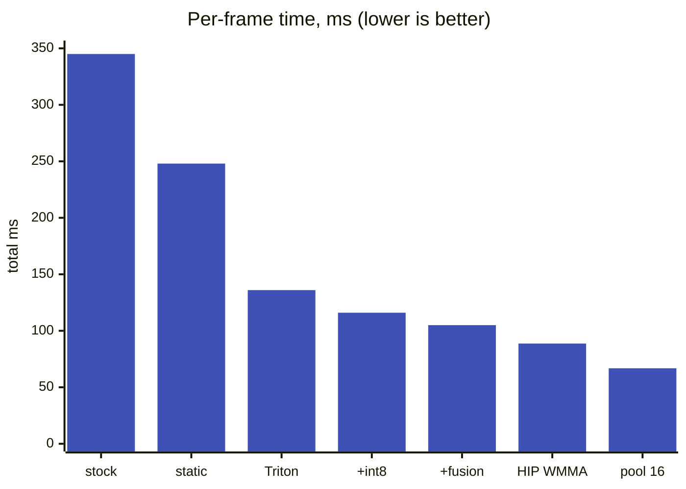

# moondream on the GPU: the fast path

> **In brief**
>
> - The GPU path takes moondream2's yes/no from **~345 ms to 88.7 ms per frame** (3.8x, MEASURED, 493 frames, 98.0 % accuracy, 99.4 %
>   agreement with the stock model; [`moondream/gpu/README.md`](../gpu/README.md)).
> - Four steps made most of it: a re-implementation with static shapes, hand-written GEMMs instead of rocBLAS, int8 for the text model
>   only, and a weight layout that avoids DRAM channel aliasing.
> - A fifth, pooling the image tokens, changes the model input and reaches **~65 ms** at 98.4 %.
> - This path is the baseline the NPU is measured against (vision GEMMs 20.7 ms in situ) and the other half of the pipelined design
>   ([overview](overview.md)).

**Conditions.** gfx1151, torch 2.14 + ROCm 7.14, HIP graphs, median over the test set. For the final numbers another GPU process kept
`gpu_busy` at 93-100 % (idle runs were a few percent faster; `RESULTS.md`, "FINAL round 3").

**Terms.** WMMA = wave matrix multiply-accumulate (the GPU's matrix instruction). LDS = local data share (on-chip scratch). MALL = the
GPU's last-level cache. KV = the attention key/value cache. W8A8 = int8 weights and int8 activations. tv / mug = the two test classes.

## The ladder



| step | encode / query / total (ms) | accuracy | what changed |
|---|---|---|---|
| stock HF bf16 | 245 / 100 / 345 | 97.8 % | baseline |
| static-shape rewrite (`md2fast.py`), bf16 graph | 197 / 51 / 248 | 97.6 % | one crop, no decode loop, no 2,048-wide masked attention |
| Triton GEMMs with fused epilogues | 117 / 19 / 136 | 97.8 % | replaces rocBLAS/Tensile |
| + int8 W8A8 text model | 104 / 12 / 116 | 97.8 % | text only; vision stays bf16 |
| + fusions, shared quantisation | 95 / 9.4 / 105 | 98.0 % | rope + KV write, yes/no-only lm_head |
| **HIP WMMA GEMMs (default)** | **79.6 / 9.0 / 88.7** | 98.0 % | `hip/i8gemm.hip`, tiled weight layout |
| same + pool 16 | 58 / 8.7 / 66.8 | 98.4 % | 729 -> 256 image tokens |

All MEASURED in `moondream/gpu/RESULTS.md` (sections "fast-bf16-graph" to "ROUND 3 SUMMARY"). Throughput is 10.9 frames/s
(`test_throughput.py`, one question) and 21.3 answers/s with two questions per frame, because the second question reuses the image KV
and costs ~2 ms instead of ~10. Inside the 79.6 ms: text int8 GEMMs 48.4, vision bf16 GEMMs 20.7, flash attention ~10, quant/LN/GELU ~6
(MEASURED in situ, `insitu_time.py`).

## Static shapes

The stock path spends its time on things the question does not need. Each saving is MEASURED against the stock path:

| change | saving | why it is allowed |
|---|---|---|
| one vision pass | -40 ms | for a 378x378 input the global and local crops are identical (verified bit-identical) |
| no decode loop | -50 ms | the answer is read from the yes/no logits of one 32-token prefill |
| mask-free flash attention over exactly 730 keys | in the 248 ms step | the 730-token image prefill needs no masked attention over a 2,048-slot KV cache |
| HIP graphs | only 2-4 % | shapes are fixed so everything is captured, but the pipeline is GPU-bound |

Top-1 token is identical to stock on all checked frames, logits cosine > 0.9997 (`verify.py`).

## GEMMs: from rocBLAS to a hand-written WMMA kernel

- **Hypothesis: the libraries are the limit.** Nothing in rocBLAS, hipBLASLt, TunableOp or inductor-Triton exceeds ~32 TFLOPS at M = 729,
  against a WMMA peak of ~57 (hot-cache microbench, `gemm_bench.py`), and small-M query GEMMs reach 1.4-2.2 TFLOPS. Hand-written Triton
  with fused bias/GELU epilogues cut encode GEMM time 172 -> 94 ms and query GEMM time 42 -> 15 ms (MEASURED).
- **The "int8 is 2x" assumption was wrong** ([N24](../../common/book/negative-results.md#n24) <!-- nr: N24 -->). The probes (`wmma_peak_*` in `hip/i8gemm.hip`) give int8 WMMA 57 TOPS and bf16 WMMA 55 TFLOPS,
  the same issue rate. Int8 only halves operand traffic. It still pays for the text model, whose 1.2 B parameters are streamed every frame.
- **The HIP kernel**: 128x128x128 tile, 8 waves of 32x64, register prefetch of the next K tile, one padded LDS buffer, dequant, bias and
  GELU fused. Cold-cache int8: 35-41 TOPS (~70 % of peak; Triton 31-33). bf16 vision shapes 33-37 TFLOPS except K = 8192 at 23.4.
  The kernel is core-bound (barriers, LDS latency): an L2-resident control reached only 41-43 TOPS.
- The HIP outputs are bit-identical to the Triton ones (same int32 sums, same fp32 WMMA order; GELU rounded to bf16 first like torch).
  That kept 98.0 % and 99.4 % agreement across the change.

### Cold, not hot

The first HIP build was *slower* in situ than Triton although faster in the microbench. The weights are 1.2 GB
per frame, far above the 32 MB MALL, and the natural (N,K) layout with K = 2,048 or 8,192 bytes per row puts the chunk at the same k
of every row on one DRAM channel (power-of-two stride). A cold bench over 8 weight copies reproduced it: 730x8192x2048 took 1,166-1,298 us
cold against 673-688 hot. The fix is a tiled layout `[N/128][K/TK][128][TK]`, so each work-group streams one contiguous 16 KB block per K step.

```text
natural (N,K):  row n = [ k0 | k1 | k2 | ... ]   row stride K bytes
                                                 (2,048 or 8,192)
                the chunk k_i of every row sits at a power-of-two stride
                -> all rows hit the same DRAM channel

tiled:          [N/128][K/TK][128 rows][TK]
                one contiguous 16 KB block per work-group per K step
                -> each work-group reads sequentially
```

| layout | text GEMMs | vision GEMMs |
|---|---|---|
| natural (N,K) | 58.1 ms | 23.6 ms |
| tiled | 48.4 ms | 20.7 ms |

MEASURED in situ (`coldbench.py`, `insitu_time.py`).

## Pooling: the biggest lever, a different model input

The 729 projected tokens are average-pooled 27x27 -> kxk before the text prefill; the vision tower still runs at full size.

| pool | tokens | total | note |
|---|---|---|---|
| none | 729 | 88.7 ms | default |
| 19 | 361 | 73.5 ms | |
| **16** | 256 | **66.8 ms** | **98.4 %** (tv misses 3 of 46 found frames, 5 false positives) |
| 14 | 196 | 61.5 ms | |
| 12 | 144 | 55.6 ms | fails the sanity gate (the reference mug frame answers no) |
| 9 | 81 | 51.0 ms | loses accuracy |

Pool 16 is the recommended fast mode, and the one the NPU pipeline targets: it makes the text side 34 ms, so the NPU tower only has to
fit in ~35 ms. The accuracy table of the pooled path with bf16 NPU numerics is in [numerics](numerics.md).

## Noise and the harness

- Triton's autotuner picked different tiles in different processes, so the fp32 accumulation order changed. 48 of 493 frames have a
  yes/no margin below 1, so a few flip: identical configs scored 97.0-98.0 %. `cache_results=True` pins the choice (MEASURED, RESULTS "Reproducibility").
- Frame-to-answer adds JPEG decode and a LANCZOS squash outside the timed region: ~3 ms with decode at 1/2 scale (bit-identical on 99 frames, 2.5x
  faster), 8 ms on a loaded CPU.
- Gates for every change: accuracy >= 95.8 % (stock minus 2 points), the two sanity frames, and agreement with stock.

## What worked

- Static shapes and the yes/no logits: 345 -> ~250 ms before any kernel work.
- Own GEMMs with fused epilogues, then int8 for the text model (116 -> 105 ms), then the HIP kernel with the tiled layout (105 -> 88.7 ms).
- Benchmarking cold: the hot microbenchmarks hid a 2x in-situ slowdown.
- Pooling to 16x16 for the fast mode; the answer quality held on this set.

## What didn't work

| idea | outcome | why | index |
|---|---|---|---|
| **fp16** (`fast-fp16-graph`) | rocBLAS fp16 kernels are faster (203 vs 248 ms) but accuracy drifts to 96.1 % | numerics drift | [N22](../../common/book/negative-results.md#n22) <!-- nr: N22 --> |
| **int8 for the vision tower** (`fast-all-int8-graph`) | 113 ms but 89.2 % (53 tv false positives) | SigLIP activations do not survive per-token int8; [F6](../../common/book/negative-results.md#f6) <!-- nr: F6 --> is the NPU side: the dense int8 mmul runs at the bfp16 rate | [N23](../../common/book/negative-results.md#n23) <!-- nr: N23 --> |
| **"int8 is 2x bf16"** | the register-only probes give 57 vs 55 T(FL)OPS | same issue rate | [N24](../../common/book/negative-results.md#n24) <!-- nr: N24 --> |
| **hipBLASLt int8** | 33-41 TOPS | only 6-8 Tensile kernels exist for gfx1151, no per-row/column scaling, so a separate dequant pass | [N25](../../common/book/negative-results.md#n25) <!-- nr: N25 --> |
| **TunableOp**, **torch.compile**, `_int_mm`, fp8 | TunableOp deadlocks with HIP graph capture (process hangs in a futex), eager it reaches 198 ms; torch.compile: no gain; `torch._int_mm` runs at bf16 speed; fp8 `_scaled_mm` is unsupported | library limits on this chip | [N26](../../common/book/negative-results.md#n26) <!-- nr: N26 --> |
| **Fused residual in the GEMM epilogue** | slower, and agreement 98.8 vs 99.4 % | the autotuner chose worse tiles. Also **folding the two K halves of the projection** (input is `cat([x, x])`): exact in real arithmetic, but bf16 rounding of the summed weight changes decisions (98.4 %) | [N27](../../common/book/negative-results.md#n27) <!-- nr: N27 --> |
| **Other HIP tile shapes**, prefetch distance 2, `s_setprio`, 16-wave work-groups | the 128x128 tile stays best | smaller tiles balance the tail of the N = 2,048 shapes (96 work-groups on 40 CUs) but lose more per work-group | [N28](../../common/book/negative-results.md#n28) <!-- nr: N28 --> |
| **WMMA flash-attention prefill** (`hip/attn.hip`) | 7-9 % faster than SDPA per call, -0.5 ms in situ (inside noise); left off | a 32-rows-per-wave variant spills 217 registers | [N29](../../common/book/negative-results.md#n29) <!-- nr: N29 --> |
| **Hot-cache microbenchmarks** as a guide for weight-streaming kernels | hid a 2x in-situ slowdown (all earlier "TOPS" had to be re-taken cold) | weights far exceed the cache | [N30](../../common/book/negative-results.md#n30) <!-- nr: N30 --> |
| the natural (N,K) layout | aliased DRAM channels until the tiled layout fixed it | power-of-two stride | [N31](../../common/book/negative-results.md#n31) <!-- nr: N31 --> |
| **Pool <= 12** | fails the sanity gate | too few tokens | [N32](../../common/book/negative-results.md#n32) <!-- nr: N32 --> |
| **Triton's autotuner** | picked different tiles per process and flipped borderline frames (97.0-98.0 % for identical configs) | changed fp32 accumulation order; `cache_results=True` pins it | [N33](../../common/book/negative-results.md#n33) <!-- nr: N33 --> |

## Lessons

- Measure weight-streaming kernels with more weights than the last-level cache. Check the stride of the layout before the kernel.
- Check a hardware ratio (int8 vs bf16 peak) with a register-only probe before building a design on it.
- Keep numerics bit-identical across kernel swaps when the accuracy gate is a few frames wide; otherwise each run measures noise.
- The biggest single lever (token pooling) changes the model's input. Report it as an option with its own accuracy row.

## Going deeper

- `moondream/gpu/RESULTS.md` (every run with keep/discard), `moondream/gpu/README.md` (commands, file map), snapshot commit `5afb31f`.
- Kernels and wrappers: `moondream/gpu/hip/i8gemm.hip`, `hgemm.py`, `md2fast.py`, `tgemm.py`, `fused.py`; harness `bench.py`, `test_hgemm.py`, `verify.py`.
- Next: [overview](overview.md) for the split between GPU and NPU, [numerics](numerics.md) for the bfp16 and bf16 emulations that were
  built on this path (`bfpemu.py`, `bf16emu.py`).
