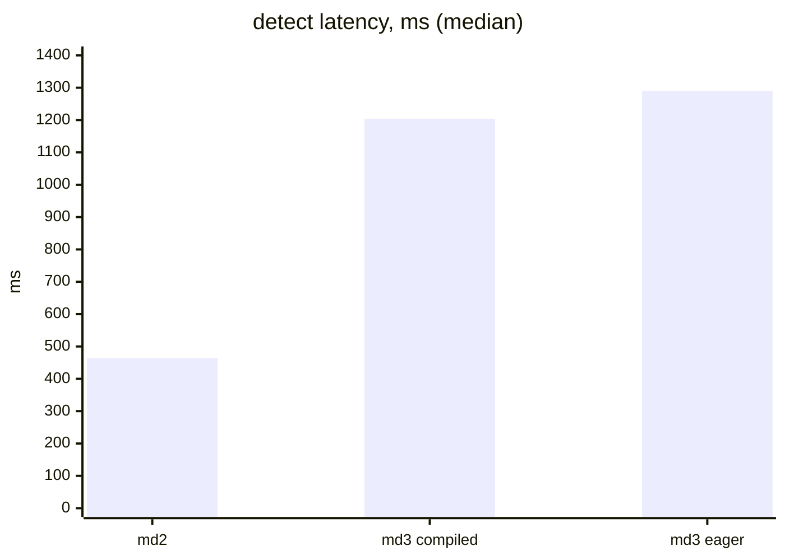

# moondream3-preview and moondream 0.5B: two other models, both rejected

> **In brief**
>
> - Grounding queries (a box or point for a named object) are the second use of moondream2, which answers them in ~460 ms per query. On 2026-10-09 moondream3-preview was benchmarked against moondream2 on the same 50 queries.
> - **Not better at grounding on this set**: the same 44 correct by eye, one more wrong, the tiny-object case lost.
> - **~2.7× slower** (detect 1,290 ms against 464 ms) and **~4.5× the GPU memory** (19 GB against 4.4 GB) (MEASURED, [`moondream3-eval/NOTES.md`](../moondream3-eval/NOTES.md)).
> - Earlier, the 0.5B model was tried as a smaller yes/no gate and failed outright: **38.5 % accuracy against 98.0 %**.
> - Neither changes the plan in [overview](overview.md): moondream2 stays, on the [GPU fast path](gpu.md). moondream3 ran on the GPU through `gpu_safe.sh` and the 0.5B on the CPU; no NPU was involved.

**Terms.** md2 / md3 = moondream2 / moondream3-preview. IoU = intersection over union of two boxes. GTT = GPU-visible system memory. AUC = area under the ROC curve. tv, mug = the two target objects of the yes/no gate.

## How was the evaluation run?

- **Pinned and reviewed before running.** `moondream/moondream3-preview` at commit `5112966d`, safetensors only (four shards, 18.5 GB bf16, 9.27 B parameters; the pickle `model_fp8.pt` was not downloaded),
  every file hashed against the Hub's LFS oids. All 11 `.py` files were read first.
- **Findings of the code review:**
    - the tokenizer is fetched unpinned from `main` on every construction (replaced with a pinned local file and `HF_HUB_OFFLINE=1`);
    - a LoRA-adapter path calls the vendor's API and `torch.load`s a download, reachable only if a caller passes an `adapter` setting (we never do);
    - no subprocess, `eval` or sockets otherwise.
- **Licence:** BSL 1.1, Apache-2.0 after two years; internal use is fine.
- **Segmentation is not in the open weights**: no `segment` method, template or mask head. It is cloud-only, so it was not tried.
- **Same grading as the earlier replay script:** first box with IoU > 0.5 against a labelled answer; points inside the smallest labelled box.
  On md2's old results the scorer gives 44 correct / 4 wrong / 1 unlabelled, matching the earlier 44/48 baseline.
- **Queries:** 50 grounding queries on everyday objects (a private set, not included) on full 720×1280 frames.
- **Environment:** same venv as the fast path (torch 2.14.1 + ROCm 7.14, transformers 4.57.6), GPU otherwise idle, medians over 50 queries.

## Results

| | moondream2 | md3 eager | md3 compiled |
|---|---|---|---|
| load (warm cache) | 2.7 s | 6.1 s | 6.1 s + 39 s compile + 19 s warm-up |
| GTT after load / peak | 3.8 / 4.9 GB | 17.9 / 19.3 GB | 19.1 / 19.5 GB |
| detect (encode + decode) | 464 ms (p90 769) | 1,290 ms (p90 1,325) | 1,204 ms |
| point | 440 ms | 1,186 ms | 1,130 ms |
| encode alone | 370 ms | 841 ms | 842 ms |
| detect on a pre-encoded image | 92 ms | 450 ms | 365 ms |
| detect: correct / wrong / unlabelled (49 graded) | 44 / 4 / 1 | 42 / 3 / 4 | same boxes as eager on 43 of 50 |
| point: correct / wrong / partial / unlabelled | 41 / 7 / 0 / 1 | 43 / 4 / 1 / 1 | same |
| small-object query, object present (12), detect | 12 | 11 | |
| absent (10): nothing returned, detect / point | 8 / 4 | 8 / 6 | |

After judging the four unlabelled md3 boxes by eye (tiny-light boxes correct, tighter than the labels; a blurred strip and a neighbouring object wrong), md3 detect is 44 correct / 5 wrong against 44 / 4.

| | md3 vs md2 |
|---|---|
| Gains | one two-instance query (picks the left one); the black frame (returns nothing) |
| Losses | a tiny far object (boxes a bottom-edge strip); boxes an unrelated part of the scene for an absent object |
| Caption and query latency (5 frames, default sampling) | eager 2.95 s short caption, 2.91 s query, 7.6 s with reasoning, against 1.39 s and 1.08 s for md2; compiled 2.27 and 1.91 s |

md3 is better as a presence test through `point` (6 of 10 absent frames correct against 4), which is not the grounding use case. All of this is MEASURED.

## moondream 0.5B as a yes/no gate

- **No usable checkpoint.** There is no `vikhyatk/moondream-0.5b`; the only release is the January 2025 ONNX bundle (`moondream-0_5b-int8.mf`, W8A8 `DynamicQuantizeMatMul`, fp16 activations)
  for a CPU-only client (onnxruntime); no bf16 weights, no HF model class; the current client is the closed Kestrel engine without ROCm.
  So the evaluation ran the official int8 file on CPU (16 threads).
- **Result** on the same 493 frames and prompt:

| tv | mug | all | agreement with stock |
|---|---|---|---|
| 36.8 % | 46.2 % | **38.5 %** | 39.1 % |

- Recall is 100 % (every found frame is a yes), but 303 of 440 negatives also answer yes, including the black sanity frame (MEASURED, [`gpu/RESULTS-0.5b.md`](../gpu/RESULTS-0.5b.md)).
- The model captions the frames sensibly, so it is yes-acquiescence on plausible objects, not a pipeline fault: four wordings stayed biased, a control question about a giraffe answered no on all 18 frames,
  and the client's own multi-crop preprocessing gave the same decisions.
- **Salvage by threshold**: the yes-no margin separates tv (AUC 0.998; in-sample threshold +2.6 gives 99.0 %) but not mug (AUC 0.908, 7 positives overlapping the negatives).
  Thresholds fitted on 53 positives from a few sessions are not a deployable rule without a held-out set per object.
- **CPU latency** 640 ms encode + 41 ms logits; a GPU port was not made. A ceiling of ~25-35 ms per frame was estimated from FLOPs (0.67 TFLOP against 2.3 for moondream2),
  EXTRAPOLATED, not worth building at 38.5 %.

## What worked

- Reading all third-party code before running it, pinning revisions and running offline: the only network paths were found and closed.
- Re-using the earlier grader on the old results first (44 correct / 4 wrong) to validate the harness before judging the new model.
- Looking at the unlabelled boxes by eye rather than counting them as wrong: two of the four unlabelled md3 detections (the tiny lights) were correct.
- A prompt/caption probe and a control object before concluding the 0.5B failure was real.

## What didn't work

| Idea | Outcome | Why (lesson) | Index |
|---|---|---|---|
| **moondream3-preview for grounding** | No accuracy gain, 2.7× latency, 4.5× memory | The one clear win (`point` as a presence test) is not the grounding use case | [N34](../../common/book/negative-results.md#n34) <!-- nr: N34 --> |
| **`model.compile()`** | The first attempt was the no-op `nn.Module.compile` and detect took ~2.2 s for unexplained reasons (ignored); the real `model.model.compile()` gained ~7 % (1,204 against 1,290 ms) after a 39 s compile | Check that compile actually compiled | [N36](../../common/book/negative-results.md#n36) <!-- nr: N36 --> |
| **moondream 0.5B** | 38.5 % | No checkpoint to port to the GPU; the threshold rescue works for one object of two | [N35](../../common/book/negative-results.md#n35) <!-- nr: N35 --> |
| **Segmentation** | Not tried | Only in the vendor cloud | |

## Lessons

- Compare models on the target metric and the target queries, with the labelled grader reproduced first. Two models can look alike on aggregate and differ on the one hard case that motivated the work.
- A smaller model that answers yes to everything plausible has full recall and no value as a gate; check the black frame and a control object.
- A pre-release model's latency (1.3 s) and memory (19 GB) matter more than a point or two of accuracy on a shared box.

## Going deeper

- `moondream/moondream3-eval/NOTES.md` (all numbers, code review), `bench.py`, `score.py`, `compare.py`, `overlay.py`; `moondream/gpu/RESULTS-0.5b.md`, `probe05.py`, `eval05.py`; snapshot commit `5afb31f`.
  The outputs and the private test frames are not in the repo.
- The fast path both models were compared with: [gpu](gpu.md). The overall plan: [overview](overview.md).
