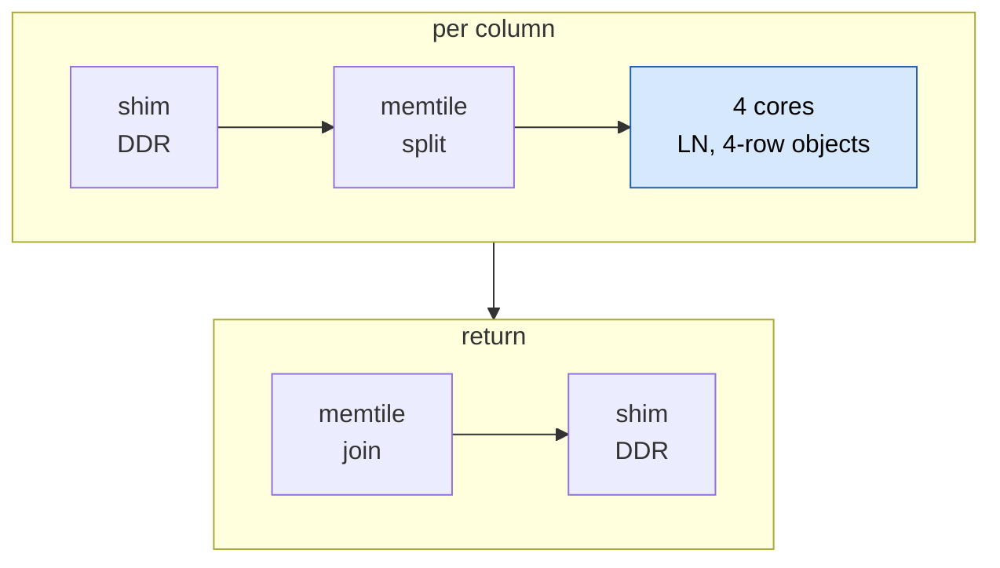

# moondream NPU elementwise: GELU, LayerNorm, LayerNorm + residual

> **In brief**
>
> - The tower's elementwise work is small in arithmetic and large in time. GELU in fp32 in the fc1 epilogue would have cost **~120 ms per frame**,
>   because AIE2P has no native fp32 vector arithmetic (MEASURED per op, extrapolated ×27; [`p6`](../npu/p6/)).
> - Rewriting everything in bf16, with fp32 only inside the MAC unit, gives **LayerNorm 116 µs and LayerNorm + residual 146 µs, both bit-exact** to the bf16 reference,
>   and **GELU +0.56 ms per fc1 (~15 ms per frame)** at 0.998 % one-ulp flips (MEASURED, [`p8`](../npu/p8/), MD RESULTS phase 8).
> - GELU is the largest remaining piece of the elementwise budget: its schedule runs at 492 bundles per 64 elements against a slot bound of ~114
>   and was not hand-scheduled (phases 11-12).
> - The general rules are in [elementwise](../../common/book/elementwise.md); this chapter is the moondream instance.

**Terms.** fc1 = the first MLP linear (729 × 1152 × 4304). bf16 = 16-bit brain float. MAC = multiply-accumulate unit. A bundle = one VLIW instruction word.
BD = DMA buffer descriptor. L1 = a core's local memory. LN = LayerNorm. ulp = unit in the last place.

## Phase 6: the fp32 plan fails

Hypothesis: fuse tanh-GELU into fc1's `acc_store` in fp32 (the accumulator is fp32 anyway). It built and was correct (0.0226 % of outputs one bf16 ulp off,
rms at the bf16 floor), but fc1 took **5.1 ms against 0.56 ms** without GELU (MEASURED, `d8_fc1g`).

The cost model: fp32 vector ops are emulated at ~21 bundles per 16-lane op, so ~1.3 cycles per element per op.

$$\text{GELU} \approx 40 \text{ ops} \times 1.3 \approx 55 \text{ cycles per element}$$

The int8 dequant epilogue of phase 4 (3 ops) paid 6 cycles per element for the same reason.

| LayerNorm / softmax (fp32) | cost |
|---|---|
| fp32 LayerNorm (`p6/ln.py`, `ln.cc`) | 246 µs per pass, ~13.5 ms per frame |
| softmax with an fp32 exp per score | priced at ~80 ms per frame |

Getting even the GELU to build took four changes:

- no inlining into the 12×12 block loop (16 KB program memory);
- 16-lane vectors (64-lane temporaries spilled 5.5 KB of stack);
- two chains per out-of-line call;
- a larger worker stack.

Conclusion: elementwise math on this NPU is bf16 (native 32 lanes) with fp32 only in reductions.

## Phase 7-8: bf16 kernels and the right GELU form

### Accuracy decides the form first

A GPU emulation (`bf16emu.py`, [numerics](numerics.md)) rounded every op to bf16 and measured per-op error:

| op | relative rms error |
|---|---|
| LayerNorm | 3.7-4.4e-3 |
| softmax | 4.2-7.6e-3 |
| GELU, tanh form $1 - 2/(e^{2u}+1)$ | **1.4-2.1e-2** (cancellation) |
| GELU, sigmoid form $x / (1 + e^{-2u})$ | 0.5-4.5e-3 |

The two GELU forms are the same function (MEASURED, `moondream/gpu/BF16_ELEMENTWISE.md`). At the task level, with only GELU rounded to bf16:

| form | false positives (exact path: 8) | decision flips | max margin shift |
|---|---|---|---|
| tanh | 14 | 10 | 2.22 |
| sigmoid | 13 | 5 | 0.97 |

### GELU kernels

fc1 729×1152×4304, `p7/` then `p8/`:

| variant | vs the sigmoid reference | bundles per 64 elements | fc1 µs (without GELU 560) |
|---|---|---|---|
| fp32, emulated | 0.0226 % one-ulp | ~3,600 (1,806 per 32) | 5,100 |
| bf16 tanh form, bf16 Horner | 29.96 % one-ulp, rms 3.55e-3 | 420 | 1,168 (contended) |
| sigmoid form, bf16 Horner exp, bf16 Newton reciprocal | 38.8 % one-ulp, rms 3.8e-3 | 392 | 948 |
| **sigmoid form, split-operand exp and reciprocal** | **0.998 % one-ulp, rms 1.5e-4, max 3.9e-4** | 492 | **1,117** |

**The split trick.** Take an fp32 value in the accumulator as $x = x_\text{hi} + x_\text{lo}$ (two bf16 vectors from one MAC). Every product is then three MACs, accumulated in fp32:

$$a b \approx a_\text{hi} b_\text{hi} + a_\text{hi} b_\text{lo} + a_\text{lo} b_\text{hi}$$

This gives ~$2^{-16}$ precision through a degree-4 Horner and two Newton steps using only native MAC-unit ops. It costs ~1.3 bundles per element and is shared with
the attention softmax (`p8/expsplit.h`).

Result: +0.56 ms per fc1, **~15 ms per frame** ($27 \times 0.56$, MEASURED per op). The native exp2/tanh are too coarse to replace it
([F7](../../common/book/negative-results.md#f7) <!-- nr: F7 -->).

### LayerNorm

`p7/ln.cc`, `ln.py`, 768×1152 over 32 cores. A column's shim feeds a memtile that splits to four cores (objects of 4 rows) and joins back; gamma/beta come once.

Gamma and beta enter once per column. Inside a core the chain is, in order:

1. fp32 mean and variance through the bf16 MAC unit: `x * 1`, `d * d` with $d = \text{bf16}(x - \text{bf16}(\text{mean}))$.
2. rstd by a scalar bit-trick plus three Newton steps (no libm).
3. bf16 rounding after each of $(x - \text{mean})$, $\cdot\,\text{rstd}$, $\cdot\,\gamma$, $+\,\beta$.

**Bit-exact against the reference, 116 µs uncontended** (142 µs under GPU load); 55 per frame, ~6.4 ms.

### LayerNorm + residual

`p7/ln_res.py`: $y = \text{LN}(x + \delta)$ and $x' = x + \delta$ from one pass, so the residual add costs nothing extra.
Objects are one row of `[x | delta]`, gathered per column by one 4-D shim pattern (sizes `[24, 4, 2, 1152]`); two-row objects exceed the shim's 10-bit wrap and decompose into more than 16 BDs.
Both outputs bit-exact, **146 µs**, 54 per frame, ~8 ms.

Fusing the residual into the GEMM epilogues was not built: a core has two input channels (A and B), and a residual tile would need a third stream or 166 KB per column in the memtile.

## Phase 11-12: why GELU stays at 492 bundles

The slot bound of the phase-8 epilogue (`gelu_b2`) is ~114 vector-slot ops per 64 elements (52 `vmac.f`, 16 `vmul.f`, 20 `vsub.f`...) and ~110 in the store slot (55 fp32-to-bf16 conversions).

| | bundles per 64 elements |
|---|---|
| Slot bound | ~114 |
| Peano (94 spills in phase 11, 74 in the phase 12 table; 154 nops) | **492** |

That is 4.3× over the bound, ~11 of the 15 ms (MEASURED, MD RESULTS phase 11-12).

Phase 12 tried to give the scheduler independent work: the same arithmetic as three stage loops with L1 staging.

| variant | result |
|---|---|
| rolled | **1,177 µs**, bit-identical output |
| fully unrolled, 2 vectors | 471 bundles, 70 spills |
| fully unrolled, 4 vectors | 469 bundles, 122 spills |
| fully unrolled, 8 vectors | 481 bundles, 302 spills |

Peano issues about one op per bundle (467 non-nop ops in 470 bundles): the loop is allocation-bound, so each extra chain becomes spills
([B12](../../common/book/negative-results.md#b12) <!-- nr: B12 -->, [elementwise](../../common/book/elementwise.md#gelu)).

A hand schedule needs a list scheduler with register allocation over ~80-op chains (12 × registers allow ~3 chains) and the exact Peano forms for the fp32-to-int emulations.
Estimated 150-200 bundles per 64 elements, GELU 15 → 5-6 ms per frame. Not started.

## What worked

- The sigmoid form with split-operand exp: 38.8 % → 0.998 % flips for 169 µs more per fc1.
- Doing the reductions in the MAC unit (`x * 1`, `d * d`) so LN stays bf16 and bit-exact at 116 µs, half the fp32 version.
- Emulating the exact bf16 op chain on the GPU first, then asking the kernel to match it to the bit.
- A one-row-object gather for LN + residual: residual adds for free.

## What didn't work

| Idea | Outcome | Why (lesson) | Index |
|---|---|---|---|
| Staged GELU chains for Peano | No gain | Allocation-bound. The asm route, or fewer ops | [B12](../../common/book/negative-results.md#b12) <!-- nr: B12 --> |
| Hardware exp2, tanh and reciprocal for the GELU and softmax | Too coarse | | [F7](../../common/book/negative-results.md#f7) <!-- nr: F7 --> |
| The 8-lane bf16 max (also hit in phase 8 attention) | Wrong values | | [F8](../../common/book/negative-results.md#f8) <!-- nr: F8 --> |
| fp32 elementwise on AIE2P | 120 ms per frame for GELU alone, 13.5 ms for LN | Emulated: a hardware fact | [N17](../../common/book/negative-results.md#n17) <!-- nr: N17 --> |
| GELU in the tanh form in bf16 | 1.4-2.1e-2 per call | Cancellation; the sigmoid form is 5-10× better | [N18](../../common/book/negative-results.md#n18) <!-- nr: N18 --> |
| A plain bf16 Horner exp and Newton reciprocal | 38.8 % one-ulp flips, rms 3.8e-3 | The split-operand version is needed | [N19](../../common/book/negative-results.md#n19) <!-- nr: N19 --> |
| A residual add in the GEMM epilogue | Not built | No third input stream | [N6](../../common/book/negative-results.md#n6) <!-- nr: N6 --> |
| Fusing GELU into the block loop; 64-lane fp32 temporaries | Did not link; spilled 5.5 KB of stack | Program memory | [N20](../../common/book/negative-results.md#n20) <!-- nr: N20 --> |
| GELU hand schedule | Open | The bound is ~114 bundles, the compiler gets 492 | [N21](../../common/book/negative-results.md#n21) <!-- nr: N21 --> |

## Lessons

- Count what the unit does natively before porting an op. fp32 vector math is emulated, so the plan changed in one measurement (5.1 vs 0.56 ms).
- Choose the numerically stable form of a function (sigmoid, not $1 - 2/(e+1)$) before spending effort on kernel accuracy.
- Split a value into hi and lo bf16 and accumulate three products in fp32 when you need more than bf16 precision from MAC-only hardware.
- Compare the compiler's bundle count with the slot bound. A 4× gap at one op per bundle means allocation, and independent chains do not fix it.

## Going deeper

- `moondream/npu/NOTES.md` phases 6-8 and 11-12; code `p6/ln.{cc,py}`, `p7/ln_res.py`, `p8/expsplit.h`, `p8/mm_f32acc.cc` (`-DGELU_BF16`), `p12/mm_f32acc.cc` (`-DGELU_STAGED`), `p12/fnsize.py`.
- Emulations: `moondream/gpu/bf16emu.py`, `bf16emu_check.py`, `BF16_ELEMENTWISE.md`.
- General: [elementwise](../../common/book/elementwise.md#the-bf16--fp32-rules), [machine](../../common/book/machine.md), [toolchain](../../common/book/toolchain.md#peano-llvm-aie).
