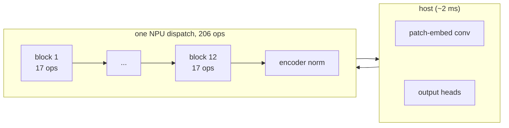
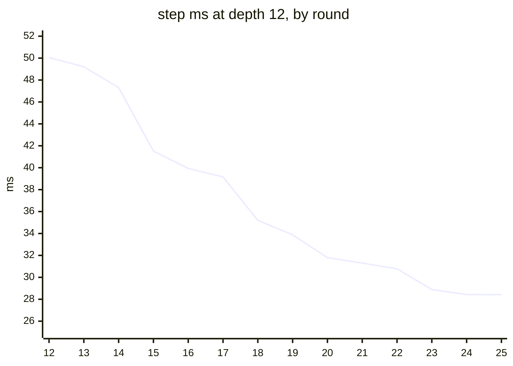

# TAPNext++ on the XDNA2 NPU

TAPNext++ is a point tracker: given a video frame and up to 48 query points, it returns where each point is now and whether it is visible.
Here the **whole step (12 blocks of SSM + ViT + attention) runs as one fused NPU dispatch per frame**, with only the patch embedding's conv and the output heads (~2 ms) on the host.
The output is bit-identical to the round-9 reference build `full12r9a`. Work is paused after round 25.

## Headline

Best build `full12r24z` (`full12r25z` rebuilt it byte-identically). Conditions: Turbo, NPU clock 1.808 GHz, gpu_busy 0.

| depth | step ms (sweep median) | DAVIS AJ, 10 videos |
|---|---|---|
| **12** | **28.42** | **70.84** |
| 10 | 23.83 | 69.90 |
| 8 | 19.09 | not run |
| 6 | 14.40 | not run |

Reference: CPU bf16 AJ 70.98 on the same 10 videos (70.54 is the GPU emulation of a bf16 trunk, RESULTS 3).
The first single-program version took 269.1 ms; the floor read off the current kernels is ~25.2 ± 0.9 ms (EXTRAPOLATED, [ledger](book/ledger.md)).

## How the step is organised



Each block is norm, GEMM, SSM, GEMM, then three more norm + GEMM groups, one of them attention; the block count is chosen at run time by swapping the instruction stream.
Details in [step-design](book/step-design.md).

## Progress (depth-12 step, best build at the end of each round)



<details><summary>The table behind the chart</summary>

| round | build | ms |
|---|---|---|
| 12 | full12r12e | 50.05 |
| 13 | full12r13f | 49.21 |
| 14 | full12r14f | 47.31 |
| 15 | full12r15m | 41.52 |
| 16 | full12r16z | 39.94 |
| 17 | full12r17d | 39.16 |
| 18 | full12r18m | 35.20 |
| 19 | full12r19z | 33.88 |
| 20 | full12r20z | ~31.8 (quiet-box estimate; -2.07 vs r19z in one process) |
| 21 | full12r21k1 | 31.30 |
| 22 | full12r22z | 30.78 |
| 23 | full12r23z | 28.89 |
| 24 | full12r24z | 28.43 |
| 25 | full12r25z (= r24z bytes) | 28.42 |

</details>

## Rebuild and verify

From `tapnext/npu` (the script `cd`s into the working copy of this folder under `$SHM_SCRATCH`, a symlink to it).
The build takes ~10 min of CPU and runs in Docker only.

```bash
r24/try24.sh NAME [--sweep]          # --sweep also builds depths 10 / 8 / 6 and times them
                                     # NOREG=1 / NOTIME=1 skip the regress / timing

# verify
r16/nrun.sh NAME.reg python3 step8.py regress --build full12NAME --depth 12 --ref full12r9a
                                     # must print BIT-IDENTICAL
r24/lint.sh full12NAME               # must report 0 asmlint errors
r16/nrun.sh NAME.ab python3 r18/ab.py --a full12r24z --b full12NAME
                                     # A/B in one process (p10 / median / mean)
TMO=3000 ./s8.sh LOG davis --build full12NAME --depth 12 --videos 10   # DAVIS AJ
```

- Every switch of the best build is listed in `npu/HANDOFF.md` (round-25 block). Each round's kept change can be turned off by an env switch (e.g. `STATS64=0`, `OPPRE2=0`); see the `try2N.sh` headers.
- The build chain is `r24/try24.sh` → r23 → r22 → r21 → r20 → r18 → `r17/xtry.sh` → `common/tools/try.sh`; then `r20/csplit20.sh` patches the lowered MLIR and rebuilds the xclbin.

> **Pitfall.** Never dispatch `build/*.unpatched.xclbin`.

## Crop study

Tracking a point group from a moving crop, with the recurrent state shifted along with the crop, is effectively lossless at W = 192 / 160 and costs ~1 AJ at W = 128 (CPU, 10 videos).
Without the state shift AJ collapses. The NPU speed-up is estimated, not built. See [crop-study/README.md](crop-study/README.md) and [the chapter](book/crop-study.md).

## Where to read next

| I want | go to |
|---|---|
| the chapters (design, GEMM, attention, SSM, norms, boundaries, numerics, ledger, crop study) | [book/README.md](book/README.md) |
| where the 28.4 ms go and what is left | [book/ledger.md](book/ledger.md) |
| the machine-level book (hardware, toolchain, measurement) | [../common/book/README.md](../common/book/README.md) |
| refuted ideas, classified | [../common/book/negative-results.md](../common/book/negative-results.md) |
| the hardware model | [../common/MACHINE.md](../common/MACHINE.md) |
| the lab notebooks | `npu/HANDOFF.md` (state at the pause, newest block first), `npu/NOTES.md` (log per round), `npu/RESULTS.md` (tables per round) |
| research: the time ledger, the ranked queue, verdicts | `research/ANALYSIS.md`, `research/PROPOSALS.md`, `research/RESULTS_FROM_MAIN.md` |
