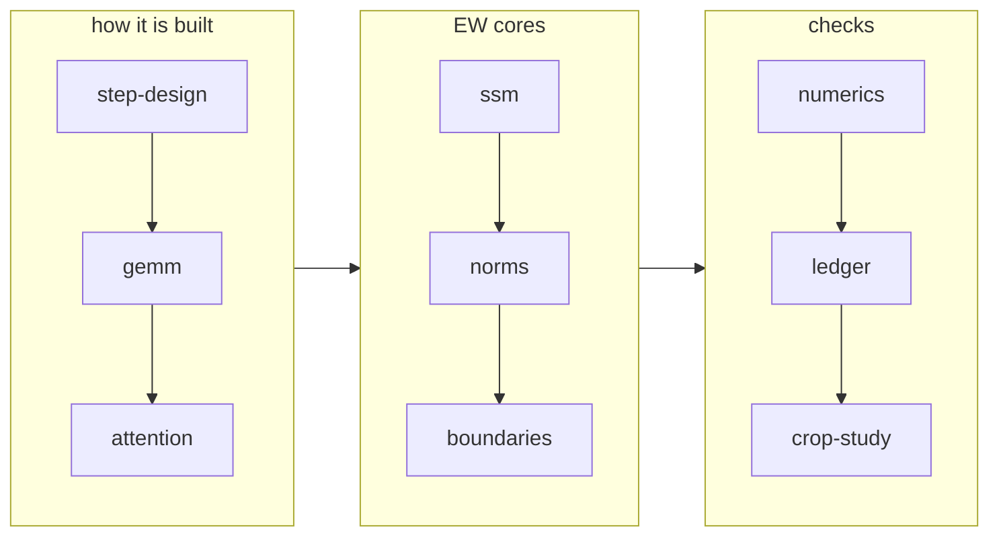

# Book: TAPNext++ on the XDNA2 NPU

The model-specific chapters for the TAPNext++ port: the whole 12-block step in one NPU dispatch, 28.42 ms at depth 12,
bit-identical to `full12r9a`, DAVIS AJ 70.84. Read [the machine-level book](../../common/book/README.md) first. These
chapters hold the TAPNext shapes, layouts and attempts, and link back up to the general chapters.

Each chapter opens with "In brief" and uses the same sections, so links stay stable: the topic sections, `## What worked`,
`## What didn't work` (anchor `#what-didnt-work`), `## Lessons`, `## Going deeper`.

Chapter order is the reading order: design first, then the cores, then accuracy, the time ledger and the CPU crop study.

| # | chapter | covers | general part |
|---|---|---|---|
| 1 | [step-design.md](step-design.md) | design8: rows per column, the core roles, ACT / W layouts (Q16, APAN, QKV, SSM area), one dispatch, depth switching, the host part (conv, heads), the progress table | [fusion](../../common/book/fusion.md) |
| 2 | [gemm.md](gemm.md) | the 11 GEMM ops per block, the k-step generations in TAPNext, accumulator pieces, epilogue kinds (GELU, gated, pan, qkv, V^T), the C path (ZHI, CSPLIT, EPLR, CSUB, ZLOAD), MSPLIT-P, L1 and text budgets | [gemm](../../common/book/gemm.md) |
| 3 | [attention.md](attention.md) | 12 heads × 1,152 rows with 48 query slots, two passes, head groups, the lazy-fast K loop (attk, attkb, S2, K2), the V phase, the P60 / P60g deal, the K/V multicast lockstep | [attention](../../common/book/attention.md) |
| 4 | [ssm.md](ssm.md) | the RG-LRU on the EW cores: tables, sqrt, gates, conv, X1 rotation, the glue, SSMIN / SSMCUT, YXSSM overlap | [elementwise](../../common/book/elementwise.md) |
| 5 | [norms.md](norms.md) | RMS / LN norms with 2 or 3 inputs, NRMK, N1K, NPIPE, STATS64, NRES, RRTWIN, RRES | [elementwise](../../common/book/elementwise.md#norms-the-general-structure) |
| 6 | [boundaries.md](boundaries.md) | the op boundaries and the CP sequence in TAPNext: IL, DAPRE, NSEQ, NRES, SRES, AQPRE, AKVPRE, 3A, OPPRE2, SSMPRE, CPPRE, YXSSM / YXR, BD pressure | [fusion](../../common/book/fusion.md), [data movement](../../common/book/data-movement.md) |
| 7 | [numerics.md](numerics.md) | bit identity to full12r9a, DAVIS, bfp16 and `encode_hw`, nk8, the LUT choices, numerics changes parked behind a DAVIS gate | [elementwise](../../common/book/elementwise.md#judging-accuracy) |
| 8 | [ledger.md](ledger.md) | where the 28.4 ms go, the floor (~25.2 ± 0.9 EXTRAPOLATED), the queue at the pause | [method](../../common/book/method.md) |
| 9 | [crop-study.md](crop-study.md) | tracking from a small moving crop (CPU study): the state shift, W = 192 / 160 / 128, a fixed zoom crop, attention outside the window, estimated NPU cost | none (CPU study) |

Raw study record: [crop-study/README.md](../crop-study/README.md). The raw record is
`../npu/{HANDOFF,NOTES,RESULTS}.md` and `../research/`.
