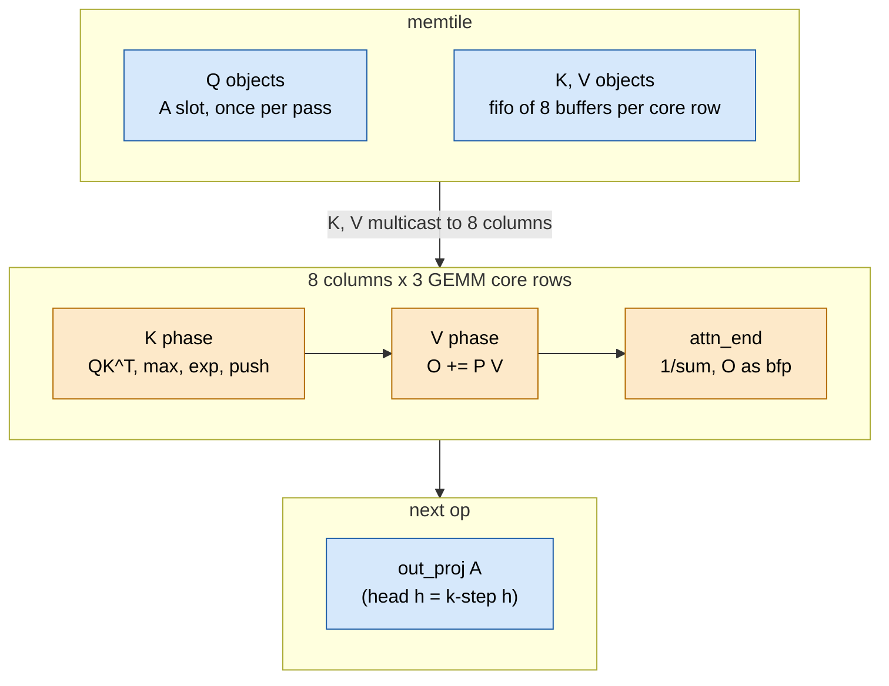

# TAPNext: attention

> **In brief**
>
> - Attention is **compute-bound** (a twin with no K-phase compute ran 43.4 ms against ~50, MEASURED, round 13) and costs **~491 µs per block, ~5.9 ms per step**
>   (timeline frontier advance, r23z/r24, MEASURED; floor 470-490 µs, MODEL).
> - It runs on the 24 GEMM cores: 12 heads over 1,072 keys, a query tile of 48 rows per pass, K and V multicast to the eight columns.
> - Three things made it fast: a lazy-max K loop in asm that falls back to an exact path for the ~10 % of units whose max moved (II 35 → 33);
>   a V phase in asm; and a **query deal** (P60g, round 15, −1.06 ms) that stopped a few slow columns from pacing all eight through the multicast.
> - The general mechanisms are in [common/attention](../../common/book/attention.md); this chapter is the TAPNext instance and its history.

**Conditions.** Depth 12, NPU clock 1.808 GHz, MEASURED per-block timelines unless tagged MODEL. A/B deltas are ms per step.

**Terms.** II = initiation interval of a modulo-scheduled loop. CP-SAT = the constraint solver that schedules the loops. TAU = the lazy-max threshold. bfp = block floating point.
Multicast = one memtile DMA channel feeding the same data to all eight columns. Lockstep = a multicast waits for every destination. Flagged unit = a (row block, key block) whose max moved.
L1 = core data memory, text = core program memory. Twin = a build with some compute removed, to find the bound.

## Shape: slots, passes, head groups

```text
keys / slots: 1,152 = 24 chunks x 48
              real: 1,072 = 1,024 image + 48 query
              chunk 22: 16 real keys (2 of its 6 key blocks); chunk 23: none
query rows:   per column 3 tiles x 48 rows (6 row blocks of 8) = 144 rows

pass 0: tiles 0-1 (12 row blocks)    pass 1: tile 2 (6 row blocks)
        each pass re-streams all of K and V for its heads
```

- **Rows and keys.** The lazy max is decided per row block, so row blocks stay whole.
- **Two passes.** The online-softmax state of three tiles does not fit L1. The K and V traffic is not the cost ([D1](#what-didnt-work)).
- **Head groups.** Core row $r$ takes heads $r + 3g$, so a head group is three heads in flight, four groups per pass ([M8.6](../../common/MACHINE.md#m8-6)).

The block cost (ATPROF, round 20):

$$t_\text{block} \approx 4 \times (\underbrace{73}_{\text{pass 0}} + \underbrace{40}_{\text{pass 1}}) + 4 \times 10\ \mu\text{s} \approx 491\ \mu\text{s}$$

A group costs ~72-75 µs in pass 0 and ~40 µs in pass 1, plus fixed costs of ~10 µs per group.



- **Flow.** Q objects go through the A slot (once per pass), K and V through the B fifo as 4,608 B objects (3,456 B payload) from a memtile fifo of 8 buffers per core row,
  **multicast by one memtile MM2S channel** to the 8 columns ([M8.6](../../common/MACHINE.md#m8-6)).
- O leaves as bfp chunks of out_proj's A. The qkv epilogue makes Q, K and V^T objects directly ([gemm.md](gemm.md#epilogue-kinds)).

## The softmax numerics, as built

The recipe is the general one (lazy max TAU = 8, fp32 argument, table exp, ones panel for row sums). Specifics (NOTES 10.1, 12.1, 11.1):

| piece | what | result |
|---|---|---|
| lazy max | no eager rescaling (it cost 0.42 ms per block, as much as the exp) | attention 1.77 → 1.35 ms per block (round 5) |
| exp by table | 80 segments of 1/4 on $[-11, 9)$, P converted straight to bfp16 | 49 bundles per 64 scores including the push |
| unscaled scores | the 1/8 moved into the table | 53 → 46 bundles, bit-identical |
| Q popped per key block | on the other load slot | 70 → 53 bundles per pair of key blocks |
| `attn_end` sums from the ones panel | 1/sum is one 64-lane vector reciprocal | −1,264 B of text (round 6) |

## The K loop: attk → attkb → S2 → II 33

Hypothesis at each step: the K phase (QK^T, row max, exp, push) is the bulk (0.60 ms per block of 1.35 in round 7 twins: exp + push 0.30, QK^T + max 0.30; V 0.19),
so write it as one modulo loop that assumes the stored max is still valid and reports a flag.

| round | variant | what | measured | evidence |
|---|---|---|---|---|
| 13 | ATTKF `attk` | fused loop per row block, II 35, 3 stages; any lane with $s - m \ge 63.75$ raises a flag, flagged row blocks rerun exactly in C++ | production 49.21 ms; fast-only twin 47.14 (−2.9) | NOTES 18; `r13/gen_attk.py` |
| 14 | ATTKB `attkb` | one call per (tile, chunk), 36 (row block, key block) iterations, 2D modifiers, II 34 | warm unit 444 → 261 cycles on one core; −0.04..−0.47 in situ (bimodal) | NOTES 19; `r14/gen_attkb.py` |
| 14 | ATTKE | chunk 0 skips the rescale (O = +0); the last chunk's 4 invalid P panels stored as zero bytes | 48.70 ms | NOTES 19.1 |
| 15 | RESCK `resc` | `rescale_rb`'s O and sum update in asm (II 8) | −0.29 | NOTES 20.1 |
| 17 | S2 | each iteration loads/stores its row block's max slot, the flags are OR-ed, no rerun of the first pass | **−0.31** at every percentile | `6462184` |
| 19 | KPREP | −m rows and −inf slots straight-line after three loads | −0.13 | `c64e978` |
| 21 | K0B | chunk 0 through the batched fast pass | −0.01..−0.03 | `5b0a14c` |
| 22 | II re-solves | 36 → 34 → 33 (U 1, `--life 1`, dm order 0,1,2,4,3) | −0.13, then −0.035 | `5a75321`, `2049c58` |
| 22 | K2 `gen_attkq` | QK-only chunk-0 pass, II 14 | −0.02 for 608 B of text, **off** | `5e3d6ba` |

What the numbers said:

- **The loop price was right, the production price was not.** The fast loop alone gave −2.9 ms as priced (P56), but production was −0.84:
  ~10 % of units (8.6-10.9 % per core: chunk 0, chunk 22 and 1-2 % whose max really moves) cost +400-900 cycles, and the multicast turned that into ~3x its own time on the wall (see [Lockstep](#lockstep-p60-and-p60g)).
  The exact test run for every unit had cost 1.35 ms; the in-loop flag removed it from the unflagged 90 % (NOTES 18.2).
- **A flagged row block is expensive.** In round 14 it cost 1,530 cycles ([M15.2](../../common/MACHINE.md#m15-2)):

$$393_\text{rerun} + 164_\text{test} + 578_\text{rescale} + 393_\text{exact rerun} = 1{,}528 \approx 1{,}530$$

- **attkb is register-bound, not port-bound.** Its resource bound is 29-31 (DM_ADA, ldb), but ex_n aliases x_n and only 6 x registers are free for the exp,
  so splitting QK and exp, carrying exp lines across trips, or holding Q in ex0-7 all failed ([common](../../common/book/attention.md#the-k-loop)).
  II 36 → 33 came from CP-SAT time (600-1,800 s per II); II 32 was not found in 1,800 s at life 2 and is queue item 5 (−0.035..−0.065, PROPOSALS rev 21 / HANDOFF round 25).
- **The K loop is on the critical path; chunk 0's fast pass is not.** II cuts landed 1:1 (round 22), while K2 removed ~850 cycles per (tile, chunk 0) for −0.02 of a predicted −0.05..−0.10 (NOTES 27.2).
- **Lazy-max statistics** (CPU map, [M15.2](../../common/MACHINE.md#m15-2)): flagged = moved to within 0.055 %. After chunk 0, 2.26 % of row blocks flag, peaking at chunks 12-13 (4.4 %),
  clustered in columns 5-6 (4.2-4.9 % vs 0.25 % in column 0).

## The V phase

`attv` (`r14/gen_attv.py`) computes $O \mathrel{+}= PV$ two dimension blocks per iteration, 24 iterations per (tile, chunk), II 21 with 2 stages; `attvs` computes the row sums from the ones panel (II 18, resource bound 11).

| step | what | result |
|---|---|---|
| round 14 bench | `attv` + `attvs` | V phase per (tile, chunk) 1,316 → 813 cycles |
| V2T (round 18, `1ac3fc9`) | both tiles in one `attv` and one `attvs` call per chunk | |
| II 21 → 20, 3 stages (`3c92210`) | CP proves II 15-19 infeasible | −0.03..−0.04 |
| `attvs` to its bound | | ≤ −0.02 ms ([K4](../../common/book/negative-results.md#k4)) |

`VTK` (`r14/gen_vt.py`, II 13) is the qkv V^T epilogue; its −496 B of C++ for 278 B paid for ATTV's text.

## Lockstep, P60 and P60g

A multicast send waits for all eight destinations, so a column runs at most one object ahead of the slowest. A flagged unit costs its own cycles for one column but the whole row's time.
MODEL ([M15.2](../../common/MACHINE.md#m15-2)): of the ~2.3 ms the slow path cost,

| part | ms |
|---|---|
| own cycles | 0.22 |
| multicast lockstep | ~1.3 |
| head-group barrier | ~0.8 |

The slow rows are clustered in the lower image, i.e. in a few columns, so the lever was **balance**, not buffering:

- `--l2-depth 4 → 8` (more K/V buffering) gave −0.36 ms, unexplained ([M15.2](../../common/MACHINE.md#m15-2)). Later it was neutral (depth 3, 5, 6, 8 within 0.02, rounds 22-23), so the memtile depth became a free BD budget.
- **P60** wanted the query tiles dealt over the columns with a single TAP per column. An exhaustive search plus a sum-of-squares identity shows only $d = 0$ solutions exist (`npu/r14/deal.py`, `npu/r14/deal2.py`; [C19](../../common/book/negative-results.md#c19)).
- **P60g** (plan8, `P60G=1`, round 15) deals the query *half tiles* (3 row blocks, 1,728 B per head) across the columns **in the two gathers only**
  (the attention Q fill and out_proj's A fill; drains, K/V, cores and host unchanged): dealt column $3T + e$ takes half $e$ of tile $T$ from natural columns $3j + H$, and the pair $\{2, 5\}$ is dealt separately.
  Composition was checked piece by piece before the build (`research/r15/deal4.py`).
- After P60g the lockstep left is small: deferring slow rows (D16) was −0.80 alone but needs L1 for per-chunk V copies, and P60 left ~0.06 ms.

| P60g result (`full12r15d`) | predicted | measured |
|---|---|---|
| step gain | −1.08 ± 0.22 ms (a hit) | **−1.06 ms** |
| attention wall per block, mean | 614 ± 18 µs | 701 → 610 µs |
| attention per step | | 8.52 → 7.38 ms |

## What worked

| lever | gain | note |
|---|---|---|
| Lazy max + table exp + fused asm K loop with exact fallback | | bit-identical to the exact path by construction (NOTES 10, 12, 18) |
| Batching the loop per (tile, chunk), running max inside the loop (ATTKB, S2) | S2 −0.31 | attention 1.35 ms per block with C++ loops (round 5) → ~0.49 ms (r24); 8.52 ms per step at r14f → ~5.9 (MEASURED timelines; rounds in between in RESULTS 22-31) |
| Query deal P60g | −1.06 ms | the cheapest large lever of the attention (a plan-only change) |
| II re-solving with more CP time (36 → 33) | −0.17 ms | when the loop is register-bound |
| Preloading attention's inputs and outputs across op boundaries | AQPRE −0.11..−0.24, AKVPRE −0.13..−0.24, OPPRE2 −0.15 | [boundaries.md](boundaries.md) |

## What didn't work

Methods and mispricings:

| idea | outcome | why / lesson | index |
|---|---|---|---|
| Fused K loop priced −3.2 ms ("fallback ≤ 3 %, +17 cycles per unit") | loop −2.9 as priced, production −0.84 | the exact test per unit (+1.35) and the multicast lockstep were unpriced | [D11](../../common/book/negative-results.md#d11) <!-- nr: D11 --> |
| "The batched loop needs 3D Q pops" | −0.04..−0.47 in situ vs −1.25 priced | false: 2D modifiers worked; lockstep multiplied the flagged-unit cost | [D12](../../common/book/negative-results.md#d12) <!-- nr: D12 --> |
| Skip chunk 0's rescale | round 13 measured nothing and reverted it for 16 B of text; round 14 measured ~−0.3 | sources disagreed; do not re-kill it from NOTES 18.5 | [D13](../../common/book/negative-results.md#d13) <!-- nr: D13 --> |

Dealing, multicast and the memtile:

| idea | outcome | why / lesson | index |
|---|---|---|---|
| P60 with one TAP per column | only $d = 0$ exists | P60g, on the gather side, replaced it | [C19](../../common/book/negative-results.md#c19) <!-- nr: C19 --> |
| Two or more TAPs per gather | wrong chunk | the A slot loads in per-head 10,368 B chunks with one lock each, so non-head-major gathers land in the wrong chunk | [C20](../../common/book/negative-results.md#c20) <!-- nr: C20 --> |
| Per-column K/V buffering in the memtile | impossible | memtiles 0-2 use all 6 S2MM channels, none left | [C21](../../common/book/negative-results.md#c21) <!-- nr: C21 --> |
| Global host tile permutation (P60t) | −0.53..−0.79 alone | worse than P60g composed | [C22](../../common/book/negative-results.md#c22) <!-- nr: C22 --> |
| Adaptive deal from the previous frame's flag counts (P60h) | ≤ −0.33 beyond P60g | never built (`unfinished`, L effort) | [C23](../../common/book/negative-results.md#c23) <!-- nr: C23 --> |
| Defer slow rows outside the lockstep | no | no L1 for per-chunk V copies | [D16](../../common/book/negative-results.md#d16) <!-- nr: D16 --> |
| More K/V slots | no | 4.6 KB per slot that L1 does not have; moot after P60g | [D17](../../common/book/negative-results.md#d17) <!-- nr: D17 --> |
| `--l2-depth 12` | 49.58 vs 49.54 ms at depth 8 | why 8 helped over 4 is still open | [D20](../../common/book/negative-results.md#d20) <!-- nr: D20 --> |

Smaller loops and text:

| idea | outcome | why / lesson | index |
|---|---|---|---|
| Cheaper exact test | under 0.1 ms left | only flagged units are tested | [D14](../../common/book/negative-results.md#d14) <!-- nr: D14 --> |
| Rarer flags without a numerics change | no gain | flag-not-move is already 0.055 % | [D15](../../common/book/negative-results.md#d15) <!-- nr: D15 --> |
| An asm exp (gen_aexp) | superseded | running attk with the new max gives the same P in −464 B | [D18](../../common/book/negative-results.md#d18) <!-- nr: D18 --> |
| 3,456 B K/V objects | −0.04 | the producer is not binding | [D19](../../common/book/negative-results.md#d19) <!-- nr: D19 --> |
| attkb in 2 stages, kernel-only attv, `-O2` rescale, K1C | killed | program memory (+96 B) or no schedule up to II 42 | [D21](../../common/book/negative-results.md#d21) <!-- nr: D21 --> |
| `attvs` toward II 11 | ≤ −0.02 ms | near its bound already | [K4](../../common/book/negative-results.md#k4) <!-- nr: K4 --> |
| S3 on the new loops | −0.01..−0.04 | even with a ×6 lockstep amplification | [K5](../../common/book/negative-results.md#k5) <!-- nr: K5 --> |
| Fewer flags by numerics (seed the max with q·k, TAU 16) | not bit-identical, +1 KB of L1 | parked behind a DAVIS gate | [F11](../../common/book/negative-results.md#f11) <!-- nr: F11 --> |
| FA4-style software exp | ≤ −0.1 ms, not bit-identical | attkb is register-bound | [F12](../../common/book/negative-results.md#f12) <!-- nr: F12 --> |
| Re-streaming K/V per pass is the cost | no | twins put the K phase at 0.60 ms and V at 0.19; pass compute, not traffic, dominates | [D1](../../common/book/negative-results.md#d1) <!-- nr: D1 --> |
| "Attention is DDR-bound" | no | the no-K-compute twin ran 43.4 vs ~50 ms | [D2](../../common/book/negative-results.md#d2) <!-- nr: D2 --> |

## Lessons

- Price a rare per-unit cost under a multicast by the max over destinations, never by its mean, and price the fallback with the loop ([H19](../../common/book/negative-results.md#h19)).
- Balance the rows across the multicast destinations instead of decoupling them. The deal was a plan-only change and the best lever per hour.
- A loop that is register-bound improves with solver time, not with resource-bound arguments; keep the CP schedule in the repo (`r17/attks.json`, `r22/attks33.json`).
- Text is a currency: every attention variant needs program memory the GEMM core does not have (128 B free at the pause).
- A twin that removes compute (K-phase, fast-only, chunk-0-skipped) is data-dependent when later flags depend on earlier results: it overstates ([measurement](../../common/book/measurement.md#twins-perturb-to-find-the-bound)).

## Going deeper

- [`tapnext/npu/NOTES.md`](../npu/NOTES.md) 10, 12 (rounds 5, 7), 18-19 (13-14), 20 (15), 22 (17), 27 (22); RESULTS 22-24, 31; `tapnext/research/RESULTS_FROM_MAIN.md` rounds 13-15 (P56, P60g verdicts).
- Generators and schedules: `tapnext/npu/r13/gen_attk.py`, `r14/gen_attkb.py` (`--s2`), `r14/gen_attv.py`, `r17/attks.json`, `r22/attks33.json`, `r22/gen_attkq.py`; benches `r13/attkb.py`; counts `r13/attkcount.py`.
- Models: `common/tools/attsim17.py`, `tapnext/research/r14/lazystat.out` (flag statistics), `r14/attcal.out`; deal: `tapnext/npu/r14/deal.py`, `tapnext/research/r15/deal4.py`.
- [MACHINE](../../common/MACHINE.md) [M6.2](../../common/MACHINE.md#m6-2), [M8.6](../../common/MACHINE.md#m8-6), [M15.2](../../common/MACHINE.md#m15-2). Next: [boundaries.md](boundaries.md), [ledger.md](ledger.md).
