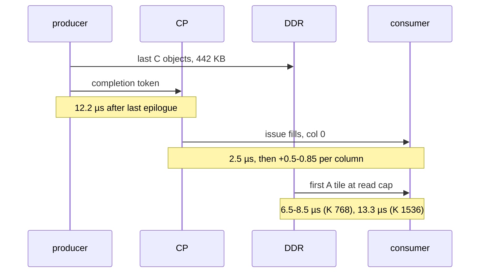

# TAPNext: op boundaries and the CP sequence

> **In brief**
>
> - Between two dependent ops the **data**, not the code, is what waits. The boundary was **DDR bytes** (the producer's last 442 KB of C objects written at the aggregate write cap, then the consumer's first tile read at the read cap), not command-processor (CP) instructions: about **3 ms per step** (MEASURED, CPST + TPROF, round 20), 12 boundaries per block.
> - Rounds 20-24 attacked them one pair at a time and kept about **−3.5 ms** (EXTRAPOLATED sum of the kept one-process A/B deltas below; round 20 alone was −2.07 ms measured).
> - Every lever is one of six moves: keep the consumer's A on chip, load it early into the slot half that is free, issue independent work before the wait, configure fills before the wait and push after, split the consumer's load per producer part, or let the consumer start on the producer's partial output.
> - The limits are the CP's push order (5 tasks per channel) and the shim's 16 live BDs.
> - Mechanisms and the CP rules are in [common/fusion](../../common/book/fusion.md). This chapter is each TAPNext instance with its numbers, its commit and the BD pressure that limits it.

**Conditions**: depth 12, NPU clock 1.808 GHz, A/B deltas in one process (p10 / median / mean, `r18/ab.py`), all levers bit-identical to the reference build `full12r9a`. Timeline gaps are `TL_ONLY` at 3-4 µs polls, build `r24z`, MEASURED.

**Terms.** CP = command processor (executes the instruction stream). BD = DMA buffer descriptor. TAP = tensor access pattern. DDR = shared system memory. EW = elementwise core. A / B / C = a GEMM's activation, weight and output objects. Memtile = a column's shared on-chip memory; the A slot is the memtile region that holds a GEMM's A.
MM2S / S2MM = DMA channel from / to a memory. Shim = the DMA block at the chip edge towards DDR. rb = row block. NRES = norm result stays on chip. SSM = the state-space mixer.

## The boundary, measured

What happens between the last write of a producer and the first MAC of its consumer (mlp0 → mlp3_a, [M11.3](../../common/MACHINE.md#m11-3)):



- **mlp0 → mlp3_a** (CPST, TPROF, round 20): the CP passes the first completion token 12.2 µs after mlp0's last epilogue; 8 token waits ~1 µs; CP issue ~2.5 µs to column 0, +0.5-0.85 µs per further column;
  the consumer's first tile 6.5-8.5 µs (K 768) / 13.3 µs (K 1536) at the read cap. Over all dependent first tiles that was 0.87 ms per step at r19z.
- The boundary's cost is real time, not compute: NTWIN (norm0 / norm2 do not wait for their producers, outputs wrong) saved −0.92 ms with walls unchanged (0.08-0.10 ms): ~38 µs per boundary, 24 boundaries per step (`d2db6ca`).

$$24 \times 38\ \mu\text{s} \approx 0.92\ \text{ms}$$

**Gaps at the pause** (TL_ONLY, 3-4 µs polls, r24z, MEASURED; RESULTS 33.2, 34.2):

| pair | gap (µs) | note |
|---|---|---|
| norm0 → yx | 16.4 | |
| norm1 → up_a | 24.2 | 27.9 in r24e's session |
| norm2 → qkv | 13.4 | |
| norm3 → mlp0 | 13.9 | |
| a split producer's pass-1 end → the norm's first word | 11-13 | the norm reads a whole row block before it writes |
| attn → out_proj | 29.2 → **13.3** | with OPPRE2 |
| qkv → attn | 61.6 | |

Remaining pace per block after NRES (r20t5): out 7.7, out_proj 6.8, down_b 6.0, mlp3_b 5.3 µs.

## The levers as built

All bit-identical to `full12r9a`; A/B in one process (p10 / median / mean, `r18/ab.py`). "Pre-registered" is the range predicted before the run.

| lever | pair | A/B ms | pre-registered | commit |
|---|---|---|---|---|
| IL | mlp0 → mlp3_a | −0.40 | −0.35 ± 0.1 | `9064248` |
| DAPRE | up_b → down_a | −0.13 | −0.07..−0.10 | `c6d7da8` |
| NSEQ | norm → GEMM | −0.17 | −0.08..−0.20 | `a5e07bf` |
| NRES | norm1 → up_a; then norm0-3 | −0.19; −0.65 for the other three | −0.15..−0.28; −0.45..−0.9 | `a5e07bf`, `4041189` |
| SRES | SSM → out | −0.16 | −0.10..−0.20 | `758a054` |
| AQPRE | qkv → attn | −0.11..−0.23 | −0.10..−0.20 | `3c8f7a0` |
| AKVPRE | qkv → attn | −0.13..−0.24 | −0.10..−0.14 | `b82f351` |
| 3A | down_a / mlp3_a → down_b / mlp3_b | −0.07..−0.08 | −0.07..−0.10 | `86442db` |
| MSPLIT-P | down_b, mlp3_b, out_proj → norms | −0.17, −0.10 | −0.18..−0.30 | `dd3677b`, `a20ceff` |
| YXSSM + YXR | yx → SSM | −0.41, −0.38 | −0.15..−0.35 (above) | `baeaf64`, `c9f9779` |
| OUTPRE | SSM → out | −0.02..−0.03 | −0.05..−0.15 | `52688cb` |
| OPPRE2 | attn → out_proj | −0.15 (v1, sends after: −0.04) | −0.08..−0.16 | `eb3d08d` |
| SSMPRE | yx → SSM | −0.07 | −0.04..−0.08 | `39eadff` |
| CPPRE | SSM, norms | −0.09 | −0.02..−0.08 | `b76509d` |

What each lever does:

- **IL** (mlp0 → mlp3_a): mlp0 dealt round-robin so its first 24 output chunks are final after step 7 of 16; its drain is split into its own group; mlp3_a's A loads **half 1 first** into the slot half mlp0 leaves free, with per-half full locks
- **DAPRE** (up_b → down_a): down_a's chunks 12-23 load into the half up_b (which reuses up_a's A) leaves free
- **NSEQ** (norm → GEMM): a norm's params fills and drains before the producer wait, only the 8 input fills after it
- **NRES** (norm1 → up_a; then norm0-3): the norm's panels leave the EW core on MM2S 1 (2-slot ring, packet 5) into memtile S2MM 5, which scatters them chunk-major into the A slot with a 3D TAP; X' alone goes to DDR; the GEMM loads no A and is issued before the norm is awaited
- **SRES** (SSM → out): the same for the SSM's z panels (units arrive head-major = contiguous)
- **AQPRE** (qkv → attn): attention's Q lives in half 1 (free under qkv's K = 768 A); its fill and memtile sends go before the wait on qkv's K / V groups
- **AKVPRE** (qkv → attn): qkv's V of heads 0-2 (step 8) is its own drain group; head group 0's K / V fills go after it, not after the whole drain tail
- **3A** (down_a / mlp3_a → down_b / mlp3_b): third A region (chunks 24-35, 373,248 B slot); k-steps 12-23 of the K = 1536 ops load during the previous op
- **MSPLIT-P** (down_b, mlp3_b, out_proj → norms): the last tile as two row passes; the norm starts on rows 0-5 ([gemm.md](gemm.md#msplit-p-the-last-tile-as-two-row-passes))
- **YXSSM + YXR** (yx → SSM): see below
- **OUTPRE** (SSM → out): out issued before the SSM's head fills; its sends wait on the per-head z chunks
- **OPPRE2** (attn → out_proj): out_proj's A part g is filled per attention head group in pass 1; sends **before** the waits; pass-1 O drains are four head-group drains issued after the K / V fills
- **SSMPRE** (yx → SSM): head 0's params fills for all columns before the yx wait
- **CPPRE** (SSM, norms): a fill that must wait is configured (BD blockwrite + patch) before the wait and only pushed after (`prefill()`)

Notes on the levers:

- **NRES alone misses.** Without NSEQ, up_a's columns started 1.5 µs apart (the CP issues the norm's work column by column) and the B multicast held every column to the last: −0.06..−0.11. With NSEQ −0.18..−0.21 ([C18](../../common/book/negative-results.md#c18)).
  NRES also needed a patch: IRON 1.4.4's pathfinder finds no route when two packet flows from two DMA channels of one tile merge, so Pn is declared from MM2S 0 and `r20/nresfix.py` adds the switchbox rule ([G9](../../common/book/negative-results.md#g9)).
  An rb-major A half broke correctness (the next op's chunk-0 load overwrote rows still being read), so the panels scatter into the usual chunk-major layout ([C17](../../common/book/negative-results.md#c17)).
- **OPPRE failed in round 20 (+0.18) and worked in round 24 as OPPRE2** because the drains and waits no longer queued in front of the attention's K / V pushes, and the sends went before the waits ([C11](../../common/book/negative-results.md#c11)).
- **CPPRE revived BDPRE**: the CP cost of a post-wait fill is ~0.55 µs per column (blockwrite, patch, maskpoll, maskwrite, push; [M11.2](../../common/MACHINE.md#m11-2)), not the 0.10 µs inferred; 8 columns skew by ~4.4 µs per wait ([C8](../../common/book/negative-results.md#c8)).

## The YXSSM pattern

The SSM's head *q* needs only yx's y tile *q* and x tile 12 + *q*, but waited for all of yx. The SSM now starts on the first drain groups:

```text
before:  yx   |1|2|3|4|5|6|7|8|                  yx's 8 steps
         SSM                   |h0|h1|...|h11|  waits for all of yx

after:   yx   |0 4|1 5|2 6|3 7|                  tile groups in YXR order
         SSM       |h0|h1|...                    starts after step 2 of 8
```

The recipe (round 23):

1. yx drains in four groups (y + x of heads 0-2, then x 3-5, 6-8, 9-11); the SSM finishes the group holding x(*q*) before head *q*'s fill, so it starts after yx step 4 of 8.
2. **YXR** orders yx's 8 steps y / x interleaved (natural tile groups 0, 4, 1, 5, 2, 6, 3, 7; the weights and flags are packed in `plan8.YX_PERM` order and the drain TAP is `[group][y | x][54 units][unit]`), so the SSM starts after step 2 of 8.
3. The SSM's z panels (SRES) cannot go to half 0 of the A slot (yx's A holds it until yx's last tile), so they go to **half 1** and `out` reads half 1. NRES / SRES tasks acquire all 12 chunk locks of a half: pick the half the running GEMM does not hold. A side effect is that norm1's NRES panels no longer wait for `out`'s last tile.
4. OUTPRE swaps `out` ahead of the SSM's head fills in the CP stream.

Measured: the SSM's first word came 134 µs before yx's last (timeline r23z1), −0.79 ms in all. It is not free: yx's wall grew 94 → 164 µs from DDR sharing, and an earlier start lengthened the SSM by 19 µs in the YXH variant (+0.09, see L6 below).
Pre-registered −0.15..−0.35 each, both above range.

## The CP sequence rules as they bit here

Each of these hung or slowed a dispatch (NOTES 24.3, 28.3, 29.3; the general list is in [fusion](../../common/book/fusion.md#deadlock-rules)):

```text
memtile MM2S channel:  [running] [q1] [q2] [q3] [q4]
                       5 tasks; a 6th push blocks the CP
```

- A memtile MM2S channel holds 5 tasks (1 running + 4 queued). A K = 1536 op pushing a 5th task before its fills blocked the CP: SEQPRE v1 +1.10 ms. A column's 6th push waits on that column's own tile 0, which needs every column's sends: push every column's first five before any sixth (r23d hung, timeout 1).
- A shim channel queues ~5 tasks too (INFERRED, r24b): 7 yx drains per column plus `out`'s drain blocked the CP before the SSM's fills (+0.44); 4 drains are free.
- A group finished through the lookahead early, with a later-issued op needed to complete it, is a deadlock (r23o2, timeout 2). **`SEQLOG=1` prints every group wait with the op being issued; read it before dispatching any reordered sequence.** Timeouts: 10 in round 3, 0 in rounds 24-25.
- Per-chunk locks identify nothing: one F lock for both A halves lets half-0 sends go before their data. A reordered load needs per-half locks ([M9.3](../../common/MACHINE.md#m9-3)).
- An acquire-only BD is refused by the verifier, release-by-0 works, acquire-by-0 passes the verifier but fails CDO generation (use a hand-off lock; [M10.1](../../common/MACHINE.md#m10-1)).
- The CP can write a core's data memory (`npu_write32`), which is how CPST stamps CP progress; a `.bin` can be decoded and re-serialised (`aie.utils.txn_trace`; `r20/binpatch.py`, `r24/cpsegs.py`). At r24 the sequence has 59,720 CP instructions in 421 sync runs.

## BD pressure

A shim holds at most 16 live runtime BDs, and a BD lives until its task group finishes. At `out_proj`, shim 0 held 16-20: nine of them the attention's Q fill and 8 K / V fills (4 per pass) kept until the attention group finishes, five drain groups (`#p0`, `#h0-3`), and out_proj's own ([M10.3](../../common/MACHINE.md#m10-3), MODEL; `tapnext/research/r26/design8_bd.py`).

| variant | peak live BDs on shim 0 | status |
|---|---|---|
| OPPRE2 | 16 (the limit) | kept |
| OPPRE2 + CPPRE_OP | 20 | never dispatched |
| + P0FREE | 16 | measured neutral, off |

- OPPRE2 ran at a peak of exactly 16. CPPRE_OP (configuring OPPRE2's A parts ahead too) needed 20 and was never dispatched.
- **P0FREE** puts Q and the pass-0 K / V fills into pass 0's drain group, so out_proj's wait on `#p0` frees 5 BDs (peak 20 → 16) and CPPRE_OP fits. Measured neutral (+0.009 median, `d9df358`): the last part's CP column spread does not gate out_proj. Kept off.
  **P1FREE** (pass-1 K / V of group *g* in `#h{g}`) would free one more per part wait; queue item 5, ~0 ms, BD room only.
- Rule: a fill belongs in the earliest drain group whose completion proves it was consumed. `aiecc --reclaim-runtime-bds` instead inserts completion maskpolls, which hang when completion depends on a later push. The 206-op build needed it in round 3 (peak 14 of 16, `--lookahead 1`).

## What is left at the pause

- EW → GEMM first tiles (the gap table above): MSPLIT-C (the GEMM's first tile on rows 0-5 while the norm writes 6-17) is priced −0.05..−0.10 (up_a), −0.03..−0.08 (qkv, mlp0), but up_a measured ~0 in round 25: norm1 reads at the cap, pass 1's B (360 KB) would be re-read inside its span.
- C hand-offs (~28 µs per block) need an 18 KB double-buffered C or LATEC's split acquire (hung): [gemm.md](gemm.md#the-c-path).
- `out`'s tile-0 bias wait is ~0 on the critical path: the slowest SSM column waits 0.03 µs, the others wait for it (`r25/outt0.py`).
- Queue: [ledger.md](ledger.md#the-queue-at-the-pause).

## What worked

- Treating the boundary as bytes, then taking bytes off DDR (NRES, SRES) or moving them ahead of the wait (IL, DAPRE, AQPRE, AKVPRE, 3A): about −2.1 ms in round 20 and −0.07 more in round 22.
- Overlap at the consumer's unit (YXSSM, YXR, MSPLIT-P): −0.79 and −0.27.
- Precise CP accounting: CPPRE and SSMPRE (−0.16) came from stamping the column skew (SSMIN with the core timer), after a model had priced the same idea at ~0.
- Probes first (CPST, DDRW, NTWIN, TL_ONLY, TPROF, SSMIN), levers second.

## What didn't work

CP-bound and pre-issue models (measured, mostly [fusion](../../common/book/fusion.md#what-didnt-work)):

| idea | outcome | why | index |
|---|---|---|---|
| "the boundary is CP-bound" (92-144 instructions × a fitted 0.17 µs) | wrong | the free constant absorbed the 12 µs producer tail; measured 0.06 / 0.11 µs per write32 / maskpoll | [C2](../../common/book/negative-results.md#c2) <!-- nr: C2 -->, [H14](../../common/book/negative-results.md#h14) <!-- nr: H14 --> (the same fit) |
| CP rate as the cause | +0.27 ms for 400 write32s | real but small | [C3](../../common/book/negative-results.md#c3) <!-- nr: C3 --> |
| SEQPRE (independent work before the wait) | priced −1.4 ± 0.5, best variant −0.04 | the boundary is bytes, not CP instructions | [C4](../../common/book/negative-results.md#c4) <!-- nr: C4 --> |
| SEQPRE v1 | +1.10 | the 5th memtile task blocks the CP | [C5](../../common/book/negative-results.md#c5) <!-- nr: C5 --> |
| SEQPRE v2 | +0.13 | | [C6](../../common/book/negative-results.md#c6) <!-- nr: C6 --> |
| drains only before the wait | +0.15, unexplained | norm drains moved early do hit (NSEQ −0.17) | [C7](../../common/book/negative-results.md#c7) <!-- nr: C7 --> |
| SENDPRE | ~0 / +0.16 | | [C9](../../common/book/negative-results.md#c9) <!-- nr: C9 -->, [C10](../../common/book/negative-results.md#c10) <!-- nr: C10 --> |
| "5 ms of boundaries" | wrong | counted the first tile's compute as boundary | [H15](../../common/book/negative-results.md#h15) <!-- nr: H15 --> |
| row-chunk overlap | model +0.6 ms; never built | | [C1](../../common/book/negative-results.md#c1) <!-- nr: C1 --> |
| the drain tail as a per-channel write limit (~4 B/cycle), as token latency, or testable with two drains | refuted | DDRW shows one stream writes 6.7 B/cycle; the tail is 442 KB at the aggregate write cap | [C14](../../common/book/negative-results.md#c14) <!-- nr: C14 -->, [C15](../../common/book/negative-results.md#c15) <!-- nr: C15 -->, [C16](../../common/book/negative-results.md#c16) <!-- nr: C16 --> |

Capacity and structure:

| idea | outcome | why | index |
|---|---|---|---|
| P43 (hoist the B fills) | −0.35 against −0.8 | the boundary is the A slot load from DDR (B is 14 % of the bytes) | [B7](../../common/book/negative-results.md#b7) <!-- nr: B7 --> |
| MRES (GEMM → GEMM output resident in the memtile) | does not fit | 124 KB park vs 112 KB free in two holes; MLPRR (IL's deal) got −0.40 through DDR instead | [B11](../../common/book/negative-results.md#b11) <!-- nr: B11 --> |
| a third A region in the existing memtile holes | does not fit | largest hole 56 KB vs 124 KB; solved by letting IRON re-pack the memtile (3A) | [C24](../../common/book/negative-results.md#c24) <!-- nr: C24 --> |
| prefetching a norm's inputs during the tail | ≤ 0.07 ms | ≤ 10 KB per column | [C25](../../common/book/negative-results.md#c25) <!-- nr: C25 --> |
| MSPLIT on `out` (norm1 starts on rows 0-5) | +0.43 with OUTPRE, +0.14 without, neutral with MSDEFER | out's 4th push waits behind yx's tasks and the SSM's fills issue late | [L5](../../common/book/negative-results.md#l5) <!-- nr: L5 --> |
| YXH (head-major yx steps) | 7 drain TAPs +0.48, 4 TAPs +0.09 | shim queue; more yx reads inside the read-capped SSM span | [L6](../../common/book/negative-results.md#l6) <!-- nr: L6 --> |

- Revived, not dead: [C8](../../common/book/negative-results.md#c8) <!-- nr: C8 --> BDPRE (CPPRE −0.09), [C11](../../common/book/negative-results.md#c11) <!-- nr: C11 --> OPPRE (OPPRE2 −0.15), [C17](../../common/book/negative-results.md#c17) <!-- nr: C17 --> NRES's rb-major design, [C18](../../common/book/negative-results.md#c18) <!-- nr: C18 --> NRES alone (needs NSEQ).
- Not indexed (NOTES 29.4, 28.4): ZCH alone +0.01..+0.02, MSDEFER +0.015, ZDROP +0.05 / neutral, P0FREE + CPPRE_OP neutral, SEQPRE loads-only −0.04.

## Lessons

- A boundary is bytes plus the CP's serial issue. Take bytes off DDR or ahead of the wait; take CP work out from behind the wait; and stamp the column skew before pricing a CP lever.
- Push order is part of the design: five tasks per channel, five per column before any sixth, group waits only on work already issued. Read `SEQLOG`.
- An overlap moves reads into another op's span. If that span is at a cap, the gain shrinks (YXH, L6); if not, it can exceed the static price (YXSSM, YXR).
- Choose the A half the running GEMM does not hold; count shim BDs before every new fill.

## Going deeper

- [`tapnext/npu/NOTES.md`](../npu/NOTES.md) 25 (round 20), 26.4, 27, 28, 29, 30; RESULTS 29, 32, 33, 34; RFM round 20 ("Reading"), round 24; ANALYSIS rev 21 §4.
- Code: `tapnext/npu/design8.py` (`prefill`, `SEQLOG`), `plan8.py` (`NRES`, `IL`, `A3`, `YXSSM`, `YXR`, `OPPRE2`), `tapnext/npu/r20/nresfix.py`, `r20/binpatch.py`, `r24/cpsegs.py`, `r25/cpcompact.py`; timelines `r24/tlo.sh`, `r24/tl3.sh`.
- [MACHINE](../../common/MACHINE.md) [M9.3](../../common/MACHINE.md#m9-3), [M10.1](../../common/MACHINE.md#m10-1), [M10.2](../../common/MACHINE.md#m10-2), [M10.3](../../common/MACHINE.md#m10-3), [M10.5](../../common/MACHINE.md#m10-5), [M11.2](../../common/MACHINE.md#m11-2), [M11.3](../../common/MACHINE.md#m11-3), [M14.5](../../common/MACHINE.md#m14-5). Next: [ledger.md](ledger.md).
