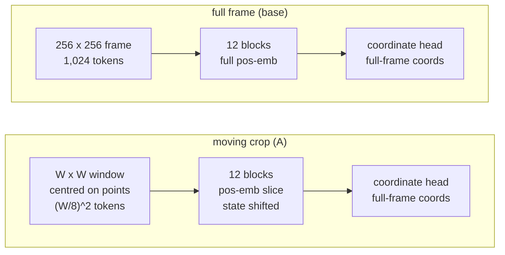

# TAPNext: the crop study (tracking from a small moving crop)

> **In brief**
>
> - A CPU study (2026-10-11, `e36e280`, no NPU or GPU) asked whether TAPNext++ can track a compact group of points from a $W \times W$ crop of the 256 frame,
>   which has fewer image tokens, without losing accuracy.
> - **Yes, if the recurrent state moves with the content** (MEASURED, 10 DAVIS videos, depth 12, bf16 CPU reference). A moving crop at native scale loses nothing
>   at $W = 192$ (AJ 69.72 vs 69.67) and 160 (69.46), and about 1 AJ at $W = 128$ (68.72). Without the state shift AJ collapses to 21-27.
> - A fixed zoomed crop loses 2.6-5.6 AJ because points leave it.
> - On the CPU a smaller crop is 1.9x ($W = 192$) to 3.7x ($W = 128$) faster. The NPU numbers are **estimates from the round-19 timeline, not a build**
>   (~17-20, 13-16, 8-12 ms against 33.9 then; the step is 28.42 ms now).
> - It is not part of the NPU step: the step is built for 1,152 rows, and every tile, panel and deal in [step-design.md](step-design.md) would have to be rebuilt for a smaller M.

**Conditions.** CPU only, bf16 reference, 10 DAVIS videos, depth 12. Source: [`tapnext/crop-study/README.md`](../crop-study/README.md), code `crop_study.py`, data `results.json`, `results_table.csv`, `results_per_video_aj.csv`.

**Terms.** AJ = average Jaccard (the DAVIS tracking score). OA = occlusion accuracy. $\delta_\text{avg}$ = fraction of points within a pixel threshold, averaged over thresholds.
RG-LRU = the recurrent layer whose state is tied to the patch grid. Pos-emb = the learned 32 x 32 position embedding. Token = one 8 px patch.

## What does the crop change?



The window sits on the 8 px patch grid, so each token keeps its absolute position (its slice of the pos-emb) and the readout stays in full-frame coordinates.
The recurrent state lives in a 32 x 32 buffer indexed by absolute patch and moves with the window, which is the "shift" below.

## Setup

Three pieces: how queries are grouped, the moving crop (A), and the fixed zoomed crop (B).

**Grouping.** A video's queries are grouped by the 64 × 64 cell (in 256 model space) holding the point's query-frame position.

- 53 groups over 10 videos, 1-15 points each (16 singletons, median 2). Query-frame bbox side median 20 px, max 54 px.
- Each group is tracked on its own, with no 48-slot padding; metrics are computed per video over all points and averaged, as in `davis_cpu.py`.
- Grouping alone costs 1.3 AJ (69.67 vs the ungrouped run's 70.98): points lose their co-tracked neighbours, the same effect as the support points.

**A, a moving crop at native scale.** A $W \times W$ window on the 8 px patch grid has $(W/8)^2$ image tokens, each with its own slice of the learned 32 × 32 pos-emb, so absolute positions are kept.
The readout is the coordinate head (2 × 256 logits from the query token, soft-argmax), so predictions stay full-frame coordinates.

```text
policy per frame
  1. centre on the bbox of the active points at their previous prediction
     (plus points queried this frame), clamp to the frame
  2. grow W to 160 / 192 / 256 if bbox + 2 x 16 px margin does not fit
  3. shrink when the points come back together
```

The RG-LRU state and the 3-frame conv cache live in a 32 × 32 buffer, in one of two ways:

| variant | indexed by | effect |
|---|---|---|
| **s** (shift) | absolute patch | state moves with the content; tokens that leave drop their state, entering tokens start from zero |
| **n** (no shift) | crop-local slot | the state stays put while the crop moves |

**B, a zoomed fixed crop.** The DAVIS pickle holds 480p frames, so real extra pixels exist. A fixed square of side $S \in \{128, 160, 192\}$
(the smallest that fits the group's query-frame bbox + 2 × 16 px) is sampled from the 480p frame straight to 256 × 256 and run with the full pos-emb. Queries map in, predictions map back.

**Correctness.** `c256` (the crop path at $W = 256$) is bit-identical to `base` (`model.step`) on all 53 groups, so its AJ equals the base run's 69.67.

## Results

| variant | AJ | OA | δ_avg | frames with enlarged W |
|---|---|---|---|---|
| base, grouped, full 256 frame | **69.67** | 91.96 | 82.84 | - |
| A W = 192, shift | **69.72** | 92.10 | 82.63 | 0.0 % |
| A W = 160, shift | **69.46** | 92.20 | 82.30 | 0.15 % |
| A W = 128, shift | **68.72** | 91.42 | 82.13 | 2.7 % |
| A W = 192 / 160 / 128, no shift | 27.39 / 22.40 / 21.18 | 85.74 / 83.12 / 77.60 | 38.94 / 32.96 / 31.36 | 0.1-1.1 % |
| B S = 192 (zoom 1.33x) | 67.03 | 87.75 | 79.33 | - |
| B S = 160 (zoom 1.6x) | 64.67 | 84.88 | 76.88 | - |
| B S = 128 (zoom 2x) | 64.09 | 83.93 | 75.29 | - |

What the table says:

- **The state shift is essential.** The recurrent state is spatially tied to its patch. Without it AJ falls from ~69.7 to 21-27 (`results_table.csv`).
- **$W = 128$ costs ~1 AJ.** Per group the drop is median +0.6 AJ (10th to 90th percentile -2.8 .. +8.2, worst +18); per video -1.3 .. +3.8 (dance-twirl -3.8, camel -2.3, car-shadow -2.0).
  The fallback to a larger $W$ is rare: 2.7 % of group-frames at $W = 128$, never to the full frame with the shift on.
- **B loses overall because points leave a fixed crop** (car-shadow 81 → 55, dance-twirl 71 → 32). On the frames where the point's ground truth is inside its crop, zoom helps:
  AJ +1.3 ($S = 192$), +1.5 (160), +2.3 (128), so the extra pixel density is worth about 1.3-2.3 AJ while the points stay in view.
- A zoomed crop would have to move, which needs the pos-emb and state treatment worked out at a non-native scale. Untried.
- Differences under ~1 AJ are within noise (10 videos, 53 groups; $W = 192$ and 160 sit 0.05-0.2 from base in both directions).

## Attention outside the window

On the full-frame base runs the study computes each frame's would-be A window from the previous prediction and the softmax mass the query rows put outside it (averaged over heads, active query rows and frames):

| W | area outside | query → image mass outside (mean / min / max over groups) |
|---|---|---|
| 128 | 75 % | 20.5 % / 13.4 / 35.5 |
| 160 | 61 % | 15.4 % / 10.6 / 28.1 |
| 192 | 44 % | 11.2 % / 7.7 / 22.5 |

By block at W = 128 it is local in the middle (8-15 %) and far at the ends: block 0 35 %, block 11 67 % (close to the 75 % uniform share). About 40 % of the outside mass sits on 8 keys, which looks like sink tokens. The far mass is not small (20 % at W = 128), yet **it does not predict the AJ drop**: per group (n = 53) the
correlation is about 0 (Pearson 0.10, 0.05, -0.21 at the three sizes), per video (n = 10) a weak 0.59 / 0.43 at W = 128 / 160. The model loses little when the far keys are dropped even though it attends to them; the softmax renormalises over what is left.

## Speed

CPU, 8 threads, 8 queries, same process, interleaved, on a loaded box (load 11-14), so the ratios mean more than the milliseconds (MEASURED, `speed.json`); the NPU column is EXTRAPOLATED.

| W | image tokens | GFLOP per frame | CPU ms per frame (median, min) | NPU estimate ms |
|---|---|---|---|---|
| 256 | 1,024 | 436 | 260 (243) | 33.9 (the round-19 step, MEASURED then; 28.42 now) |
| 192 | 576 | 237 | 140 (133) | ~17-20 |
| 160 | 400 | 163 | 100 (92) | ~13-16 |
| 128 | 256 | 104 | 71 (69) | ~8-12 |

The NPU estimate scales the round-19 timeline by $r = \text{tokens} / 1{,}072$ (EXTRAPOLATED):

$$t_\text{GEMM} = \max(15.4\,r,\ 4\ \text{ms}), \qquad t_\text{attn} = 5.5\,r^2, \qquad t_\text{norms} + t_\text{SSM} = (4.1 + 3.35)\,r$$

| part | round-19 ms | scaling |
|---|---|---|
| GEMM k-steps + epilogues + drains | ~15.4 | $r$, never below the ~4 ms weight floor (~230 MB of weights from DDR at ~57 GB/s each frame) |
| attention | 5.5 | $r^2$ |
| norms | 4.1 | $r$ |
| SSM | 3.35 | $r$ |
| bubbles | ~5 | fixed for the upper end, scaled with $r$ for the lower end |

At $W = 128$ ($r = 0.28$) the GEMMs sit at the weight floor (4.4 ms vs 4.0), so going below it buys little. The round-19 breakdown is out of date (the boundaries are now ~3 ms of the step, [boundaries.md](boundaries.md); attention is 5.9 ms, [ledger.md](ledger.md)); the estimate was not redone.

## What worked

- **The shifted moving crop at native scale**: W = 192 / 160 are lossless within noise, W = 128 costs ~1 AJ, and the crop-local pos-emb slice keeps absolute positions without any remapping, because the coordinate head always reads full-frame coordinates.
- A correctness anchor (`c256` bit-identical to `model.step`) before any variant, and per-group and per-video spread, not just the mean.
- Measuring attention mass outside the window as a diagnostic: the far mass is real but harmless.

## What didn't work

| id | idea | outcome | why |
|---|---|---|---|
| [F13](../../common/book/negative-results.md#f13) <!-- nr: F13 --> | State by crop-local slot (no shift) | AJ 21-27 at every $W$ | The state is tied to its patch and must travel with it |
| [F14](../../common/book/negative-results.md#f14) <!-- nr: F14 --> | A fixed zoomed crop (B) | -2.6 to -5.6 AJ against the grouped base | Points drift out of a fixed window (car-shadow 81 → 55, dance-twirl 71 → 32 at $S = 128$). Inside the crop it gains +1.3..+2.3 AJ; a *moving* zoomed crop is untried |
| (no index entry) | Predicting the AJ drop from the attention mass outside the window | Correlation ~0 per group | The softmax renormalises over the keys that are left |

## Lessons

- State is part of the content: any scheme that moves or crops the token grid must move the recurrent state and the conv cache with it.
- Fewer tokens help the NPU only where the cost scales with tokens: GEMM rows and attention (r, r²), not the ~4 ms weight stream or the fixed per-op costs. The 8-12 ms floor at W = 128 is an estimate; the step is built for 1,152 rows.
- Group the queries by position and keep the crop's margin (16 px) large enough for the fastest mover; fall back to a larger W rather than lose points.
- Run the shared-box timing as ratios; the absolute milliseconds of a loaded CPU are not comparable with the NPU's.

## Going deeper

- [`tapnext/crop-study/README.md`](../crop-study/README.md) (setup, caveats, how to reproduce: `run.sh main run --variants ...`, ~2.6 h on the loaded box), `crop_study.py`, `results.json`, `results_groups.csv` (per-group spread and drops), `out/runs.jsonl`.
- Related: the support-point and depth frontier in RESULTS 8 ([numerics.md](numerics.md#davis-across-the-rounds)); the NPU step's row layout [step-design.md](step-design.md#rows-columns-and-core-roles-design8); the time breakdown [ledger.md](ledger.md).
