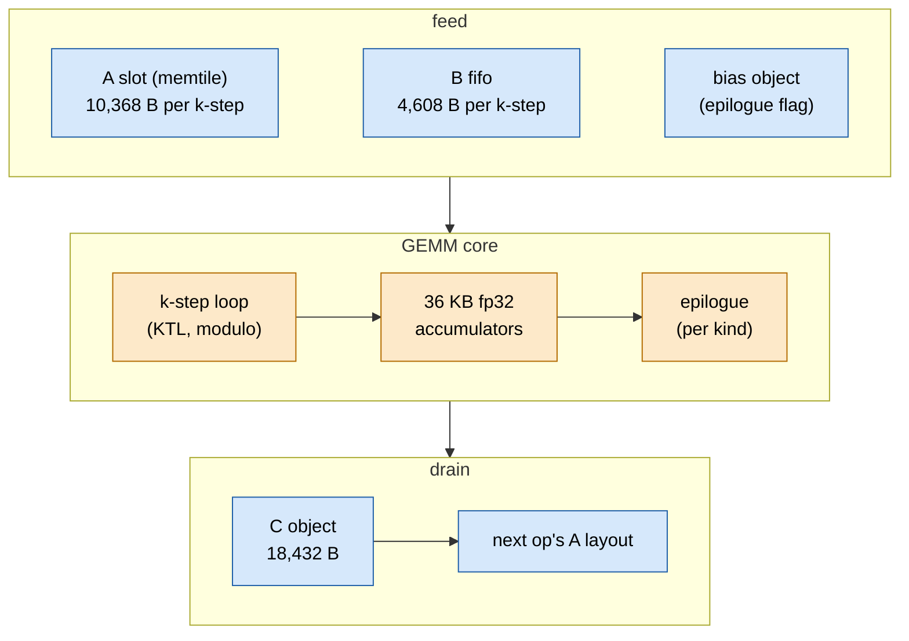
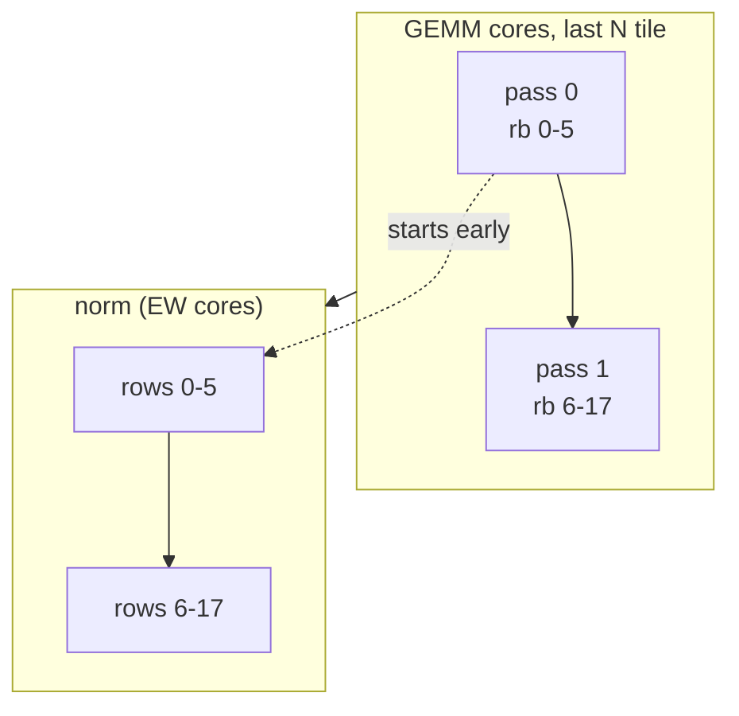

# TAPNext: GEMM

> **In brief**
>
> - The 11 GEMM ops of a block are **compute-bound** on 24 cores. Almost all of the 269 → 28.4 ms came from making their inner loop,
>   their epilogues and their C drain cheaper, in that order.
> - A core runs **1,296 k-steps per block**. The k-step went from ~2,900 cycles in situ (C++ `mm_acc`, round 6) to ~1,447 (KTL, round 23)
>   against an A-port floor of 1,304 (MODEL, [M8.3](../../common/MACHINE.md#m8-3)).
> - Epilogues went from ~77 bundles per 64 elements (round 5) to hand-scheduled loops (~1.6 ms per step, r21 timeline). The C drain went from ~2,330 cycles of waiting per tile to a few hundred.
> - What is left: DMA / bank collisions inside the k-step (~1.2 ms per step, MODEL) and a GEMM L1 and text budget that is full to within 124 B and 128 B.
> - The mechanisms are in [common/gemm](../../common/book/gemm.md); this chapter is the TAPNext instance.

**Terms.** k-step = one 64-deep slice of the reduction dimension $K$ for one 144 × 64 output tile. bfp = block floating point, the format the matrix unit reads.
L1 = a core's local data memory (64 KB), text = its program memory (16 KB). C object = the 18,432 B buffer a tile drains from. EW = elementwise core.
CP = command processor. TAP = tensor access pattern (a DMA address walk). II = initiation interval of a modulo-scheduled loop (cycles per iteration).
KTL, ROT, E7'', ZHI, CSPLIT, CSUB, ZLOAD, MSPLIT-P = names of kernels and changes, defined where they appear (evidence only).

**Conditions.** Depth 12, NPU clock 1.808 GHz unless a row says otherwise (E7'' was measured at 1.405 GHz). Gains are A/B deltas per step; status MEASURED unless tagged MODEL.

## The ops and their tiles

A core owns a third of an op's $N$ tiles (tile = 144 rows × 64 columns). Its work for an op is

$$n_\text{ks} = \frac{N_\text{tiles}}{\text{per core}} \times \frac{K}{64}.$$

| op | K | N tiles per core | k-steps per tile | k-steps per core and block |
|---|---|---|---|---|
| yx | 768 | 8 | 12 | 96 |
| out, out_proj | 768 | 4 | 12 | 48 each |
| up_a, up_b | 768 | 16 | 12 | 192 each |
| down_a, down_b, mlp3_a, mlp3_b | 1,536 | 4 | 24 | 96 each |
| qkv | 768 | 12 | 12 | 144 |
| mlp0 | 768 | 16 | 12 | 192 |

The sum is $96 + 2\cdot 48 + 2\cdot 192 + 4\cdot 96 + 144 + 192 = 1{,}296$ (MODEL, `tapnext/research/r25/ledger25.py`; ANALYSIS rev 20).

What one k-step moves, and why $K = 3072$ ops run as two halves:

```text
per k-step, per core:
  A  144 rows x 64 K, bfp16  = 144*64*9/8 = 10,368 B
       = 9 stripes of 1,152 B through a 3-stripe ring, from the memtile slot
  B  one 64 x 64 weight tile = 64*64*9/8  =  4,608 B   (B fifo)
  C  fp32 accumulators       = 144*64*4   = 36,864 B   (36 pieces of 1 KB)

A slot in the memtile: 24 chunks x 10,368 B = 248,832 B
  K = 3072 in one op: 48 chunks = 497,664 B of a 512 KB memtile
  -> does not fit, so K = 3072 runs as two K = 1536 halves   (J3)
```

The price of the split is a third norm input, see [norms.md](norms.md).



Each tile repeats feed → core → drain; the next tile's k-steps start while the previous C object is still draining (see [The C path](#the-c-path)).

**Evidence that it is compute-bound** (round 6, MEASURED): a twin with no MACs is 16.1 ms faster, one with 2x MACs 24.7 ms slower, of 84.0 ms.
[A1](../../common/book/negative-results.md#a1) refuted the A-port story.

### Accumulator pieces

Round 9 (`MM_PIECES`): the 36 KB of accumulators are 36 pieces of 1 KB (one row block of 8 rows × 32 columns of fp32; 18 row blocks × 2 column pairs).
12 live in the C object (12,288 B) and 24 in `acc_hi` (24 KB, now at 0x71A00). The map is affine:

| piece | where |
|---|---|
| pair 0 of row block rb < 12 | C slot rb |
| pair 0 of rb ≥ 12 | `acc_hi` 0-5 |
| pair 1 | `acc_hi` 6 + rb |

The epilogues are strided passes over pieces. A bank-aware runtime map made the k-step faster (323 vs 333 cycles per stripe) but the epilogue slower
(0.64 → 1.45 µs per tile), so the affine map won (NOTES 14.1, 14.3; [A8](../../common/book/negative-results.md#a8)).

## The k-step in TAPNext

The generation table is in [common/gemm](../../common/book/gemm.md#the-k-step-from-c-to-ktl). What the TAPNext layout added:

- **Packing follows the kernel.** Each generation needed the host to permute the weight tiles (`pack8.py`): `B_PAIR4` for the 4-chain call, `B_ROT` for ROT,
  and the E7'' split of B over two FIFOs. Only the GEMM weights are permuted. The first full-step run permuted the SSM and patch parameter tiles too and the SSM output was garbage
  (NOTES 12.1; `step8.py blocks` found it in one run).
- **Layout is part of the schedule.** The A ring is pinned away from the B fifo (`A_BANKS=1,2,2`, −1.5 ms, round 8).
- **One call per tile.** `mm_ktile` runs all of a tile's k-steps in one call, with B locks taken by id. KTL then made that one modulo loop of $76 + 1{,}260 \cdot n_\text{ks}$ cycles per tile.
  The gap between k-steps was waits, not code ([A21](../../common/book/negative-results.md#a21)).
- **In situ vs static.** In situ ROT ran 1,603 cycles per k-step with 168 memory stalls (round 18; KS-P38 counters), against 1,383 static.
  The excess is DMA writes into the bank the core is popping (DMAB), now ~140 cycles per k-step or ~1.2 ms per step (MODEL, `tapnext/research/r20/collide.py`).
  This is the largest unpriced GEMM item at the pause, and it is blocked by L1 capacity (see [the budgets](#l1-and-text-budgets-at-the-pause); PROPOSALS rev 21 rank 8).

<details><summary>Evidence: bank layout and commits</summary>

E7'' puts the X half of B at 0x70A00 / 0x70C40 in bank 0 and the Y half (4,224 B) in bank 3, with the GEMM stack +1,152 B so `core_data` starts at 0x70E80 (NOTES 26.1).
`ksc_check` in `design8.py` fails a build whose layout moved and names the new `KS_ACC_HI`: the k-step records are build-time constants (KSC, `c731fc3`, −288 B text).
`mm_ktile` is P35, `5bb071e`; KTL is `516d3a9`.

</details>

## Epilogue kinds

The kind is a flag word in each N tile's bias object, so one table-driven loop serves every op. The epilogue turns fp32 pieces into the next op's operands:

| kind | ops | what it does | hand-scheduled as |
|---|---|---|---|
| plain | out, out_proj, down_a/b, mlp3_a/b | bias add, bf16, drained in the Q16 layout | `bias_pcs` strided passes (44 bundles per 8 blocks) |
| GELU | yx (y half, 12 of 24 tiles) | bias + LUT GELU, bf16 | `bgelu` (II 12, flat-edge tables), `GELU_MS` before it (II 13) |
| gated pair | up_a, up_b | $\text{gelu}(\text{gate}+b)\cdot(\text{up}+b)$ on a tile pair = one k-step chunk of down's A, as bfp panels; the second tile of a pair copies the first's stash | `GUP` (II 6 per 64 lanes), `CPY32` (II 1 copy) |
| GELU to panels | mlp0 | bias + GELU, then bfp pushes in mlp3's A layout | `bgelu3` + `PAN` (II 16 per row block of 8 pushes) |
| Q / K objects | qkv | bf16 to bfp panels in attention's object layout | `PAN` flags 5 / 6 |
| V^T objects | qkv | 8 × 8 transposes into V^T panels | `VTK` (II 13) |
| attention O | attn | O as bfp chunks of out_proj's A | `attn_end` |

Measured steps, each bit-identical (commits in the NOTES round sections):

| change | gain (ms per step) | round |
|---|---|---|
| epilogue as strided passes | −5.3 | 6 |
| LUT GELU | −6.0 | 6 |
| `GELU_II` fixed / `GELU_MS` | −0.88 / −0.53 | 11 |
| `GUP` / `CPY32` / `PAN` / `BGELU` | −0.55 / −0.30 / −0.30 / −0.32 | 12 |

In situ a gated_b tile's epilogue fell 5.11 → 3.68 → 2.10 µs and the mlp0 panel pushes cost 1.23 µs per tile (NOTES 17.3).
`bgelu` sits at its port bound (ldb 11 / DM_ADA ~12), so there is no further epilogue lever (NOTES 26.4; [B5](../../common/book/negative-results.md#b5)).

## The C path

The C object (18,432 B) also holds 12,288 B of the accumulators, so a tile could not start until the whole object had drained at 7.9 B/cycle:
~2,330 cycles per tile, ~1.2 ms per step (round 19 TPROF, MEASURED). The cure is to release the object in parts:

```text
C object, 18,432 B
+--------------+--------------+-------------+--------------+
| sub 1        | sub 2        | sub 3       | part 2       |
| 0..3,455     | 3,456..6,911 | 6,912..     | 12,288..     |
|              |              | 12,287      | 18,431       |
+--------------+--------------+-------------+--------------+
|<------------ part 1: 12,288 B ----------->|
CSUB:   sub-parts 1-3 are released one by one
CSPLIT: part 1 drains first and releases the next tile;
        part 2 drains during the next tile
```

The steps, in order, all bit-identical and measured in one-process A/B:

| step | idea | A/B ms | commit |
|---|---|---|---|
| ZHI | zero `acc_hi` right after the C release, inside the drain wait | −0.15 | `9133756` |
| CSPLIT | drain bytes 0-12,287 first (releases the next tile), 12,288-18,431 during it; the lowered MLIR is patched (`r19/csplit.py`, lock CS_Z), an unpatched build hangs | −0.25 | `d5a9ee2` |
| EPLR | plain epilogues release part 1 as they finish it | −0.12 | `d6761bd` |
| CSUB | part 1 in three sub-parts released one by one (release-by-0 BDs) | −0.13 | `5c9fa57` |
| ZLOAD | the first k-step's MACs use the `zero_acc` config bit; no zeroing stores | −0.13 | `d09a01a` |

The five add up to −0.78 ms. TPROF hand-offs (epilogue end to the next tile's entry), in cycles:

| tile kind | before CSUB | after CSUB |
|---|---|---|
| plain | 1,355 | 345 |
| gated | 676 | 75 |
| mlp0 | 1,807 | 668 |

(r21t2.) About 28 µs per block is still hand-off (up_a 6.4, up_b 7.1, mlp0 5.2, qkv 3.8 µs; `r25/hands.py`).
A double-buffered C needs 18 KB of GEMM L1. LATEC (acquire sub-parts 2 and 3 inside the first k-step) hung the step, probably a core waiting for its own drain
while holding a multicast input (`50640be`, [B9](../../common/book/negative-results.md#b9)). The residual add cannot join the epilogue ([J1](../../common/book/negative-results.md#j1)).

## MSPLIT-P: the last tile as two row passes

For down_b, mlp3_b and out_proj (the ops whose consumers are norms) the last N tile runs as two row passes, rb 0-5 and rb 6-17, each with its own C object,
so the norm after it starts on rows 0-5 while the cores compute the rest (NOTES 28.1; the overlap idea is in [boundaries.md](boundaries.md)).



The pieces:

- the core table carries `nks | (nt + 1) << 8`; `mm_ktile` counts objects and picks the pass; KTL takes the row-block period as an argument (`r23/mm_rot_k70p`);
- the passes' own record tables (464 B) do not fit the GEMM L1, so they run on `rot_rec` with five entries patched in place, and a `static_assert` compares the patched table with `ktl_rec`'s pass tables (it caught pass 1's head jump);
- the memtile gets tasks `pa` (rows 0-5 of every chunk, lock-free) and `lastb` (rows 6-17 with the release); the sixth task of a column is pushed only after all columns have five (pushed column by column it hung, r23d).

| op | gain (ms) | commit |
|---|---|---|
| down_b + mlp3_b | −0.16..−0.21 (pre-registered −0.18..−0.30) | `dd3677b` |
| KTL | −0.14..−0.19 | `7edc4ab` |
| out_proj | −0.08..−0.12 | `a20ceff` |

That is near the static price and far under the NTWIN bound of −0.92 ms (norms not waiting for their producers at all): each pass pays its own call and drain, and the norms take their DDR share.
MSPLIT on `out` and MSPLIT-C (the GEMM after a norm) are dead or ~0: see [boundaries.md](boundaries.md#what-didnt-work).

## L1 and text budgets at the pause

| resource | state | evidence |
|---|---|---|
| GEMM program memory | 16,256 of 16,384 B (128 free); attention was ~6.9 KB of it at round 13 | HANDOFF round 25; MACHINE [M6.2](../../common/MACHINE.md#m6-2) |
| GEMM L1 | data region 124 B free; bank 3 full (a +384 B `data_size` overflowed it); stack 2,560 B, deepest path 1,856 B | NOTES 28.3; MACHINE [M6.3](../../common/MACHINE.md#m6-3) |
| EW program memory | 15,728 of 16,384 B (656 free) | HANDOFF round 24 |
| EW L1 | stack 4,864 B (deepest 1,792), arena 22,016 B, input ring 20 × 768 B; research found 5.4-6.9 KB for the SSM glue (not applied) | ANALYSIS rev 21 §3; MACHINE [M7.2](../../common/MACHINE.md#m7-2) |
| memtile (0-2) | A slot grown to 36 chunks; 3,584 B left after IRON re-packed it | NOTES 27.1 |

Budgets decided what could be built, more often than any schedule did:

- Text levers are time levers: `TXT18` (EW, −400 B) also gave −0.07 ms, `IV32` freed 560 B of GEMM text, `KSC` 288 B. K2 (a QK-only chunk-0 pass) is bit-identical and −0.02 ms for 608 B, so it stays off (`5e3d6ba`).
- Every layout lever needed an idle bank or free L1 the core does not have (J6, A24, A25 below); the GEMM core is the reason the largest remaining item is unreachable.

## What worked

| lever | gain | note |
|---|---|---|
| Hand-scheduled asm, one generation after another | C++ → `gen_mm` −1.9 → `mm_kstep` −2.0 → `mm_ks` −3.5 → ROT −3.3 → g0a −0.18 → E7'' −0.28 (at 1.405 GHz) → KTL −0.82 | each bound by the one before (NOTES 12-28) |
| Layout instead of scheduling rules | A ring pinned off the B bank −1.5; X and Y halves of B in two banks | |
| Epilogues as array passes, then modulo-scheduled loops | about −9 ms in rounds 6-12 | includes the GELU table |
| Releasing the C object early and in parts | −0.78 ms (ZHI, CSPLIT, EPLR, CSUB, ZLOAD) | |
| Row passes on the last tile where a norm follows | −0.27 ms in all (MSPLIT-P) | |

## What didn't work

L1, text and tile-shape limits killed these (all in [negative-results](../../common/book/negative-results.md)):

| idea | outcome | why / lesson | index |
|---|---|---|---|
| A-slot bank pinning with the piece layouts | did not link; no number recorded | bank sections overflow. Write down the section budget before trying a layout variant | [A9](../../common/book/negative-results.md#a9) <!-- nr: A9 --> |
| Deep-K accumulator visits, A from the neighbour core, a fourth GEMM row | parked | L1 and EW blockers, then superseded by ROT. Revisit only if the k-step needs more A | [A10](../../common/book/negative-results.md#a10) <!-- nr: A10 --> |
| Accumulators out of the C object | not built | needs +12,288 B of L1; 576 B are free. ZHI / CSPLIT / EPLR attacked the wait instead | [A16](../../common/book/negative-results.md#a16) <!-- nr: A16 --> |
| Shrink the GEMM stack to free bank-0 room | at most ~512 B | the deepest path is 1,856 B. Name the bytes before proposing an L1 lever | [A24](../../common/book/negative-results.md#a24) <!-- nr: A24 --> |
| Move the GELU tables' bank-0 copies to bank 3 | never built | moving `aexp_ab` instead is open | [A25](../../common/book/negative-results.md#a25) <!-- nr: A25 --> |
| $K = 3072$ as one op | does not fit | 48 chunks = 497 KB of the 512 KB memtile with this chunking (3A already took it to 36) | [J3](../../common/book/negative-results.md#j3) <!-- nr: J3 --> |
| Alternate the popped B bank per k-step | no room | needs a second 4,224 B Y buffer in bank 0 | [J6](../../common/book/negative-results.md#j6) <!-- nr: J6 --> |
| `out`'s tiles 1-3 following the SSM heads like tile 0 | no | four 18 KB C objects (72 KB) exceed the 64 KB L1, and the 1.77 MB drain would land after the last head anyway | [L4](../../common/book/negative-results.md#l4) <!-- nr: L4 --> |
| Gated tiles in the CSUB group loop | +0.02 ms against −0.04..−0.08 predicted | kept only as a −256 B text lever (`4ed0218`) | [B13](../../common/book/negative-results.md#b13) <!-- nr: B13 --> |
| Runtime-driven C drains with per-op lengths | ~−0.05..−0.1 ms for ~17 runtime pushes per block | the 74 MB of junk writes per step sit in part 2 and tiles are not write-bound; the CP is in order | [B14](../../common/book/negative-results.md#b14) <!-- nr: B14 --> |
| Bank-aware runtime piece map | +0.8 µs per tile in the epilogue | the table-driven epilogue costs more than the k-step gains | [A8](../../common/book/negative-results.md#a8) <!-- nr: A8 --> |
| B prefetch out of the popped bank | not kept | the B bank is busy 0.97 of the time under ROT and no idle bank is left for the prefetch (this L1 layout) | [A12](../../common/book/negative-results.md#a12) <!-- nr: A12 --> |
| A slots in the least busy bank | best assignment only −0.1 ms | no idle bank, and bank 0 has no room | [A15](../../common/book/negative-results.md#a15) <!-- nr: A15 --> |
| E7'' at R 64 | neutral in situ | `unfinished`: more CP workers in a quiet window | [A27](../../common/book/negative-results.md#a27) <!-- nr: A27 --> |
| KTL at R 68-69 bank-clean | no schedule | within the CP budgets; `unfinished`: a placement where A slots and pieces never share a bank | [L1](../../common/book/negative-results.md#l1) <!-- nr: L1 --> |
| Hoist the B fills for B-starved first tiles | −0.35 against −0.8 predicted | the dependent boundary is the A slot load from DDR (B is 14 % of the bytes) | [B7](../../common/book/negative-results.md#b7) <!-- nr: B7 --> |
| GELU on the idle EW cores instead of in the epilogue | over the cap | ~11 MB per block on top of ~42 GB/s exceeds the DDR cap | [J5](../../common/book/negative-results.md#j5) <!-- nr: J5 --> |
| LATE-C / LATEC | the build hung | see [the C path](#the-c-path) | [B9](../../common/book/negative-results.md#b9) <!-- nr: B9 --> |
| Residual add in the epilogue | impossible | no third core input port | [J1](../../common/book/negative-results.md#j1) <!-- nr: J1 --> |

The rows from A8 on are measured against the C path or the k-step; details in [common/gemm](../../common/book/gemm.md#what-didnt-work).

## Lessons

- Attack the largest static item of the whole call, re-solve, replay; every generation moved the bound (chains → accumulator swap → B bank → call prologue → DMA collisions and the A port).
- In this core the real budget is L1 and text, not cycles. Put bytes and banks in every proposal before pricing it.
- Release the C object early and in parts; never wait for your own drain while holding a multicast input.
- Static price × 0.75 for k-step cuts ([A18](../../common/book/negative-results.md#a18)); a gap measured as waits is not code.

## Going deeper

- [`tapnext/npu/NOTES.md`](../npu/NOTES.md) 12 (round 7), 14 (9), 17 (12), 23-24 (18-19), 26 (21), 28 (23); RESULTS 17-18, 28, 30, 32.
- Generators: `tapnext/npu/r7/gen_mm.py`, `r9/gen_ks.py`, `r12/gen_gup.py`, `r12/gen_pan.py`, `r12/gen_bgelu.py`, `r14/gen_vt.py`, `r18/gen_rot.py`, `tapnext/research/r22/gen_e7.py` (`--ktl`); C path: `r19/csplit.py`, `r21/mkzload.py`; MSPLIT-P: `r23/mm_rot_k70p`.
- Probes: `r19/tprof.py` (tile stamps), `r18/ksp38.py`, `tapnext/research/r20/collide.py`, `r25/hands.py`.
- [MACHINE](../../common/MACHINE.md) [M4.4](../../common/MACHINE.md#m4-4), [M6.3](../../common/MACHINE.md#m6-3), [M8.3](../../common/MACHINE.md#m8-3), [M15.1](../../common/MACHINE.md#m15-1). Next: [attention.md](attention.md) (the other user of these cores), [boundaries.md](boundaries.md).
