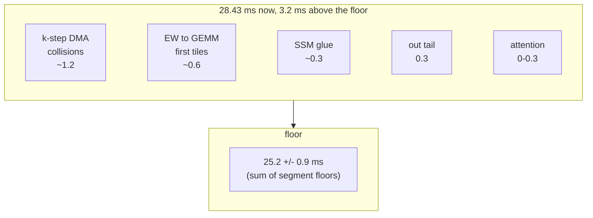
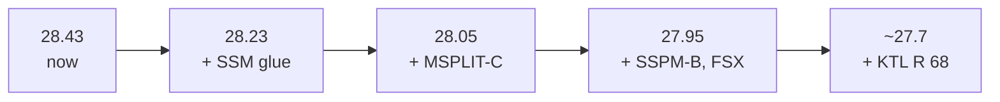

# TAPNext: the time ledger, the floor and the queue

> **In brief**
>
> - The step takes **28.42 ms at depth 12** (MEASURED, quiet sweep; full12r24z, rebuilt byte-identically as r25z). The ledger splits it into twelve
>   segments of one block, 2.37 ms each, and gives each segment a floor.
> - The floors sum to **~25.2 ± 0.9 ms (EXTRAPOLATED)**. The 3.2 ms between now and the floor is mostly the k-step's DMA collisions (~1.2 ms per step,
>   blocked by GEMM L1), EW → GEMM first tiles (~0.6), the SSM glue (~0.3) and `out`'s tail (0.3).
> - The queue left at the pause is worth about **-0.7 ms** (28.43 → ~27.7, EXTRAPOLATED), with the SSM glue and its L1 first.
> - The floor is a sum of bounds read off the current kernels, not a built step: a new k-step or freed GEMM L1 would move the ledger itself.

**Conditions** for every absolute timing: Turbo, NPU clock 1.808 GHz, GPU idle (gpu_busy 0), no CPU load beyond a light background worker.
An LLM on the GPU or 12 FP-compute threads on the CPU will make every number slower (see the risks below).
Status tags: MEASURED, MODEL (computed from a cost model), EXTRAPOLATED.

**Terms.** EW = elementwise core (norms, SSM). GEMM = matrix-multiply core. k-step = one 64-wide slice of the reduction dimension for one tile.
L1 = a core's 64 KB data memory. DDR = the shared system memory. BD = DMA buffer descriptor. CP = the NPU's command processor
(also the constraint-programming solver used for schedule searches, "CP-SAT"). TPROF = the per-tile profiling timestamps.

## Where the 28.4 ms go

The unit is the **frontier advance** of a segment: how far it moves the latest last-word time of the block. Advances sum to the wall, and an overlapped op gets only what it extends.
Segment times are from the r23z timelines (MEASURED). Floors are MODEL (`tapnext/research/r25/ledger25.py`, output `ledger25.out`; ANALYSIS rev 20 §1, `git show 3febc0d:npu-research/ANALYSIS.md`).
Floor ranges come from four bounds: the k-step floor (1,296 k-steps per block per core at 1,304-1,411 cycles), TPROF epilogues, the DDR read cap and the attention's compute bound.

```mermaid
%%{init: {"themeVariables": {"xyChart": {"plotColorPalette": "#3f51b5, #ff9800, #4caf50"}}}}%%
xychart-beta
    title "ms per step by segment: now vs floor midpoint"
    x-axis ["attn", "up", "yx+SSM", "down", "mlp0", "mlp3", "qkv", "norm0", "norm3", "norm1", "out_proj", "out"]
    y-axis "ms" 0 --> 6.5
    bar [5.92, 4.69, 4.01, 3.06, 2.72, 2.12, 1.86, 1.12, 0.91, 0.95, 0.90, 0.62]
    bar [5.76, 4.15, 3.47, 2.78, 2.26, 1.81, 1.46, 1.10, 0.88, 0.87, 0.47, 0.30]
```

Blue = now; orange, drawn over it = floor midpoint, so the blue cap is the gap to the floor (midpoint of the range in the table); segments are sorted by time now. The table lists them in block order.

| segment | now µs per block | floor µs | ms per step now / floor | bound |
|---|---|---|---|---|
| norm0 (+ mlp3_b pass 2) | 93 | 90-93 | 1.12 / 1.08-1.12 | DDR read cap |
| yx + SSM (YXSSM, YXR) | 334 | 272-305 | 4.01 / 3.27-3.66 | the SSM span: read cap and compute just under ([ssm.md](ssm.md)) |
| out (tiles 1-3 + drain) | 52 | 20-30 | 0.62 / 0.24-0.36 | tile 0 follows the heads; tiles 1-3 need all |
| norm1 | 79 | 70-75 | 0.95 / 0.84-0.90 | DDR read cap |
| up_a + up_b | 391 | 334-357 | 4.69 / 4.01-4.28 | k-steps + gated epilogues |
| down_a + down_b + norm2 | 255 | 223-241 | 3.06 / 2.67-2.89 | k-steps + norm2 DDR |
| qkv | 155 | 117-126 | 1.86 / 1.40-1.51 | k-steps + qkv epilogues |
| attention | 493 | 470-490 | 5.92 / 5.64-5.88 | compute ([attention.md](attention.md)) |
| out_proj | 75 | 38-41 | 0.90 / 0.45-0.49 | k-steps; A after the attention |
| norm3 | 76 | 71-76 | 0.91 / 0.85-0.91 | LN compute vs DDR |
| mlp0 | 227 | 183-194 | 2.72 / 2.19-2.33 | k-steps + gelu_pan epilogues |
| mlp3_a + mlp3_b | 176 | 145-156 | 2.12 / 1.74-1.87 | k-steps + plain epilogues |
| **step** (+ the final norm once) | 2,406 | 2,033-2,183 | **28.97 / 24.5-26.3** | |

What the table says:

- **Largest shares:** attention 5.92 ms (20 %), up_a + up_b 4.69, yx + SSM 4.01, down + norm2 3.06, mlp0 2.72, mlp3 2.12, qkv 1.86.
  The four norms are 3.8 ms by their own walls (norm0 90, norm1 63, norm2 92, norm3 72 µs per block), partly overlapped with their producers.
- **Linear in depth:** 2.34 ms per block plus ~0.4 ms (sweep 28.42 / 23.83 / 19.09 / 14.40, [step-design.md](step-design.md#depth-switching-and-phases)).
- **From the r23z timeline to the pause.** The ledger step (28.97) is the r23z timeline; r23z swept at 28.89. **Round 24 then took -0.48 ms** (28.43); round 25 kept nothing.

| round-24 change | ms | effect |
|---|---|---|
| STATS64 | -0.10 | norm1, norm3 walls -5 µs |
| OPPRE2 | -0.15 | attn → out_proj gap 28.3 → 13.3 µs |
| SSMPRE | -0.07 | the SSM's column skew |
| CPPRE | -0.09 | the SSM's column skew |

Two cost models bound the table from below (both MODEL):

$$t_{k\text{-step}} = \frac{1296 \times 1304\ \text{cycles} \times 12\ \text{blocks}}{1.808\ \text{GHz}} = 11.2\ \text{ms}$$

At the in-situ ~1,447 cycles per k-step it is 12.4 ms. The 1,304 cycles are the A-port floor ([M8.3](../../common/MACHINE.md#m8-3)). The k-step is ~44 % of the step.

$$t_\text{DDR} = \frac{70.8\ \text{MB read per block} \times 12}{55\text{-}59\ \text{GB/s}} \approx 14.4\text{-}15.5\ \text{ms}$$

(`r21/ddrbudget.py`; a block also writes 53.5 MB.) The step is not DDR-bound as a whole, but individual EW spans (norms, SSM) sit at the cap.

## The floor, and how far from it we are

**~25.2 ± 0.9 ms, EXTRAPOLATED.** Rev 20 summed the per-segment floors above (24.5-26.3 ms, midpoint 25.4). Rev 21 reduced it by round 24's boundary gains to 25.2 (ANALYSIS rev 21 §2).
It assumes every segment reaches the lower end of its range at once.

Items in ms per step. What stands between now and the floor (ANALYSIS rev 21 §2):

| item | ms per step | what would move it | status |
|---|---|---|---|
| k-step DMA collisions (~140 cycles per k-step) | ~1.2 | an idle bank for B or A, i.e. GEMM L1 that does not exist | blocked; PROPOSALS rank 8 |
| EW → GEMM first tiles | ~0.6 | MSPLIT-C, norm-pass glue | priced ~0..-0.10 |
| the SSM | ~0.3 | glue to the input floor, then fewer input bytes | queue rank 1, 3 |
| `out`'s tail | 0.3 | tile 0 follows the heads; tiles 1-3 need all | L4 (below) |
| attention | 0-0.3 | attkb II 32 | queue |

These sum to ~2.4-2.7 ms of the 3.2 ms gap. The remainder is not itemised in the sources (C hand-offs, ~28 µs per block = 0.34 ms per step, are one candidate).

> **Note.** The floor is a **statement about the current kernel designs**: a new k-step with fewer cycles, or L1 freed in the GEMM core, would move the ledger itself.

## The queue at the pause

PROPOSALS rev 21 (research pass 21), base 28.43 ms. Prices are EXTRAPOLATED unless marked. "Gate" is the check to pass before building.
Ids are the proposal names used in the lab notebooks; the "what" column says what each one is.

| rank | id | what | cost | price ms | gate / check |
|---|---|---|---|---|---|
| 1 | SSM glue | `ssq2` + `reck2` + `ggk2` over chunk pairs, with EWSTACK's L1 | M | -0.15..-0.25 | `tcall` per chunk; SSMIN chunk ≥ ~2,030 afterwards |
| 2 | EWSTACK | EW stack 0x1300 → 0x800 (+2,816 B bank 0); union the norm-only scratch (+1,536 B) | S | 0 (enables 1) | aiecc requirement 1,792 B; regress bit-identical |
| 3 | MSPLIT-C up_a / qkv / mlp0 | the GEMM's first tile on rows 0-5 while the norm writes 6-17 | M | -0.05..-0.10 / -0.03..-0.08 each | TL_ONLY gaps 27.9 / 14.2 / 17.6 µs |
| 4 | SSPM-B + KPAD + FSX | params read once and unpadded (floor ~2,030 → ~1,870), then FSX's compute can land | L | -0.05..-0.15 together | an SSMCUT twin after 1 |
| 5 | P1FREE | pass-1 K / V fills in `#h{g}` | S | ~0 (BD room) | static peak ≤ 15 |
| 6 | KTL R 68 / 69 bank-clean | no schedule found (R 69 hard: 4 / 12 workers; R 68 soft: 35 conflicts plateau); needs a placement where A slots and accumulator pieces never share a bank | L | -0.2..-0.3 / -0.1..-0.15 | replay 0 stalls |
| 7 | input ring 16 slots | +3,072 B bank 3 if 1 needs more L1 | S | 0..+0.03 risk | norms A/B |
| 8 | k-step DMA collisions | the largest unpriced item; blocked by GEMM L1 | — | — | [A24](../../common/book/negative-results.md#a24), A25, J6 (below) |

**Ceiling of the queue** (EXTRAPOLATED, ms per step, cumulative):

**Floor:** ~25.2 ± 0.9.

The open queue of the optimisation rounds at the pause (HANDOFF round 25) overlaps and adds items; prices MODEL / EXTRAPOLATED, all need a build and a one-process A/B:

| id | what | price ms | note |
|---|---|---|---|
| RRES | residual rows rb < 10 of norm0 / norm2 parked in memtile half 1, fed to the EW S2MM 1 | -0.27 (RRTWIN bound -0.49) | coded; blocked at aiecc (memtile BD budget, R ring placement). [norms.md](norms.md#rres-residual-rows-on-chip-coded-blocked-at-aiecc) |
| SSM glue by chunk pairs | as above | -0.15..-0.25 | needs ~5 KB EW L1; RRES takes the data tail |
| norm pass-2 glue | 287 / 364 cycles per unit vs 117 / 177 static | up to -0.1..-0.3 | needs research's static decomposition first |
| KTL R 68-69 bank-clean | as above | -0.2..-0.3 | S once found |
| attkb II 33 → 32 (bound 31) | CP with 12 workers, 3,600 s, `--life 1`, stages 3 / 4 | -0.035..-0.065 | S |
| C hand-offs (~28 µs per block) | LATEC-style split C locks | ≤ -0.1..-0.15 | L, risky: LATEC hung |
| dead or ~0 | MSPLIT-C up_a / qkv / mlp0, out's bias wait, CPPRE_OP, SSPM-B alone | ~0 | |

**Risks** that apply to any number here (HANDOFF round 25; MACHINE [M1.4](../../common/MACHINE.md#m1-4)):

- **The NPU clock drops to 1.41 GHz under many FP-compute CPU threads at ~100 W package power** (12 AVX-512 matmul threads; AVX2 the same; 12 DRAM-copy threads and 12 scalar-spin threads do not). Cap BLAS / OpenMP threads at 6 beside the NPU.
- **The NPU with the GPU busy is untested.** The norms and the SSM sit at the 55-59 GB/s read cap, and an LLM on the GPU shares that DDR.
- Dispatch time is bimodal (~0.17 ms apart, p90 ~32 ms) under foreign CPU load: compare A/Bs in one process.
- Resources are full: GEMM text 128 B free, GEMM L1 data 124 B, EW text 656 B (HANDOFF round 25; NOTES 28.3).

## How the ledger and the queue moved

| when | what moved |
|---|---|
| Rev 20 → 21 | Rev 20 ranked SSPM-B first and priced the SSM glue at ~0, because the SSM span read at 54 GB/s, ~95 % of the cap. Main's SSMIN and research's SSMCUT showed it compute-bound by ~255 cycles per chunk, so rev 21 ranks the glue first (M1). |
| Round 24 | Kept STATS64, OPPRE2, SSMPRE and CPPRE (-0.48 vs r23z). The CP-time lever was a measurement (a post-wait fill is ~0.55 µs, not ~0.10) that revived C8. |
| Round 25 | Kept nothing: MSPLIT-C up_a priced ~0 (norm1 at the read cap), `out`'s bias wait is off the critical path, P0FREE + CPPRE_OP neutral. Three probes moved the model instead of the build: RRTWIN (the norm bounds per input count), CLKLOAD2 (the clock rule), SSMCUT. |
| Analysis passes | CP-SAT runs (KTL R 68-69) stopped at the pause: no bank-clean schedule in 1,200-1,800 s at 2-12 workers. |

## What worked

- A ledger in frontier-advance units that sums to the wall, with a floor per segment: it ranked every lever of rounds 20-25 and found which ones were bounded by L1, not by cycles.
- Pre-registered prices with a bound and an in-between outcome: rev 21's SSMCUT result was the in-between case and still settled the question.
- Probes that separate two hypotheses (CPST, DDRCAP, SSMCUT, RRTWIN) before any lever is ranked.
- Reproducible state: the best build is a list of switches, rebuilds byte-identically (`r24/try24.sh`), and every change has an env off-switch ([README](../README.md#rebuild-and-verify)).

## What didn't work

Entries marked *method* are mispricings that shaped this ledger (lessons in [method](../../common/book/method.md#how-mispredictions-happened)).

| id | idea | outcome | why |
|---|---|---|---|
| [M1](../../common/book/negative-results.md#m1) <!-- nr: M1 --> | Near a cap priced as capped (class method) | SSM glue priced ~0 until SSMCUT | SSMCUT showed the span compute-bound |
| [L3](../../common/book/negative-results.md#l3) <!-- nr: L3 --> | DDR headroom from a window average (class method) | 78 GB/s r+w over yx + SSM taken as headroom | The cap is of a different kind; inside the SSM span reads were 54 GB/s, at the read cap |
| [H15](../../common/book/negative-results.md#h15) <!-- nr: H15 --> | "5 ms of boundaries" (class method) | Measured ~3 ms | The gaps counted first-tile compute |
| [C12](../../common/book/negative-results.md#c12) <!-- nr: C12 --> | "The NPU sustains ≥ 84 GB/s" (class method) | DDRCAP measured ~55-59 | Derived from norm walls × bytes |
| [H6](../../common/book/negative-results.md#h6) <!-- nr: H6 --> | Baselines from older rounds (class method) | Deltas measured against an older round | The base had moved |
| [H27](../../common/book/negative-results.md#h27) <!-- nr: H27 --> | A half-built proposal scored as a whole (class method) | Scored as a whole | Only half was built |
| [H21](../../common/book/negative-results.md#h21) <!-- nr: H21 --> | Ranges written after main's measurement (class method) | Not counted as pre-registered | Post-hoc |
| [L1](../../common/book/negative-results.md#l1) <!-- nr: L1 --> | KTL at R 68-69 (unfinished) | Queue item on a verdict, not a proof | More CP workers or a new placement could settle it |
| [L2](../../common/book/negative-results.md#l2) <!-- nr: L2 --> | FSX (unfinished) | Stale value bound | Bound predates M1 |
| [E16](../../common/book/negative-results.md#e16) <!-- nr: E16 --> | The 12-x-register schedule (unfinished) | Queue item on a verdict, not a proof | No schedule found |
| [A27](../../common/book/negative-results.md#a27) <!-- nr: A27 --> | E7'' at R 64 (unfinished) | Queue item on a verdict, not a proof | No conflict-free schedule found |
| [A24](../../common/book/negative-results.md#a24) <!-- nr: A24 --> | The stack (L1 capacity) | Blocked | L1 full, [gemm.md](gemm.md#what-didnt-work) |
| [A25](../../common/book/negative-results.md#a25) <!-- nr: A25 --> | The LUT bank (L1 capacity) | Blocked | L1 full |
| [J6](../../common/book/negative-results.md#j6) <!-- nr: J6 --> | Alternating the B bank (L1 capacity) | Blocked | L1 full |
| [L4](../../common/book/negative-results.md#l4) <!-- nr: L4 --> | Four C objects in L1 (L1 capacity) | Blocked | 72 KB over a 64 KB L1 |

## Lessons

- Rank levers by the ledger's floor per segment, and check which resource (cycles, bytes, L1, text, BDs) binds before the price.
- A queue ceiling (-0.7 ms of 28.4) is a small fraction of the 3.2 ms gap to the floor; the biggest piece (the k-step collisions) needs L1 the GEMM core does not have, so the next step-change is a redesign of the core's L1 or the tile, not another lever.
- Label every number with its conditions and its status. This ledger's floor is EXTRAPOLATED, its segments MEASURED, its prices MODEL.
- Before another GPU or CPU workload shares the box, re-measure: the clock and the DDR are shared.

## Going deeper

- [`tapnext/research/ANALYSIS.md`](../research/ANALYSIS.md) rev 21 (§0 scorecard, §1 SSM, §2 ledger, §6 queue, §7 method); [`PROPOSALS.md`](../research/PROPOSALS.md) rev 21; [`RESULTS_FROM_MAIN.md`](../research/RESULTS_FROM_MAIN.md) (verdicts); [`npu/HANDOFF.md`](../npu/HANDOFF.md) top block (state, switches, open queue).
- Rev 20's ledger and prices: `git show 3febc0d:npu-research/ANALYSIS.md`; older revisions `git show eed3870:npu-research/revN/<file>`. Tools: `tapnext/research/r25/ledger25.py` (output `tapnext/research/r25/ledger25.out`), `tapnext/research/r25/advance.py`, `tapnext/research/r21/ddrbudget.py`.
- [MACHINE](../../common/MACHINE.md) [M1.4](../../common/MACHINE.md#m1-4), [M7.2](../../common/MACHINE.md#m7-2), [M8.3](../../common/MACHINE.md#m8-3), [M10.2](../../common/MACHINE.md#m10-2), [M10.3](../../common/MACHINE.md#m10-3), [M10.5](../../common/MACHINE.md#m10-5), [M11.2](../../common/MACHINE.md#m11-2), [M11.3](../../common/MACHINE.md#m11-3), [M15.1](../../common/MACHINE.md#m15-1), [M15.3](../../common/MACHINE.md#m15-3). Methods: [method](../../common/book/method.md), [measurement](../../common/book/measurement.md).
