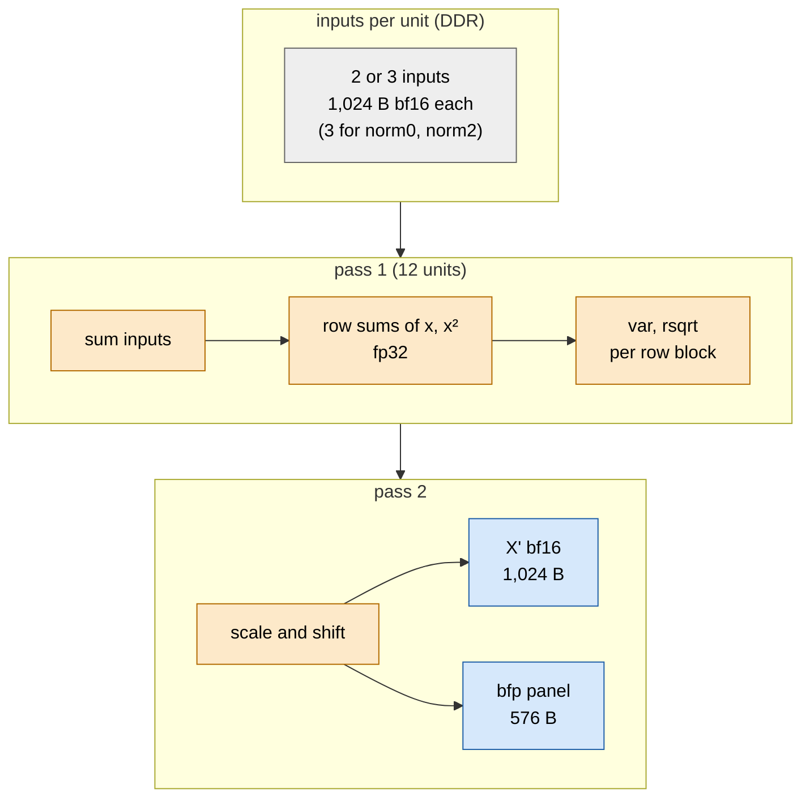

# TAPNext: norms

> **In brief**
>
> - Four norms per block (norm0 and norm1 are RMS, norm2 and norm3 are LayerNorm) run on the EW cores. Today each takes **63-92 µs per block**, about **3.8 ms per step**; in round 3 they took ~1.5 ms per block (~18 ms per step).
> - What bounds a norm depends on its **input count**. The two **3-input** norms (norm0, norm2: residual plus two K-half partials, 3 KB per unit) are **byte-bound at the aggregate DDR read cap**. The two **2-input** norms (norm1, norm3) are **compute-bound** at ~480 (RMS) / ~560 (LN) cycles per unit.
> - The time fell through three kinds of work: less per-call overhead (round 5), pass 1 and pass 2 in assembly (rounds 15-16, 24), and keeping the panels out of DDR (round 20).
> - The lesson: price every norm lever per input count. A byte lever does nothing for a 2-input norm and a compute lever does nothing for a 3-input one.
> - The general structure of a norm on the EW core is in [common/elementwise](../../common/book/elementwise.md#norms-the-general-structure).

**Conditions** for the absolute timings unless a row says otherwise: depth 12, NPU clock 1.808 GHz, walls from `TL_ONLY` timelines at build `r24z`, MEASURED (RESULTS 34.2).

**Terms.** EW = elementwise core. RMS = root-mean-square norm, LN = LayerNorm. Unit = one k-step (64 columns) of one row block. rb = row block (8 rows).
bfp = block floating point, the format the matrix unit reads. Panel = a bfp tile of a norm's output. Q16 = the residual-stream layout ([step-design.md](step-design.md)).
BD = DMA buffer descriptor. TAP = tensor access pattern (a multi-dimensional DMA address walk). DDR = the shared system memory. CP = command processor. NRES = "norm result stays on chip".

## The unit and the two passes

A norm is a loop over 216 units: 18 row blocks $\times$ 12 k-steps. Pass 1 collects a row block's statistics, pass 2 normalises it.



Outputs per unit: X' (bf16) and a bfp panel. With NRES only X' goes to DDR and the panel goes straight to the next GEMM's A slot on chip.

| Part | What it is |
|---|---|
| Inputs | norm0 = RMS of (previous block's D3 + D4 + residual); norm1 = RMS of (out + residual); norm2 = LN of (D1 + D2 + residual); norm3 = LN of (out_proj + residual). Block 0's norm0 has one input (X0). The final encoder norm is a 3-input LN (`ln_out`). |
| Residual X' | Stored as bf16 in the Q16 layout. The sum is commutative, so the streams are sorted by address and fetched with one 4-dimensional TAP (`plan8.py` `norm`). |
| Unit | One k-step of one row block: 8 rows $\times$ 64 columns, 1,024 B bf16 per input (3,072 B for 3 inputs). Output per unit: X' + panel = 1,024 B + 576 B bfp, or, with NRES, only X' to DDR and the panels on chip. |
| Pass 1 | Reads a row block's 12 units, sums the inputs, accumulates row sums of $x$ and $x^2$ in fp32 (`n1k`). Per row block: $\text{var} = (768\,q - s^2)/768^2$ with exact bf16 products, and rsqrt by a bit-trick seed plus Newton steps in hi/lo MACs. |
| Pass 2 | Applies scale and shift and pushes the bfp panels (`nrm_rms`, `nrm_ln`). |
| Parameters | Scale + 1, gamma, beta, eps: a header-keyed object per norm. eps travels in the header (round 5: the encoder norm uses torch's 1e-5; round 4 had 1e-6 for all). |

## Steps

The per-block cost fell in ten kept or tried steps. Each row is one round (evidence in the last column).

| round | step | measured | evidence |
|---|---|---|---|
| 4 | norm3's input TAP had a 10.5 MB BD step (20-bit field): columns ran one after another | 6 ms → 0.8 | NOTES 9.2; [G11](../../common/book/negative-results.md#g11) |
| 5 | one loop body per mode (template), `out_begin` / `out_end` slot reservation, statistics on 32 lanes in the MAC unit, no n_in branches | 0.31-0.36 → 0.10-0.13 ms per norm | NOTES 10.1 |
| 15 | `NRMK`: pass 2 as asm, X' stored and panels pushed straight into the output ring; `div768` for the slot counts | −0.40; −1.05 with the SSM | NOTES 20.1 |
| 16 | `N1K`: pass 1 + statistics per unit, loop-carried 64-lane MACs on register pairs, LN II 11, RMS II 10 | −0.16..−0.28 (priced −0.6) | NOTES 21.1, RESULTS 25.1 |
| 17 | `NPIPE`: pass 2 of rb interleaved with pass 1 of rb + 1 in groups of G = 6 units; AL1 padding of the params fills | −0.05..−0.15 (priced −0.55) | NOTES 22.1 |
| 20 | `NSEQ` + `NRES` on all four norms; panels leave the EW core on MM2S 1 into the memtile A slot | −0.17 / −0.19 (norm1), −0.65 (the other three) | `a5e07bf`, `4041189` |
| 22 | `TXT18`: norm twins by function pointer, a 2-trip stats loop, one ring copy (EW text −448 B) | −0.07 | `99e5b40` |
| 23 | `MSPLIT-P` on down_b / mlp3_b / out_proj: norms start on rows 0-5 | −0.27 in all | [gemm.md](gemm.md#msplit-p-the-last-tile-as-two-row-passes) |
| 24 | `STATS64`: the two 32-row halves' statistics as one 64-lane chain (tcall per row block LN ~1,050 → 471, RMS ~650 → 406) | −0.10 (priced −0.04..−0.08) | `3710969` |
| 25 | RRTWIN (timing twin), NIO2 (stamps), RRES (coded, not built) | nothing kept | `cbee01b`, `2c1b366` |

All deltas are ms per step (A/B in one process), except round 4 and round 5 which are per norm.

## What bounds a norm

Test: run the real norm and a **twin** that does not read the residual (outputs wrong), and compare walls. If the removed bytes explain the whole gap, the norm is byte-bound.

Walls, TL_ONLY at 3-4 µs polls, 3 runs each, `r24z` vs the RRTWIN twin, MEASURED (RESULTS 34.2):

| norm | kind | inputs | wall | RRTWIN | removed bytes explain it |
|---|---|---|---|---|---|
| norm0 | RMS | 3 | 90.1 µs | 67.0 | yes (−23 µs) |
| norm1 | RMS | 2 | 63.4 | 60.5 | no (−3) |
| norm2 | LN | 3 | 91.7 | 73.7 | yes (−18) |
| norm3 | LN | 2 | 71.7 | 70.3 | no (−1.4) |

### 3 inputs: the aggregate read cap

Eight columns each read 3,072 B per unit, and a unit takes 801 cycles:

$$\frac{8 \times 3{,}072\ \text{B}}{801\ \text{cycles}} \times 1.808\ \text{GHz} = 55.5\ \text{GB/s} = \text{aggregate read cap}$$

(DDRCAP, round 19).

- The cap is aggregate, so a second shim channel per column does nothing ([C13](../../common/book/negative-results.md#c13); [data-movement](../../common/book/data-movement.md#the-ddr-caps)).
- Only fewer DDR bytes move these norms: NRES (panels on chip) saved −0.65 ms; the RRTWIN bound for removing the residual stream is −0.49 ms.

### 2 inputs: compute

The floor is ~480 cycles per unit (RMS) and ~560 (LN), which coincides with their 2-input I/O rate. In situ, NIO2 (round 25) gives per-unit costs in cycles including stamps:

| | pass 2 in situ | pass 2 static | pass 1 incl. input waits |
|---|---|---|---|
| RMS | 287 | 117 | 720 |
| LN | 364 | 177 | 695 |

So **pass 2's glue (~170-190 cycles per unit around the asm kernel) is the larger half** of a compute-bound unit. Halving it would be worth up to ~−0.1..−0.3 ms (HANDOFF round 25 queue item 3, needs a static decomposition first).

### Why three models were wrong

- Before DDRCAP, three successive models blamed the output port (E2, 2.35 B/cycle), a fitted input rate (E5, 5.75 B/cycle) and one shim channel (3.8 B/cycle). Each fit let a free constant absorb the unseparated time ([H13](../../common/book/negative-results.md#h13), H3); stamps and DDRCAP replaced them.
- The N1K price (−0.6) assumed the per-unit glue would go. It stayed (`in_need` 28-41 cycles, pointer setup 36, `in_done` 39), and `in_need` still waited 104.8 cycles per unit.
- A twin that skipped pass 1 + statistics gave −1.98 ms (NORM_TWIN=2: 40.18 → 38.20) while N1K delivered −0.2. Removing compute from a partly input-bound unit overstates what faster compute buys ([H17](../../common/book/negative-results.md#h17)).

## RRES: residual rows on chip (coded, blocked at aiecc)

Norm0 and norm2 read the residual X' (a norm output of the previous block) from DDR. RRES parks part of it on chip so those reads disappear.

```text
mlp3_b / down_b leaves residual rows (rb < 10) in memtile half 1
        |   120 units x 1 KB fit (half 1 = 124,416 B)
        v
 2 KB ring --> EW core's free S2MM 1 --> norm0 / norm2
```

- Priced −0.27 ms (RRTWIN bound −0.49; EXTRAPOLATED), the queue's item 1 in HANDOFF round 25. Parameters: `plan8.py` `RRES`, `RRB = 10`.
- aiecc refuses it for two reasons: memtile (0,1)'s runtime BD budget ("too many simultaneously active buffer descriptors"), and the R ring's placement (`.aie.bank0` / `.aie.bank2` overflow; pin it after `core_data`, data_size 26,240).
- The default build also broke once when an `#ifdef` was inserted inside another's `#else` (`6f7b7d7`).

## What worked

- Template + slot reservation + direct ring stores (round 5: 3x faster than the per-64 B helper).
- Generated asm for pass 2 and pass 1 + statistics with panels pushed straight into the ring (NRMK, N1K), then one 64-lane statistics chain (STATS64).
- Cheap arithmetic for slot counts, exhaustive for $x < 2^{16}$, −1.05 ms in all:

    $$\lfloor x/768 \rfloor = \big(((x \gg 8) \cdot 21846) \gg 16\big)$$

- Keeping the norm→GEMM panels on chip (NRES, with NSEQ so the CP's per-column issue does not stagger the columns), −0.84 ms for all four.
- Pricing per input count after RRTWIN: it separated the two bounds in one run and killed the 3-input compute levers.

## What didn't work

| idea | outcome | why | index |
|---|---|---|---|
| a noinline "append 64 B to the output ring" helper | norms 3x slower than their DMA bound (0.31-0.36 vs 0.10-0.13 ms) | ~300 calls per row block; reserve slots per unit | [E1](../../common/book/negative-results.md#e1) <!-- nr: E1 --> |
| "norms are output-port bound, R_out 2.35 B/cycle" | wrong | stamps show `out_begin` ~5 net cycles; the fit put the missing pass-2 time on R_out | [E2](../../common/book/negative-results.md#e2) <!-- nr: E2 --> |
| NPIPE interleave | priced −0.55 on E2's bound, got −0.05..−0.15 (G 4-6) and +0.07 at G 2; with NIOC +0.06..+0.13 | each group pays `_end` / `_begin` (~45 cycles) | [E3](../../common/book/negative-results.md#e3) <!-- nr: E3 --> |
| NG1 / NG2 / NS / N-IO in asm | −0.44..−0.7 priced; NIOC measured −0.17..−0.23 against −0.55 static | pass 1 waits on input; round 25 settled the bound per input count, and the glue is the remaining lever | [E4](../../common/book/negative-results.md#e4) <!-- nr: E4 --> |
| a fitted input rate of 5.75 B/cycle | wrong | free constants absorbed the 3-input time; the bound is the aggregate read cap (8 × 3,072 B per 801 cycles) | [E5](../../common/book/negative-results.md#e5) <!-- nr: E5 --> |
| FOLD (n_in 3 → 2 by summing D1 + D2 / D3 + D4 upstream) | retired under a refuted fit; never re-priced. `unfinished` | under the DDR-cap reading, fewer input streams is exactly the lever | [E6](../../common/book/negative-results.md#e6) <!-- nr: E6 --> |
| an output-path bench and 1,600 B output slots | R_out is not binding | follows from E2 | [E7](../../common/book/negative-results.md#e7) <!-- nr: E7 --> |
| statistics as a second pass over the stage (NORM_SPLIT) | 0 ms; kept inside NRMK only | pass 1 was not the bound | [E9](../../common/book/negative-results.md#e9) <!-- nr: E9 --> |
| NRMK with X' / panel copy passes into the ring | +0.6 ms (direct stores −0.40) | per-call cost of the copy | [E10](../../common/book/negative-results.md#e10) <!-- nr: E10 --> |
| N1 priced −0.6 ± 0.25 | −0.16..−0.28 | the per-unit glue stayed and the norms are partly input-bound | [E11](../../common/book/negative-results.md#e11) <!-- nr: E11 --> |
| folding the norms into the GEMM prologue / epilogue (P7-FOLD, −4.6 ± 1.5 priced). `unfinished` | parked | GEMM L1 (932 B then) and text (544 B), an A-path residual protocol, a double drain; activation-side small-g channels are a numerics risk | [E18](../../common/book/negative-results.md#e18) <!-- nr: E18 --> |
| the residual add (or the K-split partial sum) in the producing GEMM's epilogue | would make the 3-input norms 1-2 input and stay bit-identical, but impossible | a GEMM core has two input ports and no third S2MM | [J1](../../common/book/negative-results.md#j1) <!-- nr: J1 --> |
| the EW core adding x + d1 while the second K half runs | no DDR headroom | moves 5.3 MB per op into ops already at ~66 GB/s | [J2](../../common/book/negative-results.md#j2) <!-- nr: J2 --> |
| prefetching a norm's independent inputs during the producer's drain tail | ≤ 0.07 ms | the ring holds ~5 units, ≤ 10 KB per column | [C25](../../common/book/negative-results.md#c25) <!-- nr: C25 --> |
| "the NPU sustains ≥ 84 GB/s", derived from norm walls × bytes | wrong | the measured aggregate read cap is ~55-59 GB/s | [C12](../../common/book/negative-results.md#c12) <!-- nr: C12 --> |
| EW fits with a nuisance parameter | misled three models | a free constant absorbs unseparated time | [H13](../../common/book/negative-results.md#h13) <!-- nr: H13 --> |
| the norm twin priced from step deltas | −1.98 vs −0.2 | a removal twin overstates for a partly input-bound unit | [H17](../../common/book/negative-results.md#h17) <!-- nr: H17 --> |

## Lessons

- Price a norm per input count: 3-input = bytes (only fewer DDR bytes help), 2-input = compute (the per-unit glue and pass 2 help).
- Per-call glue and slot arithmetic cost as much as the math; reserve per unit, store straight into the ring, divide by multiplying.
- A removal twin overstates when the unit is partly input-bound; use input-wait stamps (NPROF `in_need`) next to it.
- When a model has a free constant, run the probe that separates the terms before ranking levers (DDRCAP, RRTWIN).

## Going deeper

<details><summary>Evidence and code</summary>

- [`tapnext/npu/NOTES.md`](../npu/NOTES.md) 10.1, 20, 21, 22, 25, 30; RESULTS 25, 26, 34; RFM rounds 15, 16 (norm verdicts); PROPOSALS rev 21; HANDOFF round 25 queue items 1 and 3.
- Kernels: `tapnext/npu/ew8.cc` (`norm_rows`, NPIPE loop, `stats64`), generators `tapnext/npu/r15/gen_nrm.py`, `tapnext/npu/r16/gen_n1k.py`; probes: NPROF (round 16), NIO2 (round 18), `tapnext/npu/r19/ddrcap.py` (DDR caps), walls via `TL_ONLY` (`tapnext/npu/r24/tlo.sh`).

</details>

- [MACHINE](../../common/MACHINE.md) [M8.7](../../common/MACHINE.md#m8-7), [M10.5](../../common/MACHINE.md#m10-5), [M14.5](../../common/MACHINE.md#m14-5). Next: [boundaries.md](boundaries.md), [ledger.md](ledger.md).
