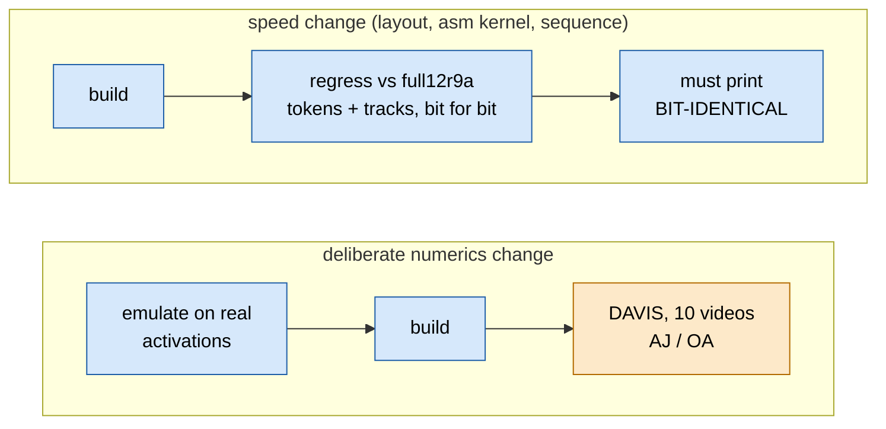
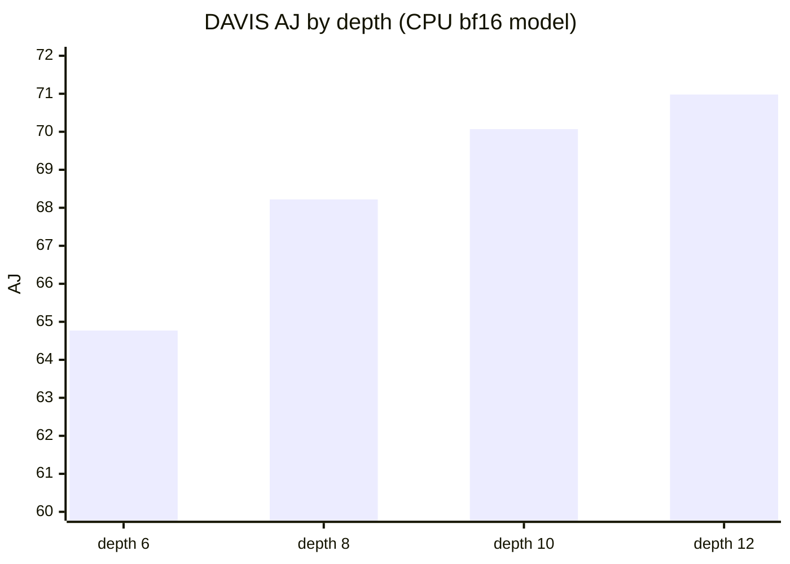

# TAPNext: numerics

> **In brief**
>
> - Every kept change since round 9 is **bit-identical** to the reference build `full12r9a`: the final tokens of all 1,152 rows and the tracks over 4 frames compare equal (`step8.py regress`, MEASURED, every round 10-25).
> - The numerics were fixed in rounds 5-9 and cost nothing measurable on TAP-Vid DAVIS: **AJ 70.84 (OA 92.57) at depth 12** and **69.90 (91.02) at depth 10** on the 10-video subset, against 70.98 / 70.07 for the CPU bf16 model and 70.54 for the GPU emulation of a bf16 trunk (RESULTS 3, 8, 34.3).
> - The recipe: bfp16 operands into fp32 accumulators, bf16 elementwise math, tables for the transcendentals (GELU, attention exp, SSM sigmoid and sqrt), and the device's own bfp conversion modelled exactly in the host references (`encode_hw`).
> - What is not in the step: changes that are not bit-identical (a few lever candidates, parked behind a DAVIS round that was never run).
> - The general rules for judging an approximation are in [common/elementwise](../../common/book/elementwise.md#judging-accuracy). This chapter is what TAPNext does and decided.

**Conditions**: DAVIS numbers are the 10-video "first" subset, 48 query slots (earlier builds 128), vendored model; MEASURED unless marked.

**Terms.** AJ = average Jaccard, OA = occlusion accuracy (the TAP-Vid DAVIS scores). bfp16 = block floating point, 8 values per shared exponent. bf16 = bfloat16. LUT = lookup table. GELU = the MLP activation. SSM = state-space mixer.
RMS = root mean square. ulp = unit in the last place. RNE = round to nearest even. EW = elementwise core. L1 = a core's local memory.

The two judges, in order of cost:



## The gates

| gate | what it checks | where |
|---|---|---|
| `step8.py regress --ref NAME` | final tokens (all 1,152 rows) + tracks over 4 frames, bit-for-bit against a saved build; must print BIT-IDENTICAL | every kept change, rounds 10-25; SKILL ("bit-level regression") |
| `step8.py blocks` | a depth-1 build with the **real weights** against the torch block, region by region | found the GELU bug (clamped multiplicand) that every random-data test missed (round 4), and the permuted SSM parameter tiles (round 7) |
| directed tests t1 / t2 / t3 / t4 / t5 (`run8.py`) | GEMM + norms, gated pairs, SSM, qkv → attention → out_proj, patch embed, against bit-level numpy models | RESULTS 12, 15.6 |
| `asmlint`, one-core benches with hashes | the generated kernel against the C++ or a numpy model, guard zones clean | [measurement](../../common/book/measurement.md#correctness-gates) |
| DAVIS, 10 videos "first" (`s8.sh davis`) | the end metric: AJ / OA / δ | rounds 4-9 and re-runs; numerics unchanged after round 9, so later builds were not re-run (r20, r21, r25 re-ran it, identical) |

Why both:

- The regress is exact and cheap, so a refactor (every asm kernel, every layout) is judged on it.
- DAVIS is the only judge of a numerics change, because SSM numerics at the ulp level give the same chaotic 30-frame noise (~0.015 px mean, 0.1-0.2 px max over 30 frames; CPU model, RESULTS 18.3, [H26](../../common/book/negative-results.md#h26)).
- The in-situ regress also caught what benches missed: g2f's lock race, and a scalar OR read one cycle early in the attention flag (NOTES 18.4, 19.3, 23.1).

## DAVIS across the rounds

10 videos, "first", 48 slots (earlier builds 128), vendored model, MEASURED unless marked (RESULTS 3, 8, 13-18, 24-34).


| build / round | depth 12 AJ (OA) | depth 10 AJ (OA) | note |
|---|---|---|---|
| CPU bf16 (`davis_cpu.py`) | 70.98 (92.76) | 70.07 (91.21) | depth 8: 68.22, depth 6: 64.77 |
| GPU emulation, bf16 trunk | 70.54 (92.49) | - | RESULTS 3 |
| + bfp16 operands on all 96 trunk GEMMs, fp32 accumulate | 70.47 | - | −0.07 |
| + bfp16 Q / K / V / P in the attention | 70.37 | - | −0.17 vs bf16 |
| the scratch NPU path (trunk + attention on the NPU, rest CPU) | 70.68 | - | RESULTS 5 |
| design8 `full12f` (round 4) | 70.81 | - | |
| round 5 (`full12m`) | 71.00 | 69.87 | depth 8: 68.28 |
| round 6 (LUT GELU) | 70.83 | 69.94 | depth 8: 68.25 |
| round 7-8 | 70.78 | 69.83 | |
| **round 9 on (`full12r9a`)** | **70.84 (92.57)** | **69.90 (91.02)** | SSM tables; every later build bit-identical |

- The step is within ±0.4 AJ of the CPU model, which is noise on 10 videos (RESULTS 8: "the three differ only in reduction order").
- Depth falls AJ by ~0.9 (10), ~2.8 (8), ~6.2 (6) on the CPU model (figure below).
- Depth 10 + 8 support points per query reached 71.33 (+0.35 over depth 12, CPU model), which needs up to 225 query slots, and the step has 48.



## bfp16 and `encode_hw`

Operands and activations that feed a GEMM are **bfp16ebs8**: 8 values share one exponent.

```text
one block (9 B):   [E] [m0 m1 m2 m3 m4 m5 m6 m7]
                    |   8 x int8 mantissas
                    1 B shared exponent
one panel (72 B):  8 blocks = an 8 x 8 tile
accumulators:      fp32 over the whole K
```

The accumulators stay fp32 over the whole K ([common/gemm](../../common/book/gemm.md#is-it-compute--or-data-bound); moondream F4).

The rules:

- **The device's conversion differs from the host codec.** `to_vector<bfp16ebs8>()` / `vst.push.conv` rounds to nearest even at the block's max exponent, and when a mantissa would round to +128 it **bumps the shared exponent and re-rounds every mantissa from the exact values**; −128 is kept.
  `aie.utils.bfp.encode` saturates at +127 and bumps nothing, so device-produced panels differ from host-encoded ones in ~2.5 % of panels (one row by one mantissa step). `tapnext/npu/pack7.py:encode_hw` reproduces the device bit-exactly (0 of 13,824 panels differ;
  `r12/pushcheck.py` checks the pushes) and is the reference for anything a kernel converts. Host-encoded GEMM operands stay with the codec because the mmul consumes either (RESULTS 11; SKILL §6).
- **Rounding mode.** The core default is FLOOR; `aie::set_rounding(conv_even)` once per core, else every bf16 / bfp conversion truncates ([elementwise](../../common/book/elementwise.md#the-bf16--fp32-rules)).
- **V^T panels share exponents over keys**, so the host reference encodes the transposed matrix (NOTES 8.3); the 8-lane bf16 `max` returns wrong values ([F8](../../common/book/negative-results.md#f8)).
- RMSNorm with torch's bf16 numerics (`bf16(x²)` summed in fp32, mean → bf16, + eps → bf16, rsqrt → bf16, `x · rstd` → bf16, `· (scale + 1)` → bf16) was bit-exact against numpy on 1,152 × 768 random rows (RESULTS 11).

## The LUT choices

Round 3's elementwise numerics (`nk8.h`, NOTES 8.1): exp32 with an fp32 hi/lo argument, reciprocal by an elementary-unit seed + two fp32 Newton corrections, GELU = x·sigmoid(2u) with u in fp32 (15 % of bf16 roundings flip, ≤ 2 ulp), sqrt by an int16 seed + 2 Newton steps. Then, by site, all judged on real activations by the bfp ratio (`r6/numh.py`):

$$\rho = \frac{\text{rms}(\text{approx} - \text{exact})}{\text{rms}(\text{bfp16}(\text{exact}) - \text{exact})}$$

so $\rho < 1$ means the approximation is more accurate than the bfp16 rounding the tensor will get anyway.


| site | choice | evidence |
|---|---|---|
| GELU in yx, gated | table, 64 segments of 1/8 on [−4, 4), hand lookup (16 ns per 32 lanes vs 63), bf16 slope, fp32 offset, later flat-edge tables and `bgelu` fusion; **tanh** form | bfp ratio 0.059 / 0.264, equal to nk8; DAVIS 70.83; −6.0 ms (NOTES 11.1) |
| GELU in mlp0 | the same table with the **erf** form torch's `nn.GELU()` computes (every earlier build used tanh there) | vs the erf reference: nk8 (tanh) p99 39 ulp, erf LUT p99 3.3 ulp, same rms 8.7e-4 (RESULTS 15.5) |
| attention exp | 80 segments of 1/4 on [−11, 9), the bottom 4 zero, bf16 slope and fp32 offset, argument in fp32 straight from s and m, P converted to bfp16 from the fp32 accumulator | softmax-weight row-norm error 0.91-0.96x the round-6 `expd_i` on real scores (`r7/expemu.py`) |
| attention 1/sum | a 64-lane vector reciprocal from the ones-panel sums | t4 O rms_rel 7.16e-3 → 6.99e-3 (not bit-identical to round 5) |
| SSM sigmoid | one asymmetric table, 1/8 segments on [−12, 8), clamped | gates mismatching torch: gate_x 18.7 → 5.3 %, gate_a 16.9 → 4.9 %, a 13.1 → 8.5 %, mult 40.3 → 6.6 %, fixed-point drift p99 3.3 → 2.9 % (RESULTS 18.3) |
| SSM sqrt | exact bf16 sqrt by a 256-mantissa 16-bit table and an int16 exponent halving | 0.09 % (-0 only) vs 33.7 % for nk8 |
| SSM exp | the arithmetic 2^f with an hi/lo argument (a table of 2^f was as accurate, not faster) | 0.53 % != RNE(exact); the 2^f table 0.23 %, 61.5 vs 60.7 cycles per 32 lanes |

Round 9's SSM tables were the last deliberate numerics change (**new numerics, more accurate on every metric**, DAVIS 70.84 / 69.90) and defined `full12r9a`; −2.8 ms. Since then speed work changed instruction sequences and layouts, never a rounding.

## Numerics parked behind a DAVIS gate

Not bit-identical, so each needs a DAVIS round (and some a bigger budget) that was never run. F10, F11 and E18 are `unfinished` in the index, F12 `measured-here`; all are small except E18 (≤ −0.3 ms each otherwise).

- [F10](../../common/book/negative-results.md#f10) <!-- nr: F10 --> bias as the accumulator's initial value (P24c): removes bias loads and MACs from every epilogue, but changes the fp32 order.
- [F11](../../common/book/negative-results.md#f11) <!-- nr: F11 --> fewer lazy-max flags by numerics: seed the max with q·k (flags after chunk 0: 2.26 → 0.27 %, ~−0.3 ± 0.4 ms) or TAU 8 → 16 (exp table to +17: +1 KB of L1 that is not there).
- [F12](../../common/book/negative-results.md#f12) <!-- nr: F12 --> FlashAttention-4-style software exp: SSM (2^f for half the vectors by a 256-entry int16 table) −0.05..−0.15, attention ≤ −0.1 (attkb is register-bound); within 1 bf16 ulp, "not worth a DAVIS round".
- [E18](../../common/book/negative-results.md#e18) <!-- nr: E18 --> folded norms (fold (1 + scale) into the next weight's rows, rstd in the epilogue): priced −4.6 ± 1.5 ms; weight-side error ratio 1.013-1.023 is fine, the activation side (small-g channels, bfp before the mean is removed) is the numerics risk and also needs GEMM L1 and text.

## What worked

- A regress that is exact and cheap, run on every kept change of rounds 10-25: no kept speed change altered a token or a track.
- One reference (`full12r9a`) and one end metric (DAVIS), both fixed after round 9; every speed lever is judged against them, so no lever traded accuracy for time.
- Emulating the exact op sequence on real activations before building a numerics variant (numpy bit models 99.2-99.9 % bit-equal to the device): minutes to reject, not a build.
- Tables where an op's accuracy is not the limit, hi/lo arithmetic where it is, the table's tail checked against what its consumer needs (the sigmoid table's tail feeds a ≈ 1).

## What didn't work

| idea | outcome | why | index |
|---|---|---|---|
| a reciprocal-free / polynomial GELU | 26-37 % bf16 mismatches, up to 4-6 ulp, vs 15 % / 2 ulp | a polynomial in \|x\| is ill-conditioned in bf16 Horner (1.6e-2) | [B6](../../common/book/negative-results.md#b6) <!-- nr: B6 --> |
| rounding s − m to bf16 before the exp | up to 2-3 % error at \|s − m\| ~ 10 | bf16 resolution near 10 | [D4](../../common/book/negative-results.md#d4) <!-- nr: D4 --> |
| the hardware `vtanh`, `aie::exp2`, `aie::inv` | `vtanh` identity for \|x\| ≤ 0.5 and 2-7 % off up to 2; `exp2` p99 10 ulp; `inv` correct but scalar | inaccurate or scalar | [F7](../../common/book/negative-results.md#f7) <!-- nr: F7 --> |
| the 8-lane bf16 `aie::max` | wrong values | cause not chased | [F8](../../common/book/negative-results.md#f8) <!-- nr: F8 --> |
| one Newton step in the reciprocal | bfp ratio 0.4-0.6, visible on the next tensor | too coarse | [F9](../../common/book/negative-results.md#f9) <!-- nr: F9 --> |
| SSM numerics judged by 30-frame max deviations | any ulp-level SSM change gives the same chaotic track noise | judge by DAVIS | [H26](../../common/book/negative-results.md#h26) <!-- nr: H26 --> |
| the symmetric sigmoid table | revived as the asymmetric one | | [E13](../../common/book/negative-results.md#e13) <!-- nr: E13 --> |
| rarer lazy-max flags without a numerics change | already 0.055 % | only a numerics change (F11) reduces it | [D15](../../common/book/negative-results.md#d15) <!-- nr: D15 --> |

## Lessons

- Make speed work bit-identical by construction (same MAC order, same roundings), and keep a regress that proves it. Spend a DAVIS round only on a deliberate numerics change.
- Test with real weights and real activations. Random data hid the GELU clamp, the permuted SSM tiles and the attention's softmax statistics.
- Model the device's conversion exactly (`encode_hw`); a host codec that saturates differs in 2.5 % of panels.
- Judge an approximation on the tensor it lands in (the bfp ratio), and check the tails against the consumer.

## Going deeper

<details><summary>Evidence and code</summary>

- [`tapnext/npu/RESULTS.md`](../npu/RESULTS.md) 3, 8, 11, 13.4, 15.4-15.6, 18.3; NOTES 8.1, 9.1, 11.1-11.2, 14.1; `.claude/skills/xdna2-npu/SKILL.md` §3, §6, §7.
- Code: `tapnext/npu/nk8.h`, `pack7.py` (`encode_hw`), `step8.py` (`regress`, `blocks`, `davis`), `r6/numh.py`, `r6/emu.py`, `r6/capture.py`, `r6/lutgen.py`, `r7/expemu.py`, `r9/ssmemu.py`, `r9/ssmlut.py`.

</details>

- DAVIS logs: `tapnext/npu/davis_cpu.jsonl`, `davis_npu.jsonl`. [common/elementwise](../../common/book/elementwise.md#tables-lut-loads) for the table mechanics. Next: [ledger.md](ledger.md).
