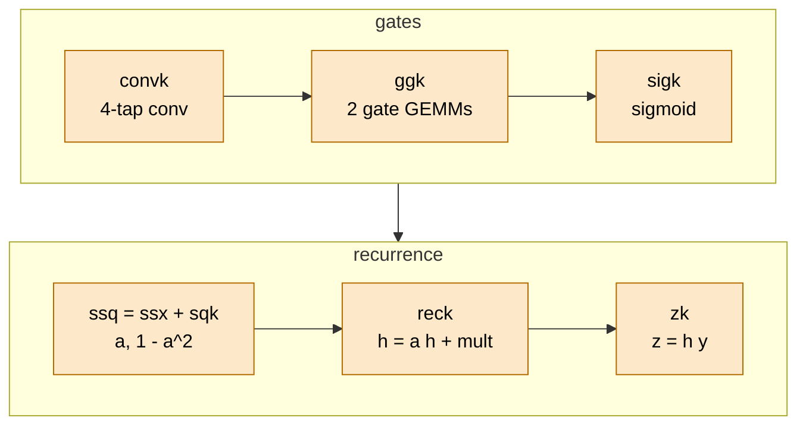
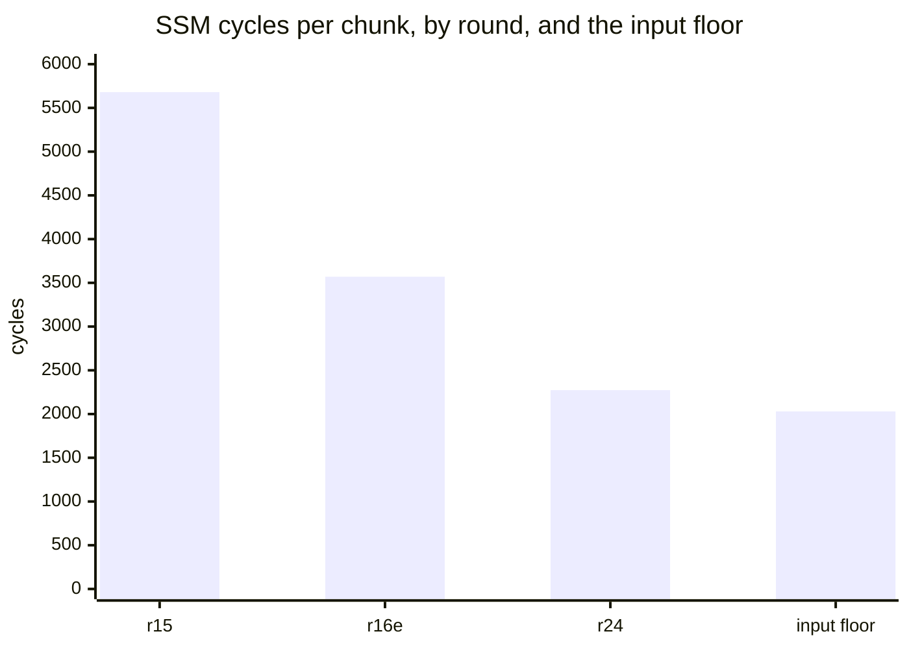

# TAPNext: SSM (RG-LRU on the EW cores)

> **In brief**
>
> - The recurrent half of each block (conv1d over 4 frames, two gate GEMMs, the RG-LRU recurrence in fp32) runs on the eight EW cores, one head at a time,
>   216 chunks per block and column. It is now **~290 µs per block (~3.5 ms per step)**, overlapping the yx GEMM that feeds it (MEASURED timelines).
> - It started at 6.7 ms per block (round 3 differential; 7.2 before the round-4 rewrite). Almost all of the gain came from **moving each phase of the chunk loop into a modulo-scheduled asm kernel**, one at a time:
>   a chunk went from ~5,680 cycles (round 15) to 2,273 (round 24, SSMIN).
> - The last measurement settled what bounds it: **compute-bound by ~255 cycles per chunk above an input floor of ~2,030 cycles** (MEASURED, SSMCUT,
>   `tapnext/research/r26/ssmcut_r25s.out` and `tapnext/research/r26/ssmcut_r25g.out`).
> - Two unbuilt glue changes could mostly recover that (−0.15..−0.25 ms, PROPOSALS rev 21 rank 1). The general tables, exp and norm structure are in [common/elementwise](../../common/book/elementwise.md).

**Conditions.** Depth 12, NPU clock 1.808 GHz, cycles are EW-core cycles per chunk (mean of 8 columns) unless tagged. Status MEASURED unless tagged MODEL.

**Terms.** SSM = state-space model; RG-LRU = the gated linear recurrence used here. EW = elementwise core. II = initiation interval of a modulo-scheduled loop (U = unroll). CP = command processor.
CP-SAT = the solver that schedules loops. bfp = block floating point. Static cycles = a one-core bench (`tcall`), in situ = inside the running step. Glue = pointer, lock and copy code around a loop.
Twin = a build with some compute removed, to find the bound.

## What a chunk is

A chunk is **8 rows × 64 channels of one head** (512 values). Per head the EW core first takes the head's parameter object (12,288 B: conv taps, softplus parameter, two 64 × 64 gate weight tiles, biases, LUT rows),
then 18 chunks (one per row block):

```text
per head:   [ params 12,288 B ]  [chunk 0] [chunk 1] ... [chunk 17]

chunk in  (7 KB):  y | conv history R0 R1 R2 R3 | h lo | h hi
                       (R = last three frames of x plus the current)
chunk out (3 KB):  h lo | h hi | z panels
                       (z = h*y as bfp, the A of the next GEMM, out)

12 heads x 18 row blocks = 216 chunks per block and column
```

`ew_ssm` is in `tapnext/npu/ew8.cc`. The phases, all generated (`rNN/gen_*.py`):



Each chunk repeats the six kernels, with part-pointer glue (`INPART_INLINE`, `PTRG`, `cpy64`) before them.

| phase | kernel | what it does | static cycles per chunk (tcall, r24g) |
|---|---|---|---|
| input parts | `INPART_INLINE`, `PTRG`, `cpy64` | pointers to the 7 parts, straddle copy | glue |
| conv1d | `convk` | 4-tap conv, one column block per iteration, II 20 (the vec bound); pushes xc's bfp panels (CGF) | 228 (glue 68) |
| gates | `ggk` | both gate GEMMs as one loop over the 8 (gate, np) pairs, II 24; epilogue bias + round | 282 (90) |
| gate sigmoid | `sigk` | sigmoid table line, kernel-only loop, II 10 / U 4 | 85 at 1 trip (45) |
| a, 1 − a² | `ssq` = `ssx` + `sqk` | log_a, exp, exact bf16 sqrt in one loop, II 30 / U 2 / 6 stages | 674 (194) |
| recurrence | `reck` | h = a·h + mult, state kept in vector order, written straight into the output ring (HRING) | 268 (92) |
| z panels | `zk` | z = h·y, pushed as bfp panels straight into the ring (or the panel ring under SRES) | 74 (34) |

Sum 1,828-1,845 cycles per unit static ([M15.3](../../common/MACHINE.md#m15-3)). In situ the whole unit was 2,273 (SSMIN, r24s): the rest is part-pointer glue, locks and ring waits.
The `first` frame flag is a vector mask (`mfirst` / `mrest`): state = input on frame 0, no instruction variants per frame.

## Where the cycles went

EW PROF, cycles per chunk (mean of 8 columns, MEASURED, NOTES 20.2, 21.2, RESULTS 24.2, 25.2; "SSM op" is the timeline's per-block span):

| phase | r15 (PROF r15b) | r16e | r24 (tcall, static) |
|---|---|---|---|
| conv | 1,125 | 440 | 228 |
| gates | 652 | 365 | 282 |
| sigmoid | 509 | 509 | 85 (1 trip) |
| log_a + exp + sqrt | 509 + 493 | 715 | 674 |
| recurrence | 902 | 313 | 268 |
| z panels | 237 | 264 | 74 |
| waits, copies, pointers, rest (total minus the rows above) | ~1,255 | ~935 | glue is inside the rows above |
| chunk total | ~5,680 | ~3,570 | **2,273** (SSMIN, in situ) |
| SSM op per block (timeline) | ~532 µs (r15m) | 426 µs | ~290 µs, overlapped with yx |



Three findings steered the work:

- **The wall was code, not waits.** At round 15 the SSM waited 165 cycles for input and 31 for output of ~5,680 (PROF); the C++ conv loop ran 377 cycles on a one-core bench but ~1,000 in situ (pointers through the stack, `in_part`).
  Generated loops then ran near their bench numbers in situ (sqk 311 / 321, ggk 310 / 365, ssq 701 / 715). Price C++ phases from in-situ stamps, not from a bench of the same source ([E15](../../common/book/negative-results.md#e15) below).
- **Per-call overhead of small helpers dominated.** Slot-count loops (`in_need`, `in_done`) were subtraction loops called per unit and chunk; $\lfloor x/256 \rfloor \cdot 21846 \gg 16 = x/768$ for $x < 65{,}536$ removed them:
  −1.05 ms together with the norms (round 15). Stores into the EW output ring cost ~3.5 cycles per vector in situ against 1 on the bench until the copies were removed;
  extra passes over the ring cost more than they saved (NRMK with copies +0.6 ms, with direct stores −0.40).
- **Register pressure sets the loop shape.** SSQ could not fit below II 30 with 12 x registers (13 bf16 constants are reloaded per use from a 704 B table); FSX (gate_a's sigmoid inside ssq) found no CP schedule at II 30-33.

## Steps, in order

| round | step | measured (ms per step) | evidence |
|---|---|---|---|
| 4 | rewritten SSM: per-head broadcast tables, array-loop transcendentals, slot-wise output, a vector reciprocal | 7.2 → 1.45 ms per block | NOTES 9.2 |
| 8 | `gate_gemm` (constant trip counts, 1,190 → ~300 cycles), `in_part`, `out_copy`, loop shapes | −2.4 | NOTES 13.1 |
| 9 | sigmoid and sqrt by table (new numerics, more accurate), tables in two banks, exp as five pipelined passes | −2.8, −0.35, −0.22 | NOTES 14.1 |
| 12 | `sigk` in asm, II 12, kernel-only | −0.61 | NOTES 17.1 |
| 15 | `ssx` −0.79, `cpy64` −0.18, `convk` −0.72, `reck` −0.84, `zring` −0.12 | | RESULTS 24.1 |
| 16 | `sqk` −0.18..−0.25, `INPART_INLINE` −0.29, `XONE` −0.28, `ggk` ~−0.41, `ssq` −0.125, `sig10` −0.05..−0.07 | | RESULTS 25.1 |
| 17 | X1 conv history as a mod-4 rotation | −0.33 per rotating frame | `0b687ba` |
| 18 | `HRING` + `PTRG` −0.35, `ZK` −0.14, `CGF` −0.06 | | RESULTS 27.1 |
| 23 | YXSSM −0.41, YXR −0.38 (the SSM starts while yx runs) | −0.79 | `baeaf64`, `c9f9779` |
| 24 | SSMPRE −0.07, CPPRE −0.09 (column skew of the CP issue) | −0.16 | `39eadff`, `b76509d` |

### X1: the conv history by rotation

$x(t)$ needs $x(t-1) \dots x(t-3)$. Copying them each frame cost 432 cycles per chunk (`cp_x`, 269 after XONE). Round 17's design instead writes the yx drain's x half into $R[t \bmod 4]$
(the drain TAP splits y | x) and maps tap $x - k$ to $R[(t-k) \bmod 4]$ in the kernel:

```text
frame t   : drain writes x(t)    -> R[t mod 4]
tap k=0..3 reads                 -> R[(t - k) mod 4]
(params header word 2 = 1 + phase; four params copies in W)
```

No copy, no state motion; the price is **4 runtime sequences per depth** and a rotating instruction buffer.
The first form, a sliding area with a wrap frame, gave the same −0.33 but +232 MB of ACT ([E17](../../common/book/negative-results.md#e17), [step-design.md](step-design.md)).

> **Pitfall.** Params fills must total a multiple of the 768 B ring slot. A 1 KB-padded params fill hung the step (round 17); padding to 3 KB multiples (AL1) gave half the predicted gain.

## SSMIN and SSMCUT: what bounds the SSM

Hypothesis in rev 20 (research): the SSM span reads at 54 GB/s, ~95 % of the aggregate DDR read cap, so it is read-capped and glue work is worth ~0 (SSPM-B ranked first).
Main's SSMIN stamp (`0413c92`, `r24/ssmin.py`) measured per chunk **in_need 52 cycles (≈44 of it the call), params 28, whole chunk 2,273**: the input ring never ran dry.
Research's SSMCUT twin removed `sigk` and `ssq` (~1,000 cycles) and measured:

| build | chunk cycles | in_need (input waits) |
|---|---|---|
| r25s (r24z + SSMIN) | 2,289 | 71 |
| r25g (twin, sigk + ssq removed) | 2,034 | 529 |

- Pre-registered outcomes H_C (chunk 1,150-1,350) and H_R (≥ 2,050) both missed; the registered in-between band held ([M1](../../common/book/negative-results.md#m1), [M2](../../common/book/negative-results.md#m2)).
- **The input floor** is one shim MM2S channel per column, which is also ~56 GB/s over 8 columns, the read cap; the two limits coincide:

$$t_\text{floor} = \frac{7{,}851\ \text{B}}{3.86\ \text{B/cycle}} \approx 2{,}030\ \text{cycles per chunk}$$

- So today's SSM is compute-bound by ~255 cycles per chunk. Ceiling (MODEL):

$$\frac{255 \times 2{,}592\ \text{chunks per column and step}}{1.808\ \text{GHz}} = 0.37\ \text{ms}$$

- Priced: SSM glue (ssq2 + reck2 + ggk2 over chunk pairs) −0.15..−0.25; SSPM-B (params read once instead of by all 8 columns: 683 of 7,851 B per chunk) + KPAD lower the floor to ~1,870,
  −0.05..−0.15 and only together with compute cuts (PROPOSALS rev 21 ranks 1, 4). Twin end spread 0.5-0.9 µs against 1.6-2.4 µs: input-paced columns finish together.
- **The glue needs ~5 KB of EW L1** (doubled chunk buffers). Research found 5.4-6.9 KB: stack 0x1300 → 0x800 (+2,816 B; deepest path 1,792 B, asm frames 64 B),
  free section tails 1,472 + 960 + 128 B, norm-only scratch shared with SSM-only buffers (+1,536 B). The input ring at 16 slots would add 3 KB.
  Not applied (EWSTACK in the queue; [ledger.md](ledger.md)).

## Overlap with yx and the CP skew

The SSM's head $q$ needs only yx's tiles $y(q)$ and $x(12 + q)$ but waited for the whole yx.

```text
yx steps, YXR order:   0  4  1  5  2  6  3  7      (y / x interleaved)
SSM starts after step 2 of 8
YXSSM drains yx in four groups; the SSM waits per group
```

The z panels go on chip to `out`'s A (SRES) into the slot half the GEMM does not hold. Mechanism and rules: [boundaries.md](boundaries.md#the-yxssm-pattern).
Measured: yx's wall grew 94 → 164 µs (shared DDR), the SSM overlaps ~130 µs of it, −0.79 ms.

In the r24 timeline the SSM's columns started ~1.6 µs apart in column order (start spread 11-12.8 µs per block), because the CP issued each column's two head-0 fills after the yx wait.
SSMPRE (params before the wait) cut the spread to 4.1-4.5 µs.

## What worked

| lever | result |
|---|---|
| Generated, CP-scheduled loops for every phase, each verified bit-identical in situ (asmlint 0, regress BIT-IDENTICAL) | 7.2 ms per block → ~0.29 ms (overlapped) |
| Tables for the transcendentals (round 9) | −2.8 ms, more accurate than the arithmetic version ([numerics.md](numerics.md#the-lut-choices)) |
| Removing per-call glue (slot counts by multiply, inlined part pointers, XONE, HRING), state in vector order on both sides | see the steps table |
| Rotating roles instead of copying history (X1) | −0.33 per rotating frame |
| Overlapping with the producer at the consumer's unit (YXSSM + YXR), then removing the CP skew (SSMPRE, CPPRE) | −0.79, then −0.16 |

## What didn't work

| idea | outcome | why / lesson | index |
|---|---|---|---|
| Symmetric sigmoid table on $[0, 8)$ | 5.1 % vs 18.6 % bf16 mismatches | $1 - s$ loses small-value relative accuracy and the gate feeds $a \approx 1$. **Revived** as one asymmetric $[-12, 8)$ table (−2.8 ms with sqrt, round 9) | [E13](../../common/book/negative-results.md#e13) <!-- nr: E13 --> |
| Cheaper exp | range-reduced $2^f$ table 61.5 vs 60.7 cycles per 32 lanes; piecewise-linear exp on log a 17-29 % mismatches | not faster / not accurate; the chain went to asm instead (SSX) | [E14](../../common/book/negative-results.md#e14) <!-- nr: E14 --> |
| "The asm z loop is no faster than C++" | 100 vs 97 cycles on one core | a bench artefact; in situ the C++ was serial. ZK gave −0.14..−0.19. **Revived** | [E15](../../common/book/negative-results.md#e15) <!-- nr: E15 --> |
| "Stores into the output ring cost ~3.5 cycles each" | fixed by fewer calls | the cost is a fixed call cost per 16 vectors | [E8](../../common/book/negative-results.md#e8) <!-- nr: E8 --> |
| Params fills padded to 1 KB multiples | the step hung; 3 KB multiples gave half the predicted gain | a packet BD completes per 768 B slot | [E12](../../common/book/negative-results.md#e12) <!-- nr: E12 --> |
| sqrt fused into ssx below II 27, and FSX | no schedule with 12 x registers (II 30 kept) | `unfinished` | [E16](../../common/book/negative-results.md#e16) <!-- nr: E16 --> |
| FSX at II 30-33 | nothing in 600-700 s each | its "read-capped, ≤ −0.05" value bound is stale after M1, so re-price | [L2](../../common/book/negative-results.md#l2) <!-- nr: L2 --> |
| A span near the cap priced as capped | SSMCUT shows compute-bound | near a cap is not on it | [M1](../../common/book/negative-results.md#m1) <!-- nr: M1 --> |
| Removing SSM compute lands 1:1 | the twin chunk was 2,034 with 529 cycles of input waits | cuts beyond ~255 need fewer input bytes | [M2](../../common/book/negative-results.md#m2) <!-- nr: M2 --> |
| yx's output to the SSM on chip and the params multicast once (YRES / SSPM) | ~0 when the SSM was compute-bound | conditionally revived once the glue reaches the floor | [J4](../../common/book/negative-results.md#j4) <!-- nr: J4 --> |
| YXH (head-major yx steps, finer drain groups) | 7 drain TAPs per column +0.48; 4 TAPs +0.09 | a shim channel queues ~5 tasks; more yx reads inside the read-capped SSM span (SSM wall 289 → 308 µs) | [L6](../../common/book/negative-results.md#l6) <!-- nr: L6 --> |

Not indexed: ZDROP (SSM ring h-only under SRES, −1.77 MB writes per block) +0.05 / neutral, ZCH (z panels per chunk) +0.01..+0.02, MSDEFER neutral:
the span is not write-bound and `out` is issued after the SSM's fills (NOTES 28.4, 29.4).

## Lessons

- Move one phase at a time into a generated loop and price it from the in-situ stamp of that phase, not from a bench of the C++ it replaces.
- Near a cap is not on it. A removal twin with input-wait stamps measures the distance to the floor; pre-register the in-between result.
- Per-call glue (~30-70 cycles around a loop) is as large as some loops; the whole call is what is priced.
- When consumer and producer are on different cores and the consumer needs a fraction of the producer's output, overlap at the consumer's unit, then cut the CP's per-column skew.
- L1 for the next change (here ~5 KB) is the real queue item. Count bytes before ranking.

## Going deeper

- [`tapnext/npu/NOTES.md`](../npu/NOTES.md) 9.2, 13-14, 20-23, 28-29; RESULTS 24-27, 32-33; ANALYSIS rev 21 §1, §3; PROPOSALS rev 21 ranks 1-4.
- Generators: `tapnext/npu/r12/gen_sig.py`, `r15/gen_ssx.py`, `r15/gen_conv.py`, `r15/gen_rec.py`, `r15/gen_cpy64.py`, `r15/gen_zk.py`, `r16/gen_sqk.py`, `r16/gen_ggk.py`, `r16/gen_ssq.py`; tables `r9/ssmlut.py`, `r9/ssm9.h`; probes `r24/ssmin.py`, `tapnext/research/r26/ssmcut_r25s.out`.
- [MACHINE](../../common/MACHINE.md) [M6.3](../../common/MACHINE.md#m6-3), [M7.2](../../common/MACHINE.md#m7-2), [M15.3](../../common/MACHINE.md#m15-3). Next: [norms.md](norms.md), [boundaries.md](boundaries.md).
