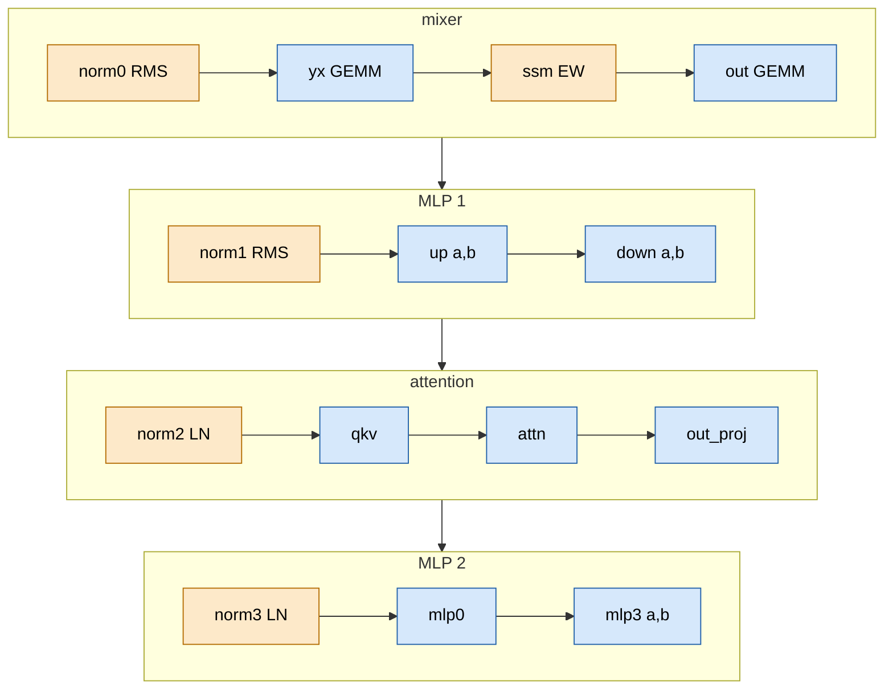
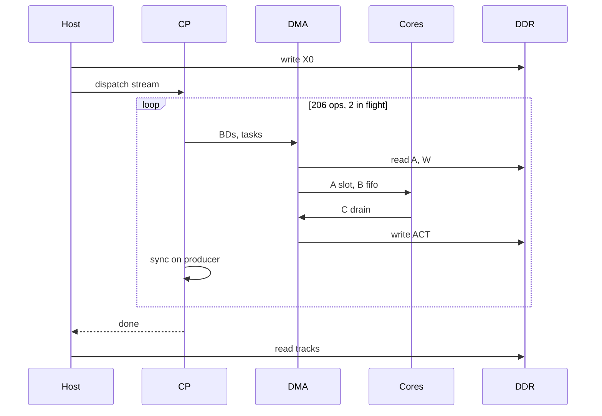
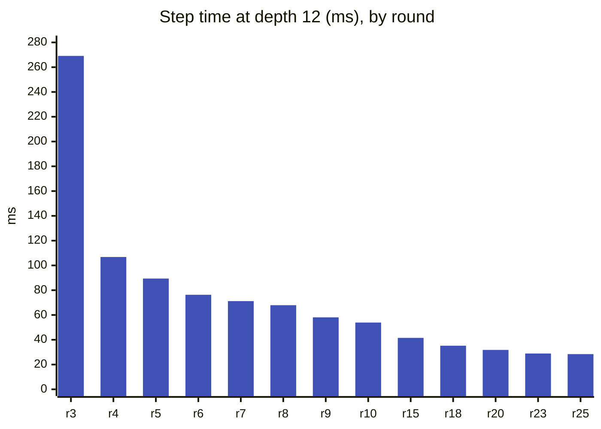

# TAPNext: step design

> **In brief**
>
> - A whole TAPNext++ step (patch-embedded frame in, 12 blocks, encoder norm, tracks out) is **one NPU dispatch of 206 ops**
>   over one fixed layout. Only about 2 ms per frame (conv, heads) runs on the host.
> - **28.42 ms at depth 12** (23.83 / 19.09 / 14.40 ms at depth 10 / 8 / 6), bit-identical to the round-9 reference
>   (DAVIS AJ 70.84, [numerics.md](numerics.md)). The first single-program version took 269.1 ms: the layout never changed, the kernels and the sequence did.
> - The layout rule that makes this work: **each op's output drain writes exactly the next op's input layout**, so there is no repack pass.
> - The block count is chosen at run time by swapping the instruction stream, not the program: cost is $2.34\ \text{ms}$ per block plus about $0.4\ \text{ms}$.
> - The general mechanism for one dispatch is in [fusion](../../common/book/fusion.md#one-dispatch). This chapter is the TAPNext instance.

**Conditions** for every absolute timing below unless a row says otherwise: depth 12, NPU clock 1.808 GHz, quiet box (GPU busy 0),
MEASURED in a depth sweep at the pause (HANDOFF round 25). Status tags: MEASURED, MODEL (computed from a cost model), EXTRAPOLATED.

**Terms.** EW = elementwise core (norms, SSM). GEMM = matrix-multiply core. DDR = the shared system memory. BD = DMA buffer descriptor.
CP = the NPU's command processor, which executes the instruction stream. TAP = tensor access pattern (a multi-dimensional DMA address walk).
k-step = one 64-wide slice of the reduction dimension $K$ for one tile. AJ = average Jaccard (the DAVIS tracking score). Memtile = the shared on-chip scratch memory of a column.

## What does one block compute?

One block is 17 ops. Each is assigned to one core kind and the cores hand data to each other through DDR.



Orange = EW core, blue = GEMM core; after MLP 2 the next block starts again at norm0. Attention is blue because it also runs on the GEMM cores: the matrix unit and the vector unit are one unit,
so a core does one or the other (REDESIGN §1). Norm kinds: norm0 and norm1 are RMS, norm2 and norm3 are LayerNorm (LN).

| op | core | shape (K = reduction, N = output; tiles of 64 per core) | notes |
|---|---|---|---|
| norm0 | EW | 3 inputs: residual + two K-half partials of the previous block's `mlp3` | block 0: 1 input (X0) |
| yx | GEMM | K 768, N 1536 (8 tiles) | y half with GELU, x half plain |
| ssm | EW | 12 heads, conv + RG-LRU | [ssm.md](ssm.md) |
| out | GEMM | K 768, N 768 (4) | A = the SSM's z panels |
| norm1 | EW | 2 inputs | |
| up_a, up_b | GEMM | K 768, N 3072 each (16) | gated pair epilogue |
| down_a, down_b | GEMM | K 1536 each, N 768 (4) | the $K = 3072$ GEMM as two K halves, two partial outputs |
| norm2 | EW | 3 inputs (two down partials + residual) | LN |
| qkv | GEMM | K 768, N 2304 (12) | Q, K and V^T objects |
| attn | GEMM | 12 heads × 1,072 keys | [attention.md](attention.md) |
| out_proj | GEMM | K 768, N 768 (4) | A = the attention output |
| norm3 | EW | 2 inputs | LN |
| mlp0 | GEMM | K 768, N 3072 (16) | GELU to panels |
| mlp3_a, mlp3_b | GEMM | K 1536 each, N 768 (4) | K halves again |

The op count adds up as 11 GEMMs + 4 norms + SSM + attention = 17 per block, and for the whole step

$$12 \times 17 + 2 = 206 \text{ ops}$$

(the 2 are the patch embedding handling and the final encoder norm). Per core and block the 11 GEMMs run 1,296 k-steps (MODEL, [ledger.md](ledger.md)).[^gemm11]

[^gemm11]: The plan has 11 GEMMs per block (RESULTS 10, `s7_block`; `plan8.py`); an earlier draft of the table of contents said 12.

## Rows, columns and core roles (design8)

The step has 1,024 image tokens and 48 query slots. They are padded so that the rows split evenly over the 8 columns of the NPU:

$$1{,}024 + 48 = 1{,}072 \;\to\; 1{,}152 = 8 \text{ columns} \times 144 \text{ rows} \;(= 18 \text{ row blocks of } 8),$$

so 80 rows are padding (RESULTS 8; REDESIGN). Column $c$ owns rows $144c \dots 144c + 143$ for **every** op, so a row never changes column.

```text
                 column 0          column 1     ...    column 7
rows           0 .. 143         144 .. 287    ...   1008 .. 1151
             +-----------+     +-----------+         +-----------+
 GEMM row 0  | GEMM core |     | GEMM core |   ...   | GEMM core |
 GEMM row 1  | GEMM core |     | GEMM core |   ...   | GEMM core |
 GEMM row 2  | GEMM core |     | GEMM core |   ...   | GEMM core |
 EW row      | EW core   |     | EW core   |   ...   | EW core   |
             +-----------+     +-----------+         +-----------+
 memtile     | A slot; B and C fifos (one memtile per column)    |
 shim        | DMA to DDR                                        |
```

Each GEMM core owns a third of an op's N tiles (a tile is 144 rows x 64 columns; a k-step is 64 K).
The EW core runs the norms and the SSM.

That is 24 GEMM cores and 8 EW cores. Attention also runs on the GEMM cores, with the 12 heads dealt as head $r + 3g$ to core row $r$ ($g = 0 \dots 3$).

| Piece | What it does |
|---|---|
| Tile deal | `yx` and `qkv` deal their N tiles round-robin over the three core rows (a 0.85 ms gain)[^p23]; `mlp0` is dealt the same way for the boundary work in [boundaries.md](boundaries.md). Weights are packed in that order on the host (`tapnext/npu/pack8.py`). |
| GEMM core program | One table-driven loop, with a row `[k-steps, C objects, tiles per object]` per op held in the core's local memory (L1), because the 16 KB of program memory cannot hold 12 unrolled ops. The epilogue kind is a flag word in each N tile's bias object ([gemm.md](gemm.md)). Attention is one more table entry: program text shrank from 16,176 to 14,848 B.[^oneseg] |
| EW core program | `ew_op` is called once per iteration of IRON's endless worker loop and reads its op kind from header word 3 of the op's first parameter slot. The compiler had unrolled a 12-block loop into 60 calls, costing 2 KB of the 16 KB (NOTES 10.1). |

[^p23]: Proposal P23, round 10.
[^oneseg]: Switch ONE_SEG, round 8.

## How are the buffers laid out?

All layouts are defined in `plan8.py` and `pack8.py`. One rule shapes them: **an op's C drain writes exactly the next op's A layout**, so no repack pass exists.

### Q16: the residual stream and norm outputs

Per column, for each of the 64-wide k-steps, 18 row blocks, each 1,600 B:

```text
Q16, per column:  [k-step] [row block 0..17]  -> 1,600 B each
                                   |
                  +-- 1,024 B  bf16 data (8 rows x 64)
                  +--   576 B  bfp panels
```

- A GEMM drains its 1,024 B parts linearly.
- A norm emits `X' | panel` per k-step with one 3-dimensional drain.
- A GEMM's A input gathers the panels with one 4-dimensional TAP.
- A residual norm gathers 1 to 3 streams with one 4-dimensional TAP (inputs at equal distances, sorted by address, since the sum is commutative).
- bfp = block floating point, the format the matrix unit reads.

### APAN and QKV

```text
APAN:  [k-step chunk] [k-step chunk] ...      stride 18,432 B

QKV:   [head][column][ Q | K | V^T objects ]  each object 4,608 B
```

- APAN holds epilogue-made chunks (gated hidden layer, mlp0 output). Its stride equals the size of one C object,
  so the junk tail of every drained object lands in padding.
- K and V use 3,456 B of their 4,608 B object; the tail is scratch while the core holds it (NOTES 19.3).

V^T panels share exponents over keys, so the host reference must encode the transposed matrix (NOTES 8.3).

### SSM area, A slot, weights

```text
SSM area (per block): 7 input streams, S bytes apart, read as one TAP
    [ y | conv history R0 R1 R2 R3 | h lo | h hi | z ]

A slot in the memtile (input operand staging):
    24 chunks x 10,368 B = 248,832 B
    36 chunks            = 373,248 B   (down_b / mlp3_b, after change 3A)
```

- The conv history is a ring mod 4: the yx drain writes x(t) into R[t mod 4], so the state never moves.
  Four runtime sequences per depth select the phase ([ssm.md](ssm.md)).
- In the 24-chunk slot, K = 1536 ops hold all 24 chunks and K = 768 ops hold half.
- The slot is driven by runtime tasks (a 2.0 ms gain).

The rotating conv history is change X1,[^x1] the larger slot is change 3A,[^3a] and the runtime-driven slot is A_RT.[^art]

[^x1]: Change X1, round 17, commit `0b687ba`.
[^3a]: Change 3A, round 22, commit `86442db`.
[^art]: Change A_RT, round 10.

| Region | Size | Notes |
|---|---|---|
| W (weights and parameter objects) | 232 MB | RESULTS 12.3 |
| ACT (activations) | 324 MB | at round 3 |
| Weight traffic per step | ~215-230 MB | streamed once through the B fifos of memtiles 0-2 and multicast across the row (REDESIGN 2.2) |

## How does one dispatch flow?

The host writes the patch-embedded input, then hands the CP a precomputed instruction stream. The CP programs the DMAs, the cores run the table-driven loops, and results land back in DDR.



Host = CPU. CP = command processor. DMA = shim and memtile DMA engines. Cores = 24 GEMM + 8 EW cores.
X0 = conv + positional embedding + query tokens (2.8 MB). Weights are streamed once per step. The C drain
is already the next op's A layout. Heads (48 rows) run on the host after the read.

How the sequence got here:

| Stage | Result | Source |
|---|---|---|
| Scratch prototype | 168 GEMM + 12 attention dispatches on six xclbins, ~2 ms of context switch each: 4.4 s per frame | RESULTS 5 |
| Pieces proven (design7) | packet flows sharing a shim channel, an EW core on each column, GEMM epilogues emitting the next op's operands: 35.1 ms for one block's 11 GEMMs $\times$ 12 blocks | RESULTS 10 |
| Everything in one runtime sequence (design8, round 3) | **269.1 ms** for 206 ops, `.bin` 7.5 MB, with ~200 serialising sync points at 0.1-0.3 ms each | NOTES 8.4, RESULTS 12.3 |
| Today | 59,720 CP instructions and 421 sync runs per step (round 24) | RESULTS 33.2 |

Rules the sequence follows:

- **Dependencies are explicit.** The plan records the last writer of every region, and the sequence finishes exactly the producer's group before a consumer.
  A lookahead pipeline alone once passed a test "only by timing" (NOTES 8.2). Two ops stay in flight (`--lookahead 2`).
- **Hardware budgets.** At most 16 live shim BDs, at most 5 tasks per memtile or shim channel before the CP blocks, and a fill group that is
  a multiple of the 768 B EW ring slot ([data-movement](../../common/book/data-movement.md#dma-bookkeeping)).
- **Look before dispatching a reordered sequence.** `SEQLOG=1` prints every group wait with the op being issued (NOTES 28.3).

> **Pitfall.** A reordered sequence can hang the box. Read the `SEQLOG` output first.

## Depth switching and phases

`full_step` lays ACT and W out for 12 blocks whatever the depth, and ops of blocks $\ge$ depth are dropped from the stream. Every depth shares one layout,
one packed W and one xclbin (the compiled program image): the elfs and CDO of the depth builds are byte-identical (NOTES 10.1).
`Step8.set_depth(d)` swaps the instruction buffer, with no rebuild and no new hardware context. After raising the depth, `reset()` clears the SSM state,
because stale blocks hold old recurrent state.

With the rotating conv history there are 4 phase sequences per depth (frame mod 4), so 16 `.bin` files; `step8` rotates the instruction buffer per dispatch (`select(phase)`).
Phases agree within 0.04 ms (RESULTS 26.3).

Cost is linear in depth (MEASURED depth sweep, RESULTS 34.3):

$$t(d) \approx 0.4\ \text{ms} + 2.34\ \text{ms} \cdot d, \qquad \frac{28.42 - 14.40}{12 - 6} = 2.34\ \text{ms per block.}$$

| depth | step time (ms) | DAVIS AJ |
|---|---|---|
| 12 | 28.42 | 70.84 |
| 10 | 23.83 | 69.90 |
| 8 | 19.09 | 68.2 (CPU model) |
| 6 | 14.40 | 64.8 (CPU model) |

AJ values for depth 8 and 6 are from the CPU model, not the device (RESULTS 8; [numerics.md](numerics.md)).

## What does the host do?

Per frame the host runs the patch embedding, packs it into the mapped ACT buffer, dispatches, and runs the tracking heads.
The whole step is 30.45 ms against 28.42 ms of dispatch (RESULTS 34.3).

| Host piece | Time (ms) |
|---|---|
| conv | 0.48 - 1.1 |
| heads | 0.6 - 1.0 |
| query tokens | 0.12 |
| X0 packing | 0.14 |
| result read | 0.08 |
| launch floor | 0.097 (97 µs) |
| **total** | **2.0 - 2.2** |

(MACHINE [M16](../../common/MACHINE.md#m16), `r11/hostprof.py`, round 11.)

- **Patch embedding on the host** (round 4). Torch's bf16 convolution (Conv2d 3 → 768, 8 × 8) takes 0.28 ms at 8 threads, and 0.39 ms with the permute, positional embedding
  and bf16 conversion (RESULTS 14.0; an earlier "0.2 ms" was the 16-thread conv alone). This gives torch's exact numerics and frees 0.7 KB of EW program text and
  1.2 ms of device time. X0 $=$ `[conv + pos-emb; query tokens; 0]` (2.8 MB) is written every frame.
- **X0 packing.** A strided copy into a persistent buffer whose panel parts stay zero: 0.75 → 0.14 ms, byte-identical (`HOST_FAST=2`).
- **Heads.** Tiny (48 rows), so they run on the CPU. numpy fp32 + `torch.erf` with `OPENBLAS_NUM_THREADS=1` takes 0.72 ms vs torch 0.94 ms (`HOST_HEADS=np`, round 13; not the default).

> **Pitfall.** Host jitter and CPU load matter. The OpenMP pool wakes late after the 28 ms wait, and other tenants add noise: a busy box makes dispatch times bimodal (~0.17 ms apart),
> so A/Bs run in one process ([measurement](../../common/book/measurement.md#ab-in-one-process)). CPU load also slows the NPU itself: 12 threads of FP compute
> at ~100 W cut the clock from 1.81 to 1.41 GHz (MACHINE [M1.4](../../common/MACHINE.md#m1-4)). Cap BLAS/OpenMP threads at 6 beside the NPU ([M3](../../common/book/negative-results.md#m3)).

## How fast did it get?

Step time at the end of each round (depth 12). The table for rounds 12-25 is also in [tapnext/README.md](../README.md#progress-depth-12-step-best-build-at-the-end-of-each-round).
All kept changes from round 9 on are bit-identical. Timings from rounds 3-11 predate the final clock fix and the A/B-in-one-process rule.



| round | ms | what moved it most | evidence |
|---|---|---|---|
| 3 | 269.1 | design8: the whole step in one program | NOTES 8, RESULTS 12 |
| 4 | 106.8 | correct with real weights; SSM 7.2 → 1.45 ms/block, norm3's 20-bit BD step (6 ms) | NOTES 9 |
| 5 | 89.4 | norms rewritten (0.31 → 0.10-0.13 ms each), depth at run time, lazy attention max | NOTES 10 |
| 6 | 76.3 | epilogues as array passes (−5.3), lookup-table GELU (−6.0) | NOTES 11 |
| 7 | 71.2 | table exp, first asm GEMM call (−1.9), the 1.81 GHz clock and the core timer | NOTES 12 |
| 8 | 67.9 | A ring pinned off the B bank (−1.5), SSM kernel (−2.4) | NOTES 13 |
| 9 | 58.1 | SSM tables (−2.8), pipelined k-step `mm_ks` (−3.5, `mm_kstep` −2.0) | NOTES 14 |
| 10 | 53.9 | A slot loaded once and runtime-driven (A_HALF −1.35, A_RT −2.0) | NOTES 15 |
| 11-14 | 52.1 → 47.3 | modulo-scheduled asm: GELU, gated epilogues, the SSM sigmoid, the attention K and V loops | NOTES 16-19 |
| 15 | 41.52 | SSM and norm passes in asm, query deal P60g (−1.06), slot-count divides (−1.05) | NOTES 20 |
| 16-17 | 39.94 → 39.16 | SQK, GGK, SSQ, N1K; S2, X1 | NOTES 21-22 |
| 18 | 35.20 | ROT rotating-accumulator k-step (−3.3, `992dfb6`) | NOTES 23 |
| 19 | 33.88 | C drain (ZHI, CSPLIT, EPLR), ROT g0a | NOTES 24 |
| 20 | ~31.8 | op boundaries taken apart: IL, DAPRE, NSEQ, NRES, SRES, AQPRE, AKVPRE (−2.07 A/B) | NOTES 25 |
| 21-22 | 31.30 → 30.78 | CSUB, ZLOAD, E7''; 3A, TXT18, attention IIs | NOTES 26-27 |
| 23 | 28.89 | KTL (−0.82), MSPLIT-P, YXSSM + YXR (−0.79) | NOTES 28 |
| 24 | 28.43 | STATS64, OPPRE2, SSMPRE, CPPRE (−0.48) | NOTES 29 |
| 25 | 28.42 | nothing kept; work paused | NOTES 30 |

The change names in the table (IL, ROT, KTL, ...) are build switches. Each is defined in the chapter that owns it:
[gemm.md](gemm.md), [attention.md](attention.md), [ssm.md](ssm.md), [norms.md](norms.md), [boundaries.md](boundaries.md).

## What worked

- **One program, fixed layout, table-driven cores.** Every later lever (asm kernels, on-chip residency, op overlap) changed the sequence or a kernel,
  never the layout of the step: 269 → 28.4 ms ($-89\%$) with the same 206 ops (NOTES 8-30).
- **The epilogue emits the next op's A.** No repack pass anywhere between GEMM, norm, SSM and attention: the drain TAPs and the A gathers do the permutation.
- **Run-time depth.** Depth 10 or 8 costs one instruction-buffer swap, which is how the accuracy/latency frontier was measured on the device (RESULTS 14.5, 34.3).
- **Explicit dependencies plus `SEQLOG`** found every ordering hazard before it hung the box: timeouts per round fell from 10 (round 3) to 0 (rounds 24-25).
- **A small host share** (2 ms): the conv is torch's exact bf16 numerics, and the heads are 48 rows.

## What didn't work

| Idea | Outcome | Why | Index |
|---|---|---|---|
| Activation-stationary redesign (X, A and a hidden ring resident in the memtile, 48-row chunk pipelining; REDESIGN.md) | **Never built.** Priced at ~62 ms with round-5 kernels and ~44 ms with 2x faster vector kernels (EXTRAPOLATED, 4-5 weeks of effort) | The incremental route reached 28.4 ms inside the existing design by speeding the kernels and moving only the boundaries that mattered on chip | |
| Row-chunk pipelining, priced with the list-schedule simulator | 76.3 → 76.9-77.2 ms (MODEL, never built) | Every chunk repeats the tile and dependent-load costs | [C1](../../common/book/negative-results.md#c1) <!-- nr: C1 --> |
| Chunked FFN with the hidden ring in the memtile | Does not fit | A GEMM-to-GEMM park needed 124 KB against 112 KB free ([boundaries.md](boundaries.md#what-didnt-work)) | [B11](../../common/book/negative-results.md#b11) <!-- nr: B11 --> |
| Sliding SSM area with a wrap frame | $-0.33$ ms per rotating frame, but $+232$ MB of ACT at $N = 8$ phases | The mod-4 rotation gave the same gain with no wrap frame. Do not rebuild the sliding form | [E17](../../common/book/negative-results.md#e17) <!-- nr: E17 --> |
| Heads on one thread | The next frame's conv slows (OpenMP pool re-spin). Number not recorded | Thread pool goes to sleep | [F1](../../common/book/negative-results.md#f1) <!-- nr: F1 --> |
| numpy heads with OpenBLAS's default threads beside torch's pool | 11.7 ms vs 0.72 ms with one thread. Fixed | Two thread pools fight over the cores | [F2](../../common/book/negative-results.md#f2) <!-- nr: F2 --> |
| Host/device overlap levers (H1, H2) | Not attempted | In the latency-bound (single-frame) regime H1 cannot help | [F3](../../common/book/negative-results.md#f3) <!-- nr: F3 --> |

> **Pitfall (a trap, not a dead idea).** A 1 KB-padded EW fill hung the step ([E12](../../common/book/negative-results.md#e12) <!-- nr: E12 -->;
> details in [ssm.md](ssm.md#what-didnt-work), rules in [data-movement](../../common/book/data-movement.md#dma-bookkeeping)).

## Lessons

- Fix the layout once and make every op's drain write its consumer's A. Then the dispatch is the only place left to optimise.
- Keep the cores and the sequence independent of the op list (table-driven loops, header-driven EW) so depth is a runtime knob.
- Price whole-step ideas (row chunks, a resident-activation redesign) with measured per-op fixed costs before building them: the incremental route won.
- Account the host: 2 ms of 30.45 is conv and heads, and CPU load beside the NPU changes the clock.

## Going deeper

- Design record: [`tapnext/npu/NOTES.md`](../npu/NOTES.md) 8-10 (design8, correctness, depth at run time), [`REDESIGN.md`](../npu/REDESIGN.md), [`HANDOFF.md`](../npu/HANDOFF.md) top block (state and every switch).
- Code: `tapnext/npu/plan8.py` (memory plan, `full_step`), `design8.py` (sequence, `SEQLOG`), `pack8.py` (weight order), `step8.py` (host, `set_depth`, `select`, `reset`).
- Evidence: [RESULTS](../npu/RESULTS.md) 12-14, 33-34 (sweeps); MACHINE [M16](../../common/MACHINE.md#m16) (host part), [M8.6](../../common/MACHINE.md#m8-6) (the A and K/V flows), [M9.2](../../common/MACHINE.md#m9-2) (memtile map).
- Next: [gemm.md](gemm.md), [attention.md](attention.md), [ssm.md](ssm.md), [norms.md](norms.md), [boundaries.md](boundaries.md), [ledger.md](ledger.md).
